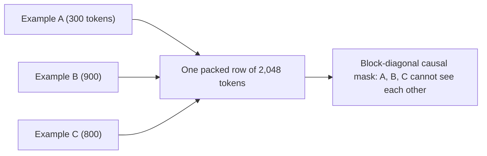

SFT examples have wildly different lengths: a one-line translation, a 2,000-token code review. GPUs want rectangular batches, every row the same length. The naive fix is **padding**: extend every example in the batch with filler tokens up to the longest one, and mask the filler out of attention and loss. It works, but you pay full compute for tokens that teach nothing.

**Packing** is the alternative: concatenate several examples end to end into one fixed-length sequence, like packing a suitcase with items of different sizes instead of putting each item in its own box.

## Padding efficiency

For a batch of $B$ sequences with real lengths $\ell_1, \dots, \ell_B$ padded to length $s$:

$$
\text{efficiency} = \frac{\sum_{i=1}^{B} \ell_i}{B \cdot s}
$$

```steps
How much padding wastes
Four examples of 100, 300, 250 and 512 tokens, padded to $s = 512$: real tokens $= 1{,}162$; slots $= 4 \times 512 = 2{,}048$.
---
Efficiency $= 1{,}162 / 2{,}048 \approx 56.7\%$. Almost half the compute goes to padding.
---
Packed into one 2,048-token row (with a small amount left over or filled with the next example), efficiency is close to 100%: roughly 1.75 times more useful tokens per step for the same compute.
---
Sorting or bucketing examples by length before batching is a middle ground: less waste than random padding without changing the attention pattern.
```

## Packing correctly: do not let examples see each other

If you pack examples A, B and C into one row with an ordinary causal mask, tokens of B can attend to A. The model then learns that answers may depend on an unrelated earlier conversation, a small but real contamination. The fix is a **block-diagonal causal mask** (per-document attention): each token attends only to earlier tokens of its own example.

$$
M_{ij} = \begin{cases} 0 & \text{if } j \le i \text{ and } \text{doc}(j) = \text{doc}(i) \\ -\infty & \text{otherwise} \end{cases}
$$

$M$ is added to the attention scores before the softmax, so $-\infty$ entries get zero weight. Position indices are also reset at the start of each packed example. Modern attention kernels accept the boundaries directly (as lists of sequence start offsets), so this costs almost nothing.



## Hyperparameters that matter most

| Setting | Typical starting point (full fine-tune) | Why |
|---|---|---|
| Learning rate | about $1\times10^{-5}$ to $2\times10^{-5}$, AdamW | Much lower than pretraining: you are adjusting, not building |
| Schedule | Short warmup (a few % of steps), cosine or linear decay | Stability early, anneal late |
| Epochs | 1 to 3 | More epochs on small data overfit quickly |
| Global batch | 32 to 256 sequences | Smooth gradients; few steps total anyway |
| Weight decay | 0 to 0.1 | Mild regularisation |
| Max length | Cover the long tail of your data | Truncating answers teaches the model to stop mid-sentence |

LoRA (a later lesson) uses learning rates roughly ten times higher, because it trains far fewer parameters starting from zero.

## Overfitting: what it looks like

With small data and several epochs, training loss keeps falling while validation loss turns upward. On a plot this is unmistakable; in outputs it shows as verbatim reuse of training answers and loss of generality. A useful sanity bound: if validation loss is $\mathcal{L}_v$, its perplexity $e^{\mathcal{L}_v}$ should be well above 1; a training loss near zero (perplexity near 1) on a few thousand examples means the model has memorised them.

## In practice

Most SFT problems are solved by the data, but a short checklist catches the rest: packing with per-document masks, a validation split checked every few hundred steps, the learning rate in the right decade, and two or three epochs at most. Pick the checkpoint by validation loss and, more importantly, by reading outputs on held-out prompts: the lowest-loss checkpoint is not always the one that behaves best.

```quiz
{"q": "A batch of 8 sequences padded to 1,024 tokens contains 4,096 real tokens. What is the padding efficiency?", "options": ["25%", "50%", "75%", "100%"], "answer": 1, "explain": "$4{,}096 / (8 \\times 1{,}024) = 4{,}096/8{,}192 = 50\\%$. Half the compute is spent on padding, which packing would recover."}
```

```quiz
{"q": "You pack conversations into 4,096-token rows but keep a plain causal mask. What goes wrong?", "options": ["Nothing; packing always uses a plain causal mask", "Tokens in later conversations can attend to earlier, unrelated conversations in the same row, teaching spurious dependencies", "The loss can no longer be masked", "The model trains slower"], "answer": 1, "explain": "A plain causal mask lets every token see all earlier tokens in the row, including other examples. A block-diagonal mask (and reset positions) keeps each example independent, as if it were trained alone."}
```
