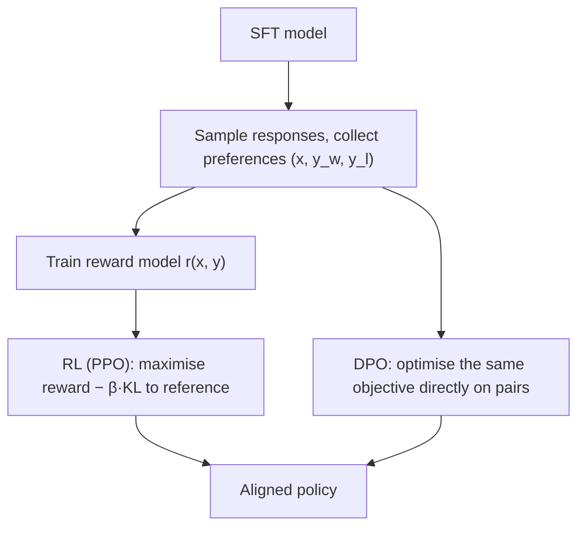

```callout-before
Before you start
You should know what SFT does: it trains a model to imitate example responses. This lesson is about what to do once imitation stops being enough.
```

Ask a food critic to cook the perfect risotto and most will struggle. Put two risottos in front of them and they will tell you, instantly and reliably, which is better and why. Judging is easier than producing. The same is true for model outputs: a reviewer who could never write the ideal answer to a hard legal question can still tell which of two drafts is clearer, more accurate and less evasive.

SFT can only teach what demonstrators can write, and it treats every target token as equally right. **Preference tuning** uses a different signal: for a prompt $x$, a **chosen** response $y_w$ (the winner) and a **rejected** one $y_l$ (the loser). From many such pairs the model learns *what makes answers better*, including qualities that are hard to demonstrate but easy to recognise: honesty about uncertainty, appropriate length, avoiding subtle errors, refusing harmful requests without refusing harmless ones.

## The data

A preference dataset is a list of triples $(x, y_w, y_l)$. Typically the current model generates two or more responses per prompt, and humans (or a strong model acting as judge) pick the better one, sometimes with a strength rating or a tie option.

```steps
From four samples to training pairs
For one prompt the model samples four responses, and a labeller ranks them: $A > C > B > D$.
---
A ranking of $k$ responses implies $\binom{k}{2} = k(k-1)/2$ ordered pairs. For $k = 4$ that is $4 \times 3 / 2 = 6$ pairs: $(A,C), (A,B), (A,D), (C,B), (C,D), (B,D)$.
---
So one ranking of four costs about as much labelling effort as a few comparisons but yields six training pairs. InstructGPT collected rankings of 4 to 9 responses per prompt for this reason.
---
The pairs from one prompt are correlated, so they are usually kept together in a batch (or down-weighted) rather than treated as independent examples, to avoid overfitting to that prompt.
```

## The two families of methods



| | RLHF with PPO | DPO |
|---|---|---|
| Steps | Reward model, then RL | One supervised-style training stage |
| Models in memory during training | Policy, reference, reward, value | Policy, reference |
| Generates samples during training | Yes (on-policy) | No (offline pairs) |
| Strengths | Can keep improving on fresh samples; flexible rewards | Simple, stable, cheap |
| Weaknesses | Complex, many hyperparameters, expensive | Limited by the fixed dataset; can over-fit pairs |

Both optimise the same underlying goal, which the next three topics make precise: get high reward according to human preferences, while staying close (in KL divergence) to the model you started from.

## How good are the labels?

Preference labels are noisy. Two careful human labellers often disagree on a substantial fraction of pairs, especially when both responses are decent. That noise sets a ceiling on how accurately any reward model can predict held-out preferences, and it is one reason the methods in this lesson include a pull back toward the reference model: the signal is a direction, not ground truth.

## In practice

Teams use preference tuning to improve helpfulness and harmlessness after SFT, to shape style (length, formatting, tone), and increasingly with **verifiable rewards** (does the code pass the tests? is the maths answer correct?), covered later in this lesson. For product teams, DPO on a few thousand in-domain preference pairs is a realistic second step after SFT; full RLHF is usually the domain of model builders.

```quiz
{"q": "A labeller ranks 5 responses to a prompt. How many (chosen, rejected) pairs does the ranking imply?", "options": ["4", "5", "10", "20"], "answer": 2, "explain": "Every pair of distinct responses is ordered by the ranking: $\\binom{5}{2} = 5 \\times 4/2 = 10$. 20 counts each pair twice (in both orders); 4 counts only adjacent pairs."}
```

```quiz
{"q": "What can preference data teach that SFT demonstrations struggle to?", "options": ["Nothing; the two contain the same information", "Which of two plausible answers is better, including qualities labellers can recognise but not easily write, and what to avoid", "New facts the base model lacks", "How to tokenize text"], "answer": 1, "explain": "SFT shows only good targets. Preferences also show a worse alternative, giving a contrast: what to move toward and what to move away from. Neither method is a good way to add new facts."}
```
