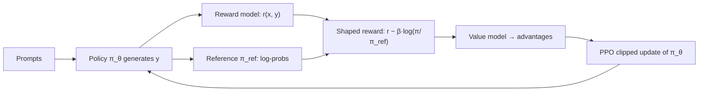

With a reward model in hand, the plan sounds simple: let the model write answers, score them, and nudge it toward higher-scoring answers. That is **reinforcement learning from human feedback** (RLHF). The model being trained is now called the **policy** $\pi_\theta$: given a prompt $x$, it chooses a response $y$ one token at a time, and the reward arrives only when the response is complete.

The danger is that the reward model is an imperfect proxy for what people want. Optimise it without restraint and the policy finds its blind spots: answers that score highly but are verbose, flattering, oddly formatted or simply nonsense. So RLHF puts the policy on a **leash**: it is rewarded for scoring well and penalised for drifting far from a **reference model** $\pi_{\text{ref}}$, normally the SFT model it started from.

## The objective

$$
\max_{\theta}\; \mathbb{E}_{x \sim \mathcal{D},\; y \sim \pi_\theta(\cdot \mid x)} \Big[\, r_\phi(x, y) \,\Big] \;-\; \beta\, \mathbb{D}_{\text{KL}}\!\left[\pi_\theta(\cdot \mid x) \,\big\|\, \pi_{\text{ref}}(\cdot \mid x)\right]
$$

$r_\phi$ is the reward model, $\beta > 0$ the strength of the leash, and the **KL divergence** $\mathbb{D}_{\text{KL}}[\pi \| \pi_{\text{ref}}] = \mathbb{E}_{y \sim \pi}\left[\log \frac{\pi(y \mid x)}{\pi_{\text{ref}}(y \mid x)}\right]$ measures, in nats, how differently the two models distribute probability. For a sampled response it is estimated from per-token log-probabilities:

$$
\log\frac{\pi_\theta(y \mid x)}{\pi_{\text{ref}}(y \mid x)} = \sum_{j=1}^{m}\left[\log \pi_\theta(y_j \mid x, y_{<j}) - \log \pi_{\text{ref}}(y_j \mid x, y_{<j})\right]
$$

```steps
The shaped reward for one sampled answer
The policy writes a 3-token answer. Its per-token log-probs are $-0.5, -1.0, -0.2$; the reference model's for the same tokens are $-1.5, -1.2, -1.0$.
---
Per-token differences: $1.0, 0.2, 0.8$. The sequence log-ratio is $2.0$ nats: the policy finds this answer $e^{2} \approx 7.4$ times more likely than the reference does.
---
The reward model scores the answer $r = 1.2$. With $\beta = 0.1$ the KL penalty is $0.1 \times 2.0 = 0.2$.
---
Shaped reward: $1.2 - 0.2 = 1.0$. An answer with the same score but a log-ratio of 12 nats would get $1.2 - 1.2 = 0$: no credit for a high score reached by going far off the reference distribution.
```

## PPO in one equation

The objective is maximised with **Proximal Policy Optimization** (PPO). For each sampled token it computes an **advantage** $\hat A$ (how much better the outcome was than expected, using a learned **value model** that predicts future reward) and the **probability ratio** between the new and the old policy, $\rho = \pi_\theta(a \mid s) / \pi_{\theta_{\text{old}}}(a \mid s)$. It then maximises the **clipped surrogate**:

$$
\mathcal{L}^{\text{CLIP}} = \mathbb{E}\left[\min\!\left(\rho \hat A,\; \text{clip}(\rho, 1 - \epsilon, 1 + \epsilon)\, \hat A\right)\right]
$$

with $\epsilon$ typically 0.2. The clip removes the incentive to move any token's probability by more than about 20% per update, which keeps learning stable.

| Case | $\rho$ | $\hat A$ | $\rho \hat A$ | clipped term | objective (min) |
|---|---|---|---|---|---|
| Good token, pushed up a lot | 1.3 | +1 | 1.3 | $1.2 \times 1 = 1.2$ | **1.2** (gain capped) |
| Bad token, pushed down a lot | 0.7 | −1 | −0.7 | $0.8 \times (-1) = -0.8$ | **−0.8** (no extra credit) |
| Good token, small change | 1.1 | +1 | 1.1 | 1.1 | **1.1** |

In the first two rows the clipped value is chosen, so its gradient is zero: once a token has moved enough, PPO stops pushing it further in that update.



## In practice

RLHF with PPO is powerful and notoriously fiddly. Four models are involved (policy, reference, reward, value), generation is slow, and there are many hyperparameters: $\beta$, $\epsilon$, learning rates, batch sizes, how many PPO epochs per batch of samples. Teams monitor three curves together: mean reward (should rise), KL to the reference (should rise slowly and level off), and an independent quality evaluation (should rise; if it falls while reward rises, the policy is gaming the reward model). Some implementations adapt $\beta$ automatically to hold the KL near a target value.

```quiz
{"q": "An answer gets reward 2.0 and has a sequence log-ratio $\\log(\\pi_\\theta/\\pi_{\\text{ref}}) = 5$ nats. With $\\beta = 0.1$, what is the shaped reward?", "options": ["2.0", "1.5", "1.9", "−3.0"], "answer": 1, "explain": "$2.0 - 0.1 \\times 5 = 1.5$. Forgetting $\\beta$ gives $2 - 5 = -3$; ignoring the penalty gives 2.0."}
```

```quiz
{"q": "In PPO with $\\epsilon = 0.2$, a token has advantage $+2$ and probability ratio 1.5. What is its clipped objective value?", "options": ["3.0", "2.4", "2.0", "1.2"], "answer": 1, "explain": "$\\rho \\hat A = 3.0$; the clipped ratio is 1.2, giving $1.2 \\times 2 = 2.4$; the minimum is 2.4. The gain from moving further than 20% is removed, and so is the gradient for this token."}
```
