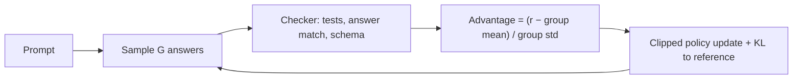

A learned reward model is a stand-in for human judgement, and stand-ins can be fooled. For some tasks you do not need one. Does the generated code pass its unit tests? Is the final number in the maths answer equal to the known solution? Does the output parse against the schema? These checks are cheap, objective and cannot be flattered. Using them as the reward is called **reinforcement learning with verifiable rewards** (RLVR), and it is the main ingredient behind recent reasoning-focused models.

The reward is often just a number from a checker: $r = 1$ if the answer is correct, $0$ otherwise (sometimes plus a small bonus for following the required format).

## Dropping the value model: GRPO

PPO needs a value model to estimate how good a state is, so it can compute advantages. That is a second large network to train and store. **Group Relative Policy Optimization** (GRPO) removes it. For each prompt, sample a **group** of $G$ responses from the current policy, score them all, and measure each one against the group's own average:

$$
\hat A_i = \frac{r_i - \mu}{\sigma}, \qquad \mu = \frac{1}{G}\sum_{k=1}^{G} r_k, \qquad \sigma = \sqrt{\frac{1}{G}\sum_{k=1}^{G} (r_k - \mu)^2}
$$

$r_i$ is response $i$'s reward, $\mu$ the group mean and $\sigma$ the group standard deviation (in practice a small constant is added to $\sigma$ to avoid dividing by zero). Every token of response $i$ shares the advantage $\hat A_i$. The policy update then uses the same clipped ratio as PPO, plus a KL penalty to the reference model. The "baseline" that PPO learned with a value model is replaced by the group average, a free estimate.

```steps
Advantages for a group of four
A maths prompt; the policy samples $G = 4$ answers. A checker scores them $r = (1, 0, 0, 1)$.
---
Mean $\mu = 0.5$. Deviations: $+0.5, -0.5, -0.5, +0.5$. Standard deviation $\sigma = \sqrt{(0.25 \times 4)/4} = 0.5$.
---
Advantages: $+1, -1, -1, +1$. Correct answers are reinforced, wrong ones suppressed, by equal amounts.
---
Now a hard prompt where only one answer in four is right, $r = (1, 0, 0, 0)$: $\mu = 0.25$, $\sigma = \sqrt{0.1875} \approx 0.433$. The correct answer gets $0.75/0.433 \approx +1.73$; each wrong one gets $-0.25/0.433 \approx -0.58$. A rare success gets a large boost.
---
If all four are correct, or all wrong, then $\sigma = 0$ and every advantage is 0: that prompt teaches nothing. Prompts with a mix of outcomes carry the learning signal, so training sets are often filtered to prompts of intermediate difficulty.
```



## Why this works, and what it needs

Because correctness is checked, the policy can be pushed hard without the reward-hacking problems of learned scores, and it can discover long chains of reasoning that humans never demonstrated: the only thing rewarded is the right final answer. Observed side effects include longer, more careful responses that check their own work. Three conditions matter:

| Requirement | Why |
|---|---|
| A reliable checker | A buggy test suite or loose answer matching is gamed immediately |
| Prompts the model sometimes solves | If the success rate is 0% or 100%, all advantages are zero |
| Enough samples per prompt | Small $G$ gives noisy means; 8 to 64 is common |

The cost is generation: each update needs $G$ full responses per prompt, which is why inference throughput matters for training too.

## In practice

Verifiable rewards suit code, maths, structured extraction and tool-use tasks with checkable outcomes. They do not directly help with open-ended qualities such as tone or helpfulness, where preference models or DPO remain the tools. A common hybrid trains on verifiable tasks and preference data together. Always inspect samples: models quickly learn to exploit gaps, for example special-casing the test inputs in code tasks.

```quiz
{"q": "A group of four samples receives rewards $(1, 1, 1, 0)$. What is the advantage of the wrong answer (using the population standard deviation)?", "options": ["$-1.73$", "$-0.58$", "$-0.75$", "$0$"], "answer": 0, "explain": "$\\mu = 0.75$, $\\sigma = \\sqrt{0.1875} = 0.433$. The wrong answer has deviation $-0.75$, so $\\hat A = -0.75/0.433 = -1.73$. The three correct ones each get $+0.25/0.433 = +0.58$; the rare failure is penalised most."}
```

```quiz
{"q": "Why does GRPO give no learning signal for a prompt on which all 8 sampled answers are correct?", "options": ["The KL penalty cancels it", "All rewards equal the mean, so $\\sigma = 0$ and every advantage is 0", "Correct answers are never reinforced", "The checker is disabled"], "answer": 1, "explain": "Advantages measure how an answer compares with its group. If every answer ties, nothing is better or worse than average. Mixed-outcome prompts are the useful ones."}
```
