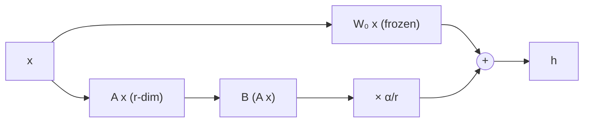

Take one weight matrix $W_0 \in \mathbb{R}^{d_{\text{out}} \times d_{\text{in}}}$ from a pretrained model, say a $4096 \times 4096$ attention projection with $16.8$ million entries. Full fine-tuning learns an update $\Delta W$ of the same shape. **LoRA** (Low-Rank Adaptation) says: do not learn $\Delta W$ directly; force it to be a product of two thin matrices.

$$
W = W_0 + \Delta W = W_0 + \frac{\alpha}{r}\, B A, \qquad B \in \mathbb{R}^{d_{\text{out}} \times r},\quad A \in \mathbb{R}^{r \times d_{\text{in}}},\quad r \ll \min(d_{\text{in}}, d_{\text{out}})
$$

$W_0$ is frozen. Only $A$ and $B$ are trained. $r$ is the **rank**, and $\alpha$ a constant that scales the update. In the forward pass, for an input $x$:

$$
h = W_0 x + \frac{\alpha}{r}\, B\,(A x)
$$

Note the order: compute $Ax$ first, a small $r$-dimensional vector, then expand with $B$. The full $d_{\text{out}} \times d_{\text{in}}$ update matrix is never formed during training.

## What rank means

The **rank** of a matrix is the number of independent directions it uses. A product $BA$ of an $d_{\text{out}} \times r$ and an $r \times d_{\text{in}}$ matrix has rank at most $r$: every column of $BA$ is a combination of the $r$ columns of $B$. A rank-1 update is an outer product of one column and one row, a single "pattern".

```steps
A rank-1 update with real numbers
Let $d_{\text{out}} = 3$, $d_{\text{in}} = 4$, $r = 1$, scale $\alpha/r = 1$. Take $B = \begin{pmatrix}1\\2\\-1\end{pmatrix}$ and $A = \begin{pmatrix}0.5 & 0 & 1 & -0.5\end{pmatrix}$.
---
$\Delta W = BA$ has rows $B_i \cdot A$: $(0.5, 0, 1, -0.5)$, $(1, 0, 2, -1)$, $(-0.5, 0, -1, 0.5)$. A full update would have $3 \times 4 = 12$ free numbers; this one is described by $3 + 4 = 7$.
---
Apply it to $x = (1, 2, 3, 4)$ the cheap way: $Ax = 0.5 + 0 + 3 - 2 = 1.5$, then $B(Ax) = (1.5, 3, -1.5)$.
---
Check with the full matrix: row 1 gives $0.5 + 0 + 3 - 2 = 1.5$, row 2 gives $1 + 0 + 6 - 4 = 3$, row 3 gives $-0.5 + 0 - 3 + 2 = -1.5$. Identical, but the factored route used $7$ multiplications instead of $12$.
```

## Initialisation: start exactly where the base model is

LoRA initialises $A$ with small random values (Gaussian, or Kaiming-uniform) and $B$ with **zeros**. Then $BA = 0$ at the start and the adapted model is **exactly** the pretrained model: training begins from a known-good point and the first updates move $B$ away from zero. If both were random, the first forward pass would add noise to every layer.

## The scale $\alpha / r$

Why divide by $r$? When the rank changes, the typical magnitude of $BA$ changes with it, so the best learning rate would shift too. The factor $\alpha/r$ keeps the update's scale roughly fixed as you vary $r$ with $\alpha$ held constant. Common choices are $\alpha = r$ (scale 1), $\alpha = 2r$ (scale 2) or a fixed $\alpha$ such as 16 or 32. A larger scale acts like a larger learning rate on the adapter. (Some later work argues for $\alpha/\sqrt{r}$ at high ranks, which shows this is a design choice, not a law.)

## Why gradients are cheap

For the loss $\mathcal{L}$ and $h = W_0 x + s\,B A x$ with $s = \alpha/r$, only $A$ and $B$ receive gradients: $\partial\mathcal{L}/\partial B = s\,(\partial\mathcal{L}/\partial h)(Ax)^{\top}$ and $\partial\mathcal{L}/\partial A = s\,B^{\top}(\partial\mathcal{L}/\partial h)\,x^{\top}$. The frozen $W_0$ needs no gradient and no optimizer state. The backward pass still flows through $W_0$ to reach earlier layers, so compute drops by roughly a third (no weight gradient for $W_0$), not by 99%.



## Merging for zero-latency inference

After training, compute $W' = W_0 + \frac{\alpha}{r} BA$ once per matrix and discard the adapter. The merged model has the original architecture and the original speed: no extra matrix multiplications at inference. (If you keep adapters separate to swap them at runtime, each request pays a small extra cost, covered in the last topic.)

## In practice

Use a library (PEFT in Hugging Face's ecosystem implements this) and check three things: that the frozen base really has `requires_grad = False`, that the trainable-parameter count matches your hand calculation, and that the adapter is applied to the matrices you intended. The next topic shows how to compute that count.

```quiz
{"q": "$B$ is initialised to zero and $A$ to small random values. What is the model's output before any training step?", "options": ["Random, because $A$ is random", "Identical to the pretrained model, because $BA = 0$", "All zeros", "Undefined until the first update"], "answer": 1, "explain": "The product $BA$ is zero whenever $B = 0$, regardless of $A$, so $W = W_0$ exactly. Training starts from the pretrained behaviour. Gradients still flow to $B$ (they depend on $A x$), so it moves away from zero."}
```

```quiz
{"q": "A rank-$r$ LoRA update $BA$ is applied to $W_0$. What is the maximum rank of the update $\\Delta W$?", "options": ["$d_{\\text{in}}$", "$d_{\\text{out}}$", "$r$", "$d_{\\text{in}} \\times d_{\\text{out}}$"], "answer": 2, "explain": "A product of a $d_{\\text{out}} \\times r$ and an $r \\times d_{\\text{in}}$ matrix has rank at most $r$. The pretrained $W_0$ keeps its full rank; only the update is constrained."}
```
