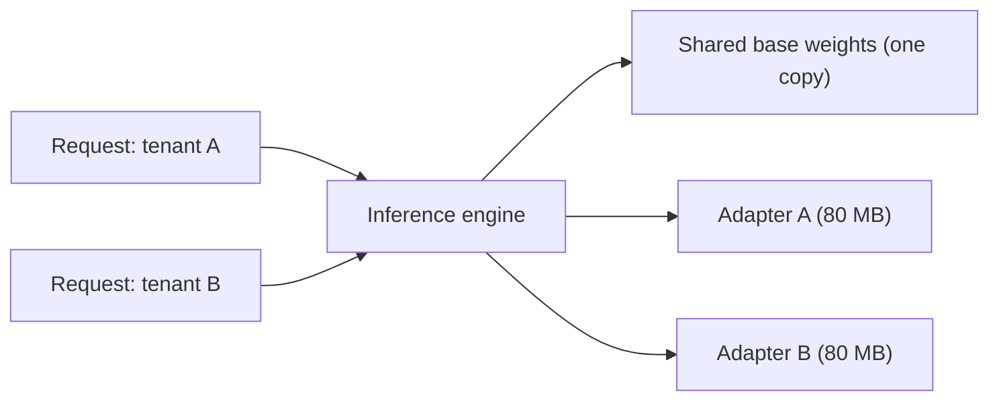

You now know the maths. This topic is the checklist an engineer actually follows: which hyperparameters to set, how to verify a run, and what to do with the adapter afterwards.

## A starting recipe

| Setting | Starting value | Note |
|---|---|---|
| Base model | The instruct version for product work | Starting from an assistant keeps its manners |
| Targets | All linear layers | Better than $Q,V$ only at the same rank |
| Rank $r$ | 16 | Raise to 64 if quality plateaus |
| $\alpha$ | $2r$ (scale 2) or equal to $r$ | Tune together with the learning rate |
| Dropout on adapter | 0 to 0.1 | Helps on very small datasets |
| Learning rate | $2\times10^{-4}$, cosine, 3% warmup | About 10x the full-fine-tune value |
| Epochs | 1 to 3 | Watch validation loss |
| Quantised base | NF4 if memory-bound | Otherwise BF16 |

## Training cost

Compute follows the same $C \approx 6ND$ logic, with one change: the frozen weights need no weight-gradient pass, so the cost is roughly $4N$ FLOPs per token instead of $6N$ (forward $2N$ plus activation gradients $2N$), plus a small adapter term. For 20,000 examples of 500 tokens, 2 epochs ($2\times10^7$ tokens) on a 7B model: $4 \times 7\times10^9 \times 2\times10^7 = 5.6\times10^{17}$ FLOPs. On one A100 at 312 TFLOP/s and 40% utilisation, that is $5.6\times10^{17}/(312\times10^{12} \times 0.4) \approx 4{,}500$ seconds, about 75 minutes. With gradient checkpointing add roughly a third. QLoRA adds the dequantisation overhead.

## Merging an adapter

For each adapted matrix, compute $W' = W_0 + \frac{\alpha}{r}BA$ and save the result as an ordinary checkpoint. The merged model is architecturally identical to the base, so it runs in every inference engine at full speed. The merge is just one matrix product per layer, seconds to minutes.

```steps
Merge, then check
Take the rank-1 example from earlier: $\Delta W = BA$ with rows $(0.5,0,1,-0.5)$, $(1,0,2,-1)$, $(-0.5,0,-1,0.5)$. Suppose $W_0$'s first row is $(0.2, 0.1, -0.3, 0.4)$.
---
Merged first row: $(0.2 + 0.5,\; 0.1 + 0,\; -0.3 + 1,\; 0.4 - 0.5) = (0.7, 0.1, 0.7, -0.1)$.
---
For $x = (1,2,3,4)$: $W'x$ first component $= 0.7 + 0.2 + 2.1 - 0.4 = 2.6$. And $W_0 x + \Delta W x = (0.2 + 0.2 - 0.9 + 1.6) + 1.5 = 1.1 + 1.5 = 2.6$. Merged and unmerged agree.
---
In practice merge in 16 bits (or higher), compare a few hundred outputs before and after, and expect tiny numerical differences from rounding.
```

## Serving many adapters

If you serve many customised variants, keep **one** copy of the base in GPU memory and load adapters on demand. Each request names its adapter; the engine computes $W_0 x + s\,B(Ax)$ with that request's $A$ and $B$. Modern serving systems batch requests that use different adapters together, running the shared $W_0 x$ once for the whole batch and the small adapter matmuls per request.

$$
\text{memory} = \underbrace{M_{\text{base}}}_{\text{once}} + n_{\text{adapters}} \times \underbrace{M_{\text{adapter}}}_{\text{per adapter}}
$$

With a 13.5 GB base and 80 MB adapters (for example, 40M parameters in BF16), 100 adapters add only 8 GB. Compare 100 full 13.5 GB copies: 1.35 TB. The trade-off is a modest per-token latency overhead from the unmerged adapter path and the engineering of adapter scheduling. For one dominant variant, merge it; for a long tail of tenants, keep adapters separate.



## What to verify

- **Trainable parameters** match your formula; the base has no gradients.
- **Validation loss** and a task metric on held-out data, plus a **general** evaluation to detect forgetting.
- **Adapter and base compatibility**: an adapter is only valid for the exact base checkpoint (and tokenizer, and chat template) it was trained on.
- **Reproducibility**: record the base model version, data version, hyperparameters and seed with the adapter file.

## In practice

The common failure is training on one prompt format and serving another: the adapter learned behaviour tied to a specific template and system prompt. Test the adapter through the same path production will use. For capacity planning, remember that LoRA reduces training cost and storage, not inference cost per token (merged, it is exactly the base model's cost).

```lab
lora-budget
```

```quiz
{"q": "A service hosts one 7B base (13.5 GB) and 50 tenant adapters of 60 MB each. How much GPU memory do the weights need?", "options": ["About 16.5 GB", "About 675 GB", "About 13.5 GB", "About 3 GB"], "answer": 0, "explain": "$13.5 + 50 \\times 0.06 = 16.5$ GB. 675 GB would be 50 full copies; 13.5 GB forgets the adapters."}
```

```quiz
{"q": "Why is a merged LoRA model no slower at inference than the base model?", "options": ["Merging quantises the weights", "After merging, $W' = W_0 + \\frac{\\alpha}{r}BA$ is a single ordinary matrix of the original shape, so there are no extra operations", "Adapters are removed from the vocabulary", "Merged models skip the attention layers"], "answer": 1, "explain": "The merged matrix has the same dimensions as $W_0$, so the forward pass is unchanged. An unmerged adapter adds two extra small matrix multiplications per adapted matrix."}
```
