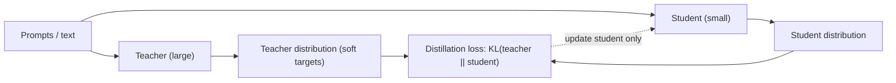

```callout-before
Before you start
You should know softmax and what it means to say a model gives a token a probability. That is all the machinery this topic needs.
```

A student preparing for an exam learns far more from a teacher who says "the answer is B, but C is a very tempting mistake, and A is nonsense" than from one who says only "B". The first answer reveals structure: which wrong answers are close, which are absurd. A training label usually carries none of that. It says "the next token is *dog*", full stop.

A large **teacher** model's output carries it. When it predicts the next word after "The pet barked at the", its probabilities might be $0.87$ for *mailman*, $0.12$ for *cat*, $0.016$ for *spoon*. The ordering says *cat* is a far better alternative than *spoon*, and that relationship (sometimes called **dark knowledge**) is exactly what a hard label throws away. **Knowledge distillation** trains a smaller **student** to reproduce the teacher's whole distribution, not just its top choice.

## Why this makes small models better

Each training token under a hard label provides about one number of supervision: which class is right. Under distillation, each token provides a full probability vector over the vocabulary, with tens of thousands of numbers' worth of relative judgements. The student learns faster per token and often generalises better, because the soft targets act as a rich regulariser. Empirically, distilled students beat same-size models trained on the same text with hard labels alone, and can match much larger ones on specific tasks.

```steps
Hard label versus soft target, one token
The teacher gives next-token probabilities: *mailman* $0.87$, *cat* $0.12$, *spoon* $0.016$ (rest negligible). The corpus token is *mailman*.
---
Hard-label training: the target vector is $(1, 0, 0)$. The student is told only "*mailman*"; *cat* and *spoon* are equally wrong. Its loss is $-\ln p_{\text{student}}(\text{mailman})$.
---
Soft-target training: the target is $(0.87, 0.12, 0.016)$. The student must also give *cat* about 7.5 times the probability of *spoon* ($0.12/0.016$): it learns that cats and mailmen both fit the context and spoons do not.
---
Information: a distribution over $V$ tokens with entropy $H$ nats communicates about $H$ nats about what plausible continuations look like, versus essentially $0$ extra nats for a one-hot label that is already known.
```

## Two ways to teach the student

| Method | What the student sees | Strength | Weakness |
|---|---|---|---|
| **Logit (or response-based) distillation** | Teacher's probabilities at every token position | Richest signal; fast learning | Needs access to teacher logits and the same tokenizer; storage heavy |
| **Sequence-level distillation** | Text generated by the teacher, used as ordinary SFT or pretraining data | Works through any API; no tokenizer match needed | Only the sampled path; no dark knowledge about alternatives |

Most open small models mix both: long synthetic datasets written and filtered by a strong teacher, and in some pretraining runs a logit-matching term during part of training.



## In practice

Distillation is how many small models reach quality that scaling laws would not predict from their size and data alone. Use it when you have a strong teacher you are allowed to learn from (your own large model, or one whose licence permits it), a narrow task where a small model can be competitive, and a serving cost or latency constraint that the teacher cannot meet. The next topic gives the exact loss.

```quiz
{"q": "Why can a soft target train a student faster than a one-hot label?", "options": ["It has fewer numbers", "It tells the student which wrong answers are plausible and which are absurd, adding information beyond the single correct token", "It removes the need for a loss function", "It makes the student bigger"], "answer": 1, "explain": "The relative probabilities of the non-top tokens carry the teacher's learned similarity structure. A one-hot label treats every wrong token as equally wrong."}
```

```quiz
{"q": "You can only reach a teacher through a text API that returns sampled answers, with no probabilities. Which distillation method is available?", "options": ["Logit distillation", "Sequence-level distillation: fine-tune the student on the teacher's generated answers", "Neither; distillation needs weights", "Only pruning"], "answer": 1, "explain": "Without logits you cannot match distributions, but you can use the teacher's outputs as training text. Check the provider's terms of use first: many forbid using outputs to train competing models."}
```
