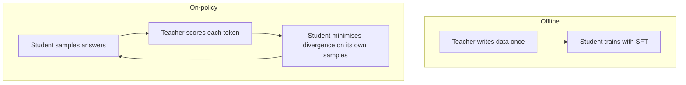

For image classifiers with a thousand classes, storing the teacher's full output is trivial. For a language model, the "class" is the next token out of a vocabulary of 32,000 to 256,000, at every one of trillions of positions. That changes the engineering. There are three practical recipes.

## Recipe 1: online logit distillation

Run teacher and student side by side on the same text. At each position, the teacher's forward pass gives logits; the student's gives its own; the loss from the previous topic is averaged over positions. Nothing is stored.

The cost is a teacher forward pass for every training token, about $2N_T$ FLOPs ($N_T$ the teacher's parameters) on top of the student's $6N_S$:

$$
C_{\text{distill}} \approx \left(6N_S + 2N_T\right) D
$$

```steps
What does distilling a 70B teacher into an 8B student cost?
Take $D = 10^9$ tokens (1B). Student training: $6 \times 8\times10^9 \times 10^9 = 4.8\times10^{19}$ FLOPs.
---
Teacher forward passes: $2 \times 70\times10^9 \times 10^9 = 1.4\times10^{20}$ FLOPs. The teacher costs about three times as much as the student's own training.
---
Total $1.9\times10^{20}$ FLOPs: about 4 times the cost of training the student alone, so in logit distillation the teacher dominates the bill. The student must be much more sample-efficient to be worth it.
---
Compare with pretraining the 8B model on 1.3T tokens ($6 \times 8\times10^9 \times 1.3\times10^{12} = 6.2\times10^{22}$): the 1B-token distillation is about 0.3% of that. This is why distillation is mostly used to finish, specialise or recover quality, not to replace pretraining.
```

## Recipe 2: cached top-$k$ logits

If you will reuse the teacher on the same data many times, you can compute its outputs once and store them. Storing every logit is impossible: 1B tokens $\times$ 128,000 vocabulary $\times$ 2 bytes $= 256$ TB. Almost all the probability mass sits in a handful of tokens, so people store only the **top-$k$** (for example $k = 64$) probabilities and their token IDs, then treat the remainder as one "other" bucket.

Storage per token is about $k \times (2 + 4)$ bytes (16-bit probability, 32-bit index): for $k = 64$ and $10^9$ tokens, $64 \times 6 \times 10^9 = 384$ GB, a thousandth of the full cost. The approximation loses the fine structure of the tail, but that tail carries little mass.

## Recipe 3: sequence-level and on-policy distillation

When the teacher is behind an API, or has a different tokenizer, use its **generated text**. Prompt the teacher, optionally filter by correctness or a judge, and fine-tune the student on the results with ordinary SFT. This is how most instruction-following and reasoning-trace datasets are built. It is cheap per example and works for any teacher, but the student only sees the one path the teacher sampled.

A known problem with training only on teacher text: at inference the student generates from its **own** distribution, which drifts to states the teacher data never covered (a form of exposure bias). **On-policy distillation** addresses this: sample responses from the *student*, have the teacher score every token of them (a forward pass, giving $\log p_{\text{teacher}}$), and minimise a divergence on those student-generated sequences. The student learns how the teacher would have continued from the student's own mistakes.



| Recipe | Teacher access needed | Relative cost | Strength |
|---|---|---|---|
| Online logit | Weights, same tokenizer | Highest | Richest signal |
| Cached top-$k$ | Weights once, same tokenizer | Moderate; storage heavy | Reuse across runs |
| Sequence-level | Any API | Lowest | Simplest; most common |
| On-policy | Teacher scoring at every step | High | Fixes train-test mismatch |

## In practice

Reasoning models are a current example: a large reasoning model generates long worked solutions, a verifier keeps the correct ones, and smaller models are fine-tuned on them. That is sequence-level distillation, and it often gives small models a larger jump on maths and coding than reinforcement learning applied directly to them. Whichever recipe you use, keep a validation set the teacher never saw, since you want to measure how well the student generalises, not how well it copied.

```quiz
{"q": "Distilling a 30B teacher into a 3B student on 2B tokens by online logit distillation. Roughly which is larger, the teacher's forward cost or the student's training cost?", "options": ["Teacher: $1.2\\times10^{20}$ vs student $3.6\\times10^{19}$", "Student: $1.2\\times10^{20}$ vs teacher $3.6\\times10^{19}$", "They are equal", "The teacher costs nothing"], "answer": 0, "explain": "Teacher: $2 \\times 3\\times10^{10} \\times 2\\times10^9 = 1.2\\times10^{20}$. Student: $6 \\times 3\\times10^9 \\times 2\\times10^9 = 3.6\\times10^{19}$. The big teacher's forward pass dominates even though it takes only $2N$ per token."}
```

```quiz
{"q": "Why do teams store only the top-64 teacher probabilities per token rather than the full vocabulary?", "options": ["The remaining logits are always exactly zero", "The tail carries little probability mass, and the full vocabulary at trillion-token scale would need hundreds of terabytes", "Top-64 is required by the KL formula", "It improves the student's accuracy"], "answer": 1, "explain": "Storing all logits for $10^9$ tokens with a 128K vocabulary is about 256 TB; top-64 is about 384 GB. The tail is small but not exactly zero, so this is an approximation traded for feasibility."}
```
