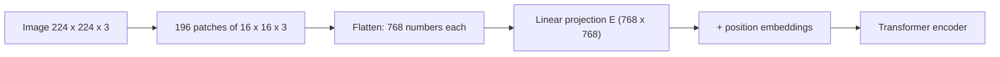

```callout-before
Before you start
A transformer only needs a sequence of vectors. It does not care whether each vector came from a word or from a piece of a photograph. Everything in this lesson is about making that conversion.
```

A language model reads a list of token embeddings. To let it read a picture, we need to turn the picture into a list of vectors of the same kind. The **Vision Transformer** (ViT) does it with an idea so simple it sounds like a joke: cut the image into square tiles, flatten each tile, and treat the tiles as words. The title of the paper says it: *an image is worth 16x16 words*.

## Cutting an image into patches

Take an image of height $H$, width $W$ and $C$ colour channels (3 for RGB), and a patch size $P \times P$. The number of patches, which is the number of tokens, is

$$
n = \frac{H}{P} \cdot \frac{W}{P} = \frac{HW}{P^2}
$$

Each patch is flattened into a vector of length $P^2 C$ and multiplied by a learned matrix $E \in \mathbb{R}^{(P^2 C) \times d}$ to produce a $d$-dimensional embedding: the **patch embedding**.

$$
\mathbf{z}_i = E\, \text{flatten}(\text{patch}_i) + \mathbf{b} + \mathbf{p}_i
$$

where $\mathbf{b}$ is a bias and $\mathbf{p}_i$ a learned **position embedding** that tells the transformer where in the image the patch came from, much as positional information does for words.

```steps
ViT-Base on a 224 x 224 image
Patches per side: $224 / 16 = 14$. Total patches: $14 \times 14 = 196$ tokens (plus one special classification token in the original ViT, so 197 positions).
---
Each patch has $16 \times 16 \times 3 = 768$ numbers (pixel values).
---
The embedding width for ViT-Base is $d = 768$, so $E$ is $768 \times 768$: $768 \times 768 + 768 = 590{,}592$ parameters (weights plus bias). A coincidence of ViT-Base: the flattened patch length equals the model width.
---
Sanity check on information: the image has $224 \times 224 \times 3 = 150{,}528$ numbers, and the token sequence holds $196 \times 768 = 150{,}528$ numbers. The patch embedding is a re-arrangement, not a compression, at this configuration.
```

In practice the patch embedding is implemented as a single **convolution** with kernel size $P$ and stride $P$, which does exactly the same computation efficiently.

## Resolution and cost

Smaller patches or larger images mean more tokens, and the transformer's attention cost grows with the square of the sequence length:

| Image | Patch | Tokens $n$ | Attention pairs $n^2$ |
|---|---|---|---|
| 224 x 224 | 16 | 196 | 38,416 |
| 336 x 336 | 14 | 576 | 331,776 |
| 448 x 448 | 14 | 1,024 | 1,048,576 |

Going from 224 with $P = 16$ to 336 with $P = 14$ multiplies the tokens by $576/196 = 2.9$ and the attention work by $8.6$. High resolution matters for reading small text and fine detail, which is why document and chart models push resolution hard and use tricks (tiling, pooling) to keep token counts manageable.



## What the encoder gives back

A ViT encoder runs these 196 vectors through transformer blocks, so each output vector summarises a patch **in the context of the whole image**: a patch of fur knows it is part of a dog. Those output vectors (or a pooled version of them) are what downstream systems use. A classifier reads the classification token; a multimodal language model reads many of the patch vectors, as later topics show.

## In practice

Know the token count before you send images to a model: it sets cost, latency and how many images fit into the context. Providers describe their own tiling and resizing rules, so check the documentation for the model you use; the formula above gives the shape of the answer. A common mistake is sending a 4000 x 3000 photo when the model downsizes it anyway; resize first and save the upload time.

```quiz
{"q": "A 384 x 384 image is cut into 16 x 16 patches. How many patch tokens result?", "options": ["144", "576", "384", "24"], "answer": 1, "explain": "$384/16 = 24$ patches per side, so $24 \\times 24 = 576$. 24 is only the number per side."}
```

```quiz
{"q": "You change from 16 x 16 patches to 8 x 8 patches on the same image. By what factor do the token count and the attention cost ($n^2$) grow?", "options": ["Tokens x2, attention x4", "Tokens x4, attention x16", "Tokens x4, attention x4", "Tokens x16, attention x256"], "answer": 1, "explain": "Halving the patch side doubles the patches per side, so tokens grow 4x, and attention work grows with $n^2$, so 16x."}
```
