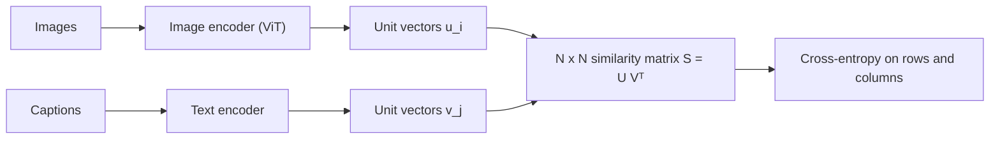

A ViT can be trained to classify images into a fixed list of labels, but a fixed list is a poor fit for the world. **CLIP** (Contrastive Language-Image Pre-training) learns from something the web has in abundance: images with captions. It trains two encoders, one for images and one for text, so that a picture and its own caption land close together in a shared vector space and mismatched pairs land far apart. The result is a vision encoder that understands images in terms of language, and that can classify into *any* label you can write as text.

Think of a matching game at a party with $N$ photos and their $N$ captions, shuffled. A good player can pair each photo with its caption. CLIP is trained to win that game, with a batch of $N$ pairs, thousands of times.

## Embeddings and similarities

For a batch of $N$ image-text pairs, the image encoder gives vectors $u_1, \dots, u_N$ and the text encoder $v_1, \dots, v_N$, each scaled to unit length. Their dot products are cosine similarities, arranged in an $N \times N$ matrix $S$ with $S_{ij} = u_i \cdot v_j$. The diagonal holds the true pairs; everything else is a mismatch.

Treat each row as a classification problem: given image $i$, which of the $N$ captions is its own? A softmax with a **temperature** $\tau$ turns similarities into probabilities:

$$
p_{i \to j} = \frac{\exp(S_{ij}/\tau)}{\sum_{k=1}^{N} \exp(S_{ik}/\tau)}
$$

The **symmetric contrastive loss** (also called InfoNCE) averages the image-to-text and text-to-image cross-entropies:

$$
\mathcal{L} = \frac{1}{2N} \sum_{i=1}^{N} \left[ -\log \frac{e^{S_{ii}/\tau}}{\sum_{k} e^{S_{ik}/\tau}} \;-\; \log \frac{e^{S_{ii}/\tau}}{\sum_{k} e^{S_{ki}/\tau}} \right]
$$

The first term picks the right caption for image $i$ (row $i$); the second picks the right image for caption $i$ (column $i$). With a random model, every entry is equal and the loss is $\ln N$, the cost of guessing among $N$ options.

## Worked example, N = 3

Cosine similarities (rows are images, columns are captions):

$$
S = \begin{pmatrix} 0.8 & 0.1 & 0.2 \\ 0.3 & 0.7 & 0.1 \\ 0.0 & 0.2 & 0.9 \end{pmatrix}, \qquad \tau = 0.5
$$

```steps
Image 1's row, with temperature 0.5
Divide by $\tau$: $(1.6, 0.2, 0.4)$. Exponentiate: $e^{1.6} = 4.953$, $e^{0.2} = 1.221$, $e^{0.4} = 1.492$. Sum $= 7.666$.
---
Probabilities: $(0.646, 0.159, 0.195)$. The true caption is the first, so the loss for this row is $-\ln 0.646 = 0.437$.
---
Rows 2 and 3 give $0.560$ and $0.345$ in the same way. Image-to-text average: $(0.437 + 0.560 + 0.345)/3 = 0.447$.
---
The columns give $0.451, 0.512, 0.371$, average $0.445$. The symmetric loss is $(0.447 + 0.445)/2 \approx 0.446$, well under the random-guess value $\ln 3 = 1.099$.
---
Change the temperature: at $\tau = 1$ the loss is $0.718$ (blurry, hard to be confident); at $\tau = 0.1$ it is $0.007$ (the diagonal is already clearly the largest, so softmax is nearly one-hot).
```

## Why the temperature matters

A small $\tau$ sharpens the softmax, so the loss focuses on the hardest mismatches: negatives that are almost as similar as the truth. A large $\tau$ treats all negatives alike. CLIP does not fix $\tau$; it learns it as a parameter (parameterised as a log-scale, initialised at $\tau = 0.07$ and clipped to avoid instability). The loss also depends heavily on batch size: each pair is contrasted against $N - 1$ negatives, so larger batches give a harder, more informative game. The CLIP paper used batches of 32,768 pairs, which is itself an engineering feat across many GPUs.

## Zero-shot classification

Because both encoders live in one space, classification becomes retrieval. To classify an image into $\{\text{cat}, \text{dog}, \text{car}\}$, write each label as a caption ("a photo of a cat"), embed those, and pick the caption with the highest similarity to the image embedding. No labelled training images for these classes were needed. This is why CLIP-style encoders are the default vision front end for many multimodal language models.



## In practice

Contrastive encoders are the backbone of image search, deduplication, content filtering and the first stage of many vision-language systems. Their weaknesses are the ones the data gives them: they capture what captions tend to say, so they are good at objects and scenes and poor at counting, fine spatial relations and text in images unless trained for it. When using one for search, normalise embeddings and use cosine similarity, exactly as in the embeddings lesson.

```quiz
{"q": "A CLIP batch has $N = 64$ pairs and the model's embeddings are random so every similarity is equal. What is the loss?", "options": ["0", "$\\ln 64 \\approx 4.16$", "1", "64"], "answer": 1, "explain": "With equal similarities the softmax over 64 captions gives each probability $1/64$, so the loss is $-\\ln(1/64) = \\ln 64 \\approx 4.16$, the cost of guessing."}
```

```quiz
{"q": "Why is the CLIP loss computed over both rows and columns of the similarity matrix?", "options": ["To double the batch size", "So that images learn to find their captions and captions learn to find their images, giving a symmetric shared space", "Because the matrix is not square", "To avoid using a temperature"], "answer": 1, "explain": "The row loss trains image-to-text retrieval; the column loss trains text-to-image retrieval. Averaging them gives a space that works in both directions."}
```
