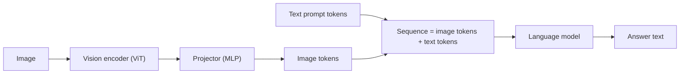

A language model already knows how to reason over a sequence of embeddings. A vision encoder already produces vectors that describe image content. The simplest way to build a **vision-language model** (VLM) is to connect them: encode the image, translate the encoder's vectors into the language model's embedding space, and place them in the sequence next to the text tokens. The LLM then reads the picture the way it reads words.

Three parts, then:

1. A **vision encoder** (often a CLIP-style ViT), usually frozen at first.
2. A **projector**: a small network mapping vision vectors to the LLM's width.
3. The **language model**, which sees `[image tokens] + [text tokens]` and generates text.



## The projector, with numbers

Take a CLIP ViT-L/14 at 336 x 336 pixels. Patch size 14 gives $336/14 = 24$ patches per side, so $24 \times 24 = 576$ patch vectors, each of width $d_v = 1024$. The LLM (say a 7B model) has width $d = 4096$. A two-layer MLP projector maps $1024 \to 4096 \to 4096$:

$$
\mathbf{h}_i = W_2\, \text{GeLU}(W_1 \mathbf{v}_i + \mathbf{b}_1) + \mathbf{b}_2
$$

```steps
Size of the projector and of an image in the context
Layer 1: $1024 \times 4096 + 4096 = 4{,}198{,}400$ parameters. Layer 2: $4096 \times 4096 + 4096 = 16{,}781{,}312$. Total about $21.0$M, 0.3% of a 7B model.
---
The image becomes 576 tokens in the LLM's context, regardless of how you phrase the question. A 4,096-token context window with a 200-token prompt and a 300-token answer leaves room for $(4096 - 500)/576 \approx 6$ images.
---
Prefill cost for one image through a 7B LLM: about $2 \times 7\times10^9 \times 576 = 8.1\times10^{12}$ FLOPs. On an H100 at 40% of its 989 TFLOP/s that is about 0.02 seconds of pure compute, before the vision encoder's own cost.
---
Pooling the patch grid by $2 \times 2$ before projecting gives $12 \times 12 = 144$ tokens: a 4x saving in context and prefill, at some loss of fine detail.
```

## Other ways to connect

| Design | How vision enters | Trade-off |
|---|---|---|
| Projector + prepend tokens (LLaVA style) | Image tokens inserted into the sequence | Simple; token count grows with resolution |
| Resampler / Q-Former | A fixed set of learned queries attends to the image features and outputs, say, 64 tokens | Fixed, small token cost; may drop detail |
| Cross-attention layers (Flamingo style) | Text layers attend to image features through added cross-attention blocks | Image does not use context length; more new parameters |
| Native multimodal (trained from the start on mixed data) | Image tokens and text tokens trained together | Strongest integration; needs enormous multimodal pretraining |

## Training in stages

A common recipe, introduced by LLaVA, trains in two stages because the pieces start misaligned:

1. **Alignment stage.** Freeze the vision encoder and the LLM; train only the projector on image-caption pairs (hundreds of thousands to millions). The loss is the usual next-token cross-entropy on the caption, conditioned on the image tokens. This teaches the projector to translate.
2. **Instruction-tuning stage.** Unfreeze the LLM (or train it with LoRA) and train on image-instruction-answer conversations: questions about images, reasoning, document reading, charts. Loss masking applies: only answer tokens count.

Later stages may add higher resolution, interleaved image-text documents, OCR and chart data, and preference tuning.

## In practice

Capabilities follow the training data. A VLM trained mostly on natural photos will read street signs but not tables; document and chart understanding needs documents and charts, at high resolution. Cost and latency follow the image token count, so check how a given model converts an image to tokens, and downsize or crop to the region that matters. Expect failure modes that text models do not have: miscounting objects, left-right confusion, and **hallucinating** text or objects that are not in the image, which is why you evaluate a VLM on your own images rather than on public leaderboards alone.

```quiz
{"q": "A 336 x 336 image with 14 x 14 patches and no pooling is fed to a VLM with a 4,096-token context. The text uses 400 tokens. About how many such images fit?", "options": ["1", "6", "10", "24"], "answer": 1, "explain": "Each image is $24 \\times 24 = 576$ tokens; $(4096 - 400)/576 = 6.4$, so 6 images. With 2 x 2 pooling each image is 144 tokens and about 25 would fit."}
```

```quiz
{"q": "In the alignment stage of a LLaVA-style recipe, which parameters are trained?", "options": ["All of them", "Only the projector, with the vision encoder and the LLM frozen", "Only the LLM", "Only the tokenizer"], "answer": 1, "explain": "The goal is to teach the projector to translate vision vectors into the LLM's embedding space without disturbing either pretrained model. The LLM is unfrozen (or given LoRA adapters) in the second stage."}
```
