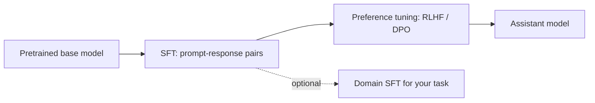

```callout-before
Before you start
You should know the next-token objective from pretraining. SFT reuses it almost unchanged, so the new ideas in this lesson are about data and formatting, not new maths.
```

```predict
{"q":"You type \"What is the capital of France?\" into a pure pretrained (base) model, with no instruction tuning. What is a likely continuation?","options":["\"Paris.\"","More questions, such as \"What is the capital of Germany?\"","A polite refusal","An error, because it cannot read questions"],"answer":1,"reveal":"More questions. On the web a question is often followed by more questions, as in a quiz. A base model knows what text looks like but not that it should be the one answering; SFT teaches that role."}
```

Type "What is the capital of France?" into a pure pretrained model and you may get back "What is the capital of Germany? What is the capital of Italy?". That is a perfectly good continuation: on the web, a question is often followed by more questions, as in a quiz or a worksheet. A **base model** has learned what text looks like. It has not learned that it is supposed to be the one answering.

**Supervised fine-tuning** (SFT), also called **instruction tuning**, teaches that role. You show the model many examples of a prompt followed by the response you want, and train it to produce the response. The knowledge was already there from pretraining; SFT teaches a format and a behaviour: read the request, answer it helpfully, stop.

## In everyday life

Imagine a new trainee at a bank's help desk. Before joining, she read every manual, brochure and old email the bank ever wrote. She knows a great deal. On day one a customer asks, "How do I block my card?" and she replies with more questions customers often ask: "How do I change my PIN? How do I check my balance?" She is not wrong about what such text looks like. Nobody has told her that her job is to answer.

That is the gap between a **base model** and an assistant. A base model is trained only to continue text, so it carries plenty of knowledge but no sense of its role. **Supervised fine-tuning**, or SFT, closes the gap by showing the model many examples of a request followed by a good reply, and training it to produce that reply. Picture a trainer sitting beside her, playing real sample calls. Another name for it is **instruction tuning**. It teaches a habit: read the request, answer it, then stop. It does not add new knowledge, because the trainee already had that from her reading.

**Where you meet it.** A company wants a support chatbot built on an open model. The raw base model rambles on or repeats the question back. After SFT on a few thousand good question-and-answer pairs, it replies directly and in the style the company wants.

```scene
title: A trainee learns to answer
step: 📖 A trainee reads every manual and brochure before joining | pretraining on raw text
step: 🙋 A customer asks a question and she answers with more questions | base model continues the text
step: 📞 A trainer plays sample calls: a question, then a good reply | prompt and response pairs
step: 🔁 She practises until replying becomes her habit | supervised fine-tuning
step: ✅ Now a customer asks, and she answers directly, then stops | assistant behaviour
takeaway: SFT teaches a model its role as the answerer; the knowledge was already there from pretraining.
```

## Same loss, different data

An SFT example is a pair $(x, y)$: a prompt $x$ (instruction, maybe a system message and earlier turns) and a target response $y = (y_1, \dots, y_m)$. The objective is the familiar cross-entropy, applied only to the response, conditioned on the prompt:

$$
\mathcal{L}_{\text{SFT}}(\theta) = -\frac{1}{m}\sum_{j=1}^{m} \log p_\theta\!\left(y_j \mid x,\, y_{<j}\right)
$$

$m$ is the number of response tokens and $y_{<j}$ the response tokens before position $j$. Compared with pretraining, nothing about the network or the optimizer changes. What changes is that the training text has a structure (prompt, then answer) and that we only grade the answer. The topic on loss masking shows how that is implemented.

```steps
What one SFT example changes
Prompt $x$: "Translate to French: good morning". Target $y$: "bonjour".
---
Before SFT, the base model's probability for "bonjour" as the first response token might be low, say $p = 0.05$, because "Translate to French: good morning" is also commonly followed by more exercises. The loss on that token is $-\ln 0.05 = 3.0$ nats.
---
Gradient steps on thousands of similar pairs raise the probability of answering rather than continuing the exercise list. Suppose it reaches $p = 0.6$: the loss falls to $-\ln 0.6 = 0.51$ nats.
---
The model has not learned French in those steps (that came from pretraining). It has learned that, in this format, its job is to produce the answer.
```

## The modern post-training pipeline



SFT usually comes first because it is simple, stable and cheap, and it gives the later preference-tuning stage a model that already behaves roughly correctly. The next lesson covers that stage.

| | Base model | After SFT |
|---|---|---|
| Training text | Raw documents | Prompt + response, in a chat template |
| Loss counted on | Every token | Response tokens only |
| Typical behaviour | Continues text in any style | Answers, follows format, stops |
| Data size | Trillions of tokens | Thousands to millions of examples |

## In practice

You will meet SFT in two settings. Model builders run large, general SFT (many tasks, many languages, safety examples) to turn a base model into an assistant. Product teams run small, specific SFT on an existing instruct model to teach a narrow behaviour: a strict output format, a house style, a classification scheme. The second kind is cheap and effective for **behaviour and format**, and much less effective for teaching new **facts**, as the last topic of this lesson explains. Start from the instruct version of a model for product work unless you have a strong reason to redo general SFT yourself.

```quiz
{"q": "A base model answers the prompt 'List three primes:' with 'List three even numbers: List three odd numbers:'. What does this show?", "options": ["The model has no knowledge of primes", "The model is continuing a plausible document rather than acting as an answerer, which SFT addresses", "The tokenizer is broken", "The temperature is too low"], "answer": 1, "explain": "Worksheets often list exercises one after another, so this is a likely continuation. The knowledge is probably present; what is missing is the trained habit of responding to the instruction, which is exactly what SFT teaches."}
```

```quiz
{"q": "During SFT, the model gives the first response token probability 0.2 and, after training, 0.8. By how much has that token's loss fallen?", "options": ["0.6 nats", "About 1.39 nats", "About 0.22 nats", "4 nats"], "answer": 1, "explain": "Loss goes from $-\\ln 0.2 = 1.609$ to $-\\ln 0.8 = 0.223$, a drop of $1.386 = \\ln 4$ nats. Subtracting the probabilities (0.6) is not the change in loss."}
```
