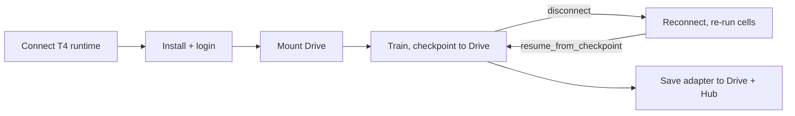

**Google Colab** gives you a Jupyter notebook running on a Google virtual machine, and on the free tier that machine usually comes with an NVIDIA **T4**: a 16 GB card with about 15 GB usable. That is enough for QLoRA on a 7B or 8B model at short context, which is a real fine-tune, not a toy. The catch is that the machine is borrowed. Google's own FAQ says free-tier limits fluctuate and GPU access is not guaranteed; as of late 2026 a session lasts at most about 12 hours, ends after roughly 90 minutes without interaction, and can be reclaimed sooner when demand is high. When it ends, every file on the VM is gone.

So Colab work has one rule beyond the CPU setup: **anything you want to keep must be written somewhere that outlives the session**, either Google Drive or the Hugging Face Hub, and written often.

## In everyday life

At a cyber cafe you pay for a computer by the hour. You can do real work on it, but the machine is not yours. When your time ends, or the power goes out, it restarts clean and everything on the desktop is gone. Sensible people save to their pen drive every few minutes, and if the session dies they sit at another machine, plug in the drive and carry on.

**Google Colab** is exactly this for model training. It lends you a computer in the cloud, often with a free GPU, but the session can end at any time and the files on it disappear with it. A **checkpoint** is a saved copy of the training state, and the habit of the chapter is to write checkpoints to somewhere that survives, such as Google Drive, regularly. After a disconnect you reconnect, run the setup cells again and **resume** from the last checkpoint.

The cafe picture stops at one point: a lost session also loses your installed libraries, so those need to be reinstalled each time.

**Where you meet it.** A learner trains a small model on the free tier, and the session drops after two hours. Because checkpoints were going to Drive every few minutes, she loses only a few minutes of training. Without them the whole run would be gone, and a perfect adapter would have vanished with the machine.

```scene
title: The cyber cafe and the pen drive
step: 💻 You sit at a cafe computer that is lent to you for limited time | Colab session on a borrowed machine
step: 📄 You keep working and files pile up on the desktop | Files on the temporary VM disk
step: 💾 Every few minutes you copy your work to a pen drive | Checkpoint saved to Drive
step: ⚡ A power cut restarts the PC and the desktop is wiped | Disconnect erases the VM
step: 🔄 At another PC you open the pen drive copy and carry on | Resume from checkpoint
takeaway: On borrowed machines, save to somewhere permanent often, so a disconnect costs minutes and not the whole run.
```

## Getting a GPU and checking it

Open a new notebook, then **Runtime → Change runtime type → T4 GPU → Save**. Confirm in a cell:

```python
!nvidia-smi
import torch
print(torch.cuda.is_available(), torch.cuda.get_device_name(0))
print(torch.cuda.get_device_properties(0).total_memory / 1e9, "GB")
```

`nvidia-smi` shows the card, its memory and what is using it. Run it again mid-training to see how close you are to the limit.

## The install cell

Colab ships with PyTorch and transformers preinstalled; do not reinstall PyTorch, or you may get a build that does not match the VM's CUDA driver. Install the rest, then print versions so you can pin them next time:

```python
!pip install -q -U trl peft accelerate datasets bitsandbytes
import trl, peft, transformers, bitsandbytes
print(trl.__version__, peft.__version__, transformers.__version__, bitsandbytes.__version__)
```

Once a notebook works, replace `-U` with exact pins, for example `"trl==1.17.1"`, using the versions you printed. A notebook that installs "latest" will eventually break on a day you did not change anything.

**The Unsloth option.** Unsloth publishes free Colab notebooks that patch the model with faster kernels and typically cut memory use substantially. Install it in a *fresh* runtime (`!pip install unsloth`), because it pins its own versions of the other libraries. It is a good choice for larger models on a T4; the plain stack above is easier to debug and is what the rest of this module assumes.

## Logging in to Hugging Face without leaking a token

Gated models (Llama, some Gemma releases) and pushing to the Hub both need a **Hugging Face access token**. Create one at huggingface.co under Settings → Access Tokens (a "write" token if you will push). Do not paste it into a cell: notebooks get shared. Click the key icon in Colab's left sidebar (**Secrets**), add a secret named `HF_TOKEN`, enable notebook access, then:

```python
from google.colab import userdata
from huggingface_hub import login
login(token=userdata.get("HF_TOKEN"))
```

## Drive, checkpoints and surviving a disconnect

```python
from google.colab import drive
drive.mount("/content/drive")
OUT = "/content/drive/MyDrive/ft-runs/qlora-8b-run1"
```

Point the trainer's `output_dir` at Drive and save checkpoints on a schedule. Then a disconnect costs you only the steps since the last save. The expected loss is half a save interval: with $s$ seconds per step and a checkpoint every $k$ steps,

$$\mathbb{E}[\text{lost time}] \approx \frac{k \cdot s}{2}.$$

**Worked example.** At $s = 6$ s per step and `save_steps=50`, a checkpoint lands every 300 s and a random disconnect loses about 150 s, under 3 minutes. Saving costs something too: a QLoRA checkpoint holds the adapter plus optimizer state. For an 8B model with 41.9M LoRA parameters (from [Sizing your first run](/learn/fine-tuning/start-here/sizing-your-first-run)) that is about $41.9 \times 10^6 \times 4 \approx 0.17$ GB of fp32 adapter weights plus $2 \times 0.17 = 0.34$ GB of Adam moments: about half a gigabyte per checkpoint. Keep `save_total_limit=2` so Drive does not fill.

The T4 also changes one precision flag. It is a Turing-generation card with no **bf16** support, so use **fp16** mixed precision. TRL's `SFTConfig` turns `bf16` on by default unless `fp16` is set, so set `fp16=True` explicitly. A minimal QLoRA setup:

```python
import torch
from transformers import BitsAndBytesConfig
from peft import LoraConfig
from trl import SFTConfig, SFTTrainer

bnb = BitsAndBytesConfig(load_in_4bit=True, bnb_4bit_quant_type="nf4",
                         bnb_4bit_compute_dtype=torch.float16,   # T4: fp16, not bf16
                         bnb_4bit_use_double_quant=True)
args = SFTConfig(output_dir=OUT, fp16=True, bf16=False,
                 per_device_train_batch_size=2, gradient_accumulation_steps=8,
                 learning_rate=2e-4, num_train_epochs=1, max_length=1024,
                 logging_steps=10, save_steps=50, save_total_limit=2, report_to="none")
trainer = SFTTrainer(model="meta-llama/Llama-3.1-8B-Instruct", args=args,
                     train_dataset=train_ds, quantization_config=bnb,
                     peft_config=LoraConfig(r=16, lora_alpha=32, lora_dropout=0.05,
                                            target_modules="all-linear", task_type="CAUSAL_LM"))
trainer.train()                              # first time
# after a disconnect: re-run every cell above, then
# trainer.train(resume_from_checkpoint=True)  # picks up the latest checkpoint in OUT
```

`train_ds` is your dataset; the [SFT step-by-step lesson](/learn/fine-tuning/sft-with-lora-step-by-step) covers building it. When training finishes, save the adapter to Drive and, ideally, to a private Hub repository:

```python
trainer.save_model(f"{OUT}/final-adapter")
trainer.model.push_to_hub("your-username/llama31-8b-myadapter", private=True)
```



```sim
lora-params
{"model": "llama3-8b", "method": "qlora", "rank": 16, "targets": "all", "gpu": "l4"}
```

The sim has no T4 option, so compare its memory figure against 15 GB yourself. QLoRA on the 8B model should sit well under that. Switch the method to **lora** (bf16 base): the memory passes 15 GB, which is why an 8B LoRA without quantisation does not fit a T4 but does fit the 24 GB L4.

## Paying for more Colab

If the free tier keeps refusing you a GPU, Colab Pro costs about US\$10 a month for 100 compute units (as of late 2026; check the current plan page, and Google AI subscription plans may include Colab benefits too). Units are consumed per hour by machine type; measurements reported in early 2026 put a T4 near 1.2 units per hour, an L4 near 1.7 and an A100 40 GB near 5.4. So 100 units is roughly $100 / 1.2 \approx 83$ T4 hours, or $100 / 5.4 \approx 18$ A100 hours. Google does not publish fixed rates, so watch the unit balance in the Resources panel.

## In practice

Leave the browser tab open and active during a run; the idle timeout counts interaction with the page. Train in short, resumable chunks rather than one 10-hour job. Write a final `print` of where the adapter was saved, because the most common Colab loss is a perfectly trained adapter in `/content/outputs` that vanished with the VM.

```bughunt
{"q":"This Colab QLoRA cell trains fine on a free T4 and writes a checkpoint every 50 steps. Two hours in, the session disconnects, you re-run every cell, and `resume_from_checkpoint=True` finds nothing. Click the line with the bug.","code":"from google.colab import drive\ndrive.mount(\"/content/drive\")\nOUT = \"/content/outputs/qlora-8b-run1\"\nbnb = BitsAndBytesConfig(load_in_4bit=True, bnb_4bit_quant_type=\"nf4\",\n                         bnb_4bit_compute_dtype=torch.float16,   # T4: fp16, not bf16\n                         bnb_4bit_use_double_quant=True)\nargs = SFTConfig(output_dir=OUT, fp16=True, bf16=False,\n                 per_device_train_batch_size=2, gradient_accumulation_steps=8,\n                 learning_rate=2e-4, num_train_epochs=1, max_length=1024,\n                 logging_steps=10, save_steps=50, save_total_limit=2, report_to=\"none\")\ntrainer = SFTTrainer(model=\"meta-llama/Llama-3.1-8B-Instruct\", args=args,\n                     train_dataset=train_ds, quantization_config=bnb,\n                     peft_config=LoraConfig(r=16, lora_alpha=32, target_modules=\"all-linear\", task_type=\"CAUSAL_LM\"))\ntrainer.train()","bug":3,"explain":"Line 3 points `OUT`, and so `output_dir`, at `/content/outputs`, which is the VM's local disk, even though Drive was mounted on the line above. Checkpoints are written on schedule and everything looks fine until the disconnect, when they vanish with the VM. Fix: `OUT = \"/content/drive/MyDrive/ft-runs/qlora-8b-run1\"`. Then a disconnect costs on average half a save interval, and `trainer.train(resume_from_checkpoint=True)` picks up the latest checkpoint."}
```

```quiz
{"q": "A Colab run takes 8 s per step and saves every 100 steps. Roughly how much training do you expect to lose to a random disconnect?", "options": ["About 400 s (under 7 minutes)", "About 800 s", "About 8 s", "Everything since the start of the run"], "answer": 0, "explain": "A checkpoint lands every $100 \\times 8 = 800$ s, and a disconnect at a random moment falls on average halfway between two saves: about 400 s. 800 s is the worst case, not the expected one. Losing everything happens only if checkpoints were written to the VM's local disk instead of Drive."}
```

```quiz
{"q": "Your QLoRA script, written for an A100, runs on a free T4 but fails at the start of training with an error about bf16. What is the right change?", "options": ["Set fp16=True and bf16=False, and use torch.float16 as the 4-bit compute dtype", "Switch to fp32 everywhere", "Remove the quantization config", "Lower the learning rate"], "answer": 0, "explain": "The T4 has no bf16 support, so mixed precision must use fp16, including the bitsandbytes compute dtype. Switching to fp32 would also avoid the error but doubles activation memory and runs much slower on the T4's tensor cores; removing quantisation would no longer fit an 8B model."}
```
