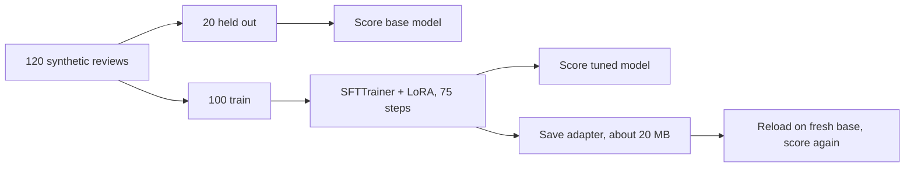

Time to fine-tune something and see it change. The task is chosen to be *visibly* learnable in a few minutes on a CPU: given a short product review, reply with nothing but a JSON object, `{"label": "positive"}` or `{"label": "negative"}`. A 135M instruct model asked to do this will usually chat instead, add an explanation, or invent its own format. A hundred examples of the exact format fix that. It is the [behaviour, not knowledge](/learn/fine-tuning/start-here/when-fine-tuning-pays) kind of change that fine-tuning is good at, at the smallest possible scale.

Because the check is mechanical (does `json.loads` succeed, and is the label right?), you get a number before and a number after rather than a vague impression. That habit, a fixed held-out test and a score, is the core of every serious run later.

## The numbers for this run

The model is **SmolLM2-135M-Instruct**: 30 layers, $d = 576$, an MLP width of 1,536 and 3 key/value heads of size 64 (so $W_k$ and $W_v$ map 576 to 192). LoRA at $r = 16$ on all linear layers adds, per layer,

$$2 \cdot 16(576+576) + 2 \cdot 16(576+192) + 3 \cdot 16(576+1536) = 162{,}816,$$

and across 30 layers $30 \times 162{,}816 = 4{,}884{,}480 \approx 4.9$M trainable parameters, about 3.6% of the model. Saved in fp32 that is $4.9 \times 10^6 \times 4 \approx 19.5$ MB: the size of the adapter file you should see at the end. With 100 examples, batch size 4 and 3 epochs the trainer takes $\lceil 100/4 \rceil \times 3 = 75$ optimizer steps. Each example is under 80 tokens, so $T < 100 \times 80 \times 3 = 24{,}000$ tokens and the $4NT$ estimate is about $1.3 \times 10^{13}$ FLOPs: one to four minutes on most laptops.

## The script

Save it as `first_run.py` in the environment from [Setting up a laptop](/learn/fine-tuning/run-fine-tuning-yourself/local-cpu-setup) and run `python first_run.py`. The model downloads once (about 270 MB) and is cached.

```python
# first_run.py -- LoRA fine-tune of SmolLM2-135M-Instruct on a CPU, before/after check.
import json, random, time, torch
from datasets import Dataset
from transformers import AutoModelForCausalLM, AutoTokenizer
from peft import LoraConfig, PeftModel
from trl import SFTConfig, SFTTrainer

random.seed(0); torch.manual_seed(0)
NAME = "HuggingFaceTB/SmolLM2-135M-Instruct"
OUT = "smol-sentiment-lora"

# 1. Data: 120 synthetic reviews -> 100 for training, 20 held out for testing.
things = ["headphones", "blender", "backpack", "phone case", "desk lamp", "kettle",
          "keyboard", "water bottle", "umbrella", "office chair", "running shoes", "toaster"]
good = ["works perfectly", "is excellent value", "exceeded my expectations",
        "feels really well made", "is a joy to use"]
bad = ["broke after a week", "is a waste of money", "stopped working quickly",
       "feels cheap and flimsy", "was a big disappointment"]
pairs = [(f"The {t} {p}.", "positive") for t in things for p in good] + \
        [(f"The {t} {p}.", "negative") for t in things for p in bad]
random.shuffle(pairs)
train_pairs, test_pairs = pairs[:100], pairs[100:120]

def prompt(review):
    return [{"role": "user", "content": f"Classify the sentiment of this review. "
                                        f"Reply with JSON only.\nReview: {review}"}]

train_ds = Dataset.from_list([
    {"prompt": prompt(r),
     "completion": [{"role": "assistant", "content": json.dumps({"label": y})}]}
    for r, y in train_pairs])

tok = AutoTokenizer.from_pretrained(NAME)
model = AutoModelForCausalLM.from_pretrained(NAME, dtype=torch.float32)

# 2. Score a model on the held-out reviews: valid JSON with the right label.
@torch.no_grad()
def score(m, show=2):
    m.eval(); ok = 0
    for i, (review, label) in enumerate(test_pairs):
        x = tok.apply_chat_template(prompt(review), add_generation_prompt=True,
                                    return_dict=True, return_tensors="pt")
        y = m.generate(**x, max_new_tokens=24, do_sample=False)
        text = tok.decode(y[0, x["input_ids"].shape[1]:], skip_special_tokens=True).strip()
        try:
            ok += json.loads(text).get("label") == label
        except (json.JSONDecodeError, AttributeError):
            pass
        if i < show:
            print(f"  {review!r} -> {text!r}")
    return ok / len(test_pairs)

print("before:", score(model))

# 3. Train LoRA adapters. CPU settings: fp32, no checkpointing, plain AdamW.
args = SFTConfig(output_dir=OUT, num_train_epochs=3, per_device_train_batch_size=4,
                 learning_rate=2e-4, logging_steps=5, save_strategy="no",
                 max_length=128, use_cpu=True, bf16=False, fp16=False,
                 optim="adamw_torch", gradient_checkpointing=False, report_to="none")
lora = LoraConfig(r=16, lora_alpha=32, lora_dropout=0.05,
                  target_modules="all-linear", task_type="CAUSAL_LM")
trainer = SFTTrainer(model=model, args=args, train_dataset=train_ds,
                     processing_class=tok, peft_config=lora)
trainer.model.print_trainable_parameters()      # expect about 4.9M trainable
t0 = time.time(); trainer.train()
print(f"trained in {time.time() - t0:.0f} s")

# 4. Score again, save only the adapter, and prove it reloads onto a fresh base.
print("after:", score(trainer.model))
trainer.save_model(f"{OUT}/final")
base = AutoModelForCausalLM.from_pretrained(NAME, dtype=torch.float32)
print("reloaded:", score(PeftModel.from_pretrained(base, f"{OUT}/final"), show=0))
```

A few choices are worth naming. The dataset is in TRL's conversational **prompt-completion** format, so the trainer applies the model's chat template and, by default, computes the loss only on the completion, the [loss masking](/learn/fine-tuning/instruction-tuning/loss-masking) you met earlier in this module. The learning rate of $2 \times 10^{-4}$ is higher than full fine-tuning would use because only the small adapter is learning. The "before" score must run *before* the trainer is built, because PEFT injects the adapters into the same model object.



## What "it worked" looks like

| Signal | Healthy | Something is wrong |
|---|---|---|
| Trainable parameters | about 4.9M, a few percent | 0 (targets matched nothing) or 135M (LoRA not applied) |
| Loss | starts around 1 to 3, falls below about 0.3 by the end | flat, or `nan` |
| Before score | low, often 0.0 to 0.3 | already near 1.0: the task was too easy to prove anything |
| After score | near 1.0 | unchanged: check the data format and that loss fell |
| Reloaded score | equal to the after score | lower: wrong adapter path or a different base model |
| Adapter file | about 20 MB `adapter_model.safetensors` | hundreds of MB: you saved the full model |

Exact numbers will vary with library versions and hardware, but the pattern should not. A perfect score here proves the *pipeline*, not that the model understands sentiment: the held-out reviews reuse the training phrases in new combinations. A real evaluation needs inputs the model has not seen in any form, which the [SFT step-by-step lesson](/learn/fine-tuning/sft-with-lora-step-by-step) builds properly.

## In practice

Once this runs, scaling up is a change of three or four lines: the model name, the precision flags (`fp16=True` on a T4, `bf16=True` on an L4 or A100), `use_cpu` removed, and a real dataset. Keep `first_run.py` as your template and reference. If anything in a larger run misbehaves, run this script again in the same environment: if it still works, the problem is in your data or model, not your setup.

```parsons
{"title":"Order the core of first_run.py (`args`, `lora` and `score` are already defined; `base` is a freshly loaded copy of the base model)","lines":["model = AutoModelForCausalLM.from_pretrained(NAME, dtype=torch.float32)","print(\"before:\", score(model))","trainer = SFTTrainer(model=model, args=args, train_dataset=train_ds, processing_class=tok, peft_config=lora)","trainer.train()","trainer.save_model(f\"{OUT}/final\")","print(\"reloaded:\", score(PeftModel.from_pretrained(base, f\"{OUT}/final\"), show=0))"],"explain":"The base score has to run before `SFTTrainer` is built, because PEFT injects the adapters into the same model object: once the trainer exists, `model` is no longer the plain base. Saving comes after training, and the reload check needs the saved folder. Loading that adapter onto a fresh base and getting the same score as after training proves you saved the right file, about 20 MB, not the whole model."}
```

```quiz
{"q": "A LoRA run with rank 8 instead of 16 on the same SmolLM2-135M layers is saved in fp32. About how big is the adapter file?", "options": ["About 10 MB", "About 20 MB", "About 5 MB", "About 540 MB"], "answer": 0, "explain": "LoRA parameters scale linearly with $r$: halving 4.9M gives about 2.4M, and $2.4 \\times 10^6 \\times 4$ bytes $\\approx 9.8$ MB. 540 MB is the size of the whole model in fp32, which you would only get by saving the merged or full model."}
```

```quiz
{"q": "After training, the 'after' score equals the 'before' score, and the log shows the loss stuck at the same value for all 75 steps. Which cause is most likely?", "options": ["The adapters are not receiving gradients, for example because the target modules matched no layers", "The learning rate is slightly too low", "The test set is too small", "The model needed more epochs"], "answer": 0, "explain": "A perfectly flat loss means nothing is being updated; check that `print_trainable_parameters` reports millions of trainable parameters, not zero. A somewhat low learning rate would still make the loss fall slowly, and test-set size cannot affect the training loss at all."}
```
