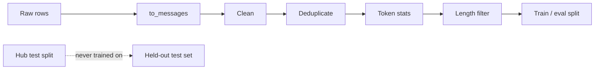

```callout-before
Before you start
You need a Python environment with `torch`, `transformers`, `datasets`, `trl` and `peft` installed, either on your own CPU or on a free Colab T4. [Run Fine-Tuning Yourself](/learn/fine-tuning/run-fine-tuning-yourself) covers the setup. The theory behind every step here is in [Instruction Tuning](/learn/fine-tuning/instruction-tuning) and [LoRA and QLoRA](/learn/fine-tuning/peft-lora).
```

```predict
{"q":"One answer in ten in your training data is wrapped in a Markdown code fence; the rest are bare. What will the fine-tuned model do?","options":["Never use a fence: the majority format wins","Wrap about one answer in ten in a fence","Always use a fence","Refuse to answer when unsure of the format"],"answer":1,"reveal":"The trainer copies what the examples show, quirks included, so about a tenth of outputs come out fenced. That is why most of this lesson is about cleaning and checking the data."}
```

Most of the effort in a fine-tuning run goes into the data. The trainer only copies what the examples show. If a tenth of your answers are wrapped in a Markdown code fence and the rest are bare, the tuned model will wrap about a tenth of its answers. Each quirk in the data comes back out of the model.

This lesson builds one run from start to finish: teach a small instruct model to turn a question and a table schema into a single SQL query, with no explanation around it. The task is a good first run because success is easy to check. Either the output is valid SQL that returns the right rows, or it isn't. We use **gretelai/synthetic_text_to_sql**, a public Apache-2.0 dataset on the Hugging Face Hub with about 100,000 training rows and 5,850 test rows. Each row has a `sql_prompt` (the question), a `sql_context` (`CREATE TABLE` and `INSERT` statements) and a `sql` answer.

## In everyday life

Think of a new clerk at a bank branch who learns to fill in forms by copying a pile of forms that others filled in earlier. Nobody explains the rules. The clerk just copies what the pile shows. If one form in ten has the date written in red ink, the clerk will soon write the date in red about one time in ten.

Fine-tuning a model works the same way. **Fine-tuning** means training a model a little further so it behaves the way you want, and the examples you give it are the **training data**. Here each example is a short conversation: a question, then the answer you want. The trainer copies the pattern in those examples, quirks included, so most of the work is preparing the pile. You throw out empty or broken examples, remove repeats, and drop any that are too long to fit. You also lock some examples away, including a **held-out test set** the model never sees until the very end, so you can later tell real learning from memorising.

The clerk picture stops at one point: a person would ask what the red ink means, but the model never asks. It copies.

**Where you meet it.** A company wants a model that turns a plain-English question about a sales table into one database query and nothing else. If the examples include chatty explanations or queries cut off halfway, the tuned model will chatter or stop mid-query. Cleaning and checking the pile first fixes that before any training time is spent.

```scene
title: A clerk learns from a pile of forms
step: 📚 The clerk gets a big pile of forms filled in by others | raw training rows
step: 🗑 Blank, torn or double-entry forms are thrown out | clean the data
step: 👯 Forms that are copies of each other are kept only once | deduplicate
step: 📏 Forms too long for the page are dropped, not cut short | length filter instead of truncation
step: 🔒 A few forms are locked away until the final test | held-out test set
step: ✍ The clerk now copies the clean pile | SFT training
takeaway: The model copies whatever the examples show, so clean, unique, right-sized examples decide the result.
```

## The conversational format

TRL's `SFTTrainer` accepts a **conversational dataset**: each row has a `messages` list of `{"role", "content"}` dictionaries. The trainer renders each row with the model's own [chat template](/learn/fine-tuning/instruction-tuning/chat-templates), so you never write `<|im_start|>` by hand. One row of our dataset looks like this:

```python
{"messages": [
  {"role": "system", "content": "Write one SQLite query that answers the question. Output only SQL."},
  {"role": "user", "content": "Schema:\nCREATE TABLE ...;\n\nQuestion: How many ...?"},
  {"role": "assistant", "content": "SELECT COUNT(*) FROM ..."}]}
```

Keep the system prompt identical in every row and identical to the one you will use in production. If you train with one wording and deploy with another, the model sees the deployed prompt as slightly out of distribution.

## How much data, and what it costs

[SFT data](/learn/fine-tuning/instruction-tuning/sft-data) explains why a narrow behaviour needs hundreds to a few thousand clean examples, not millions. LIMA got a general assistant from 1,000 examples. For a single output format, 1,000 to 3,000 is plenty. We take 2,200 rows: after the eval split that leaves 2,000 for training and 200 for evaluation. The CPU path uses a tenth of that.

Training cost grows with the tokens the model reads. If $N_{ex}$ is the number of training examples, $\bar{n}$ the mean tokens per example after the chat template, and $E$ the number of epochs, then

$$T = N_{ex} \cdot \bar{n} \cdot E.$$

**Worked example.** Suppose the token statistics below give $\bar{n} = 230$. Then one epoch reads $2{,}000 \times 230 = 460{,}000$ tokens, and three epochs read $T = 1.38$M tokens. LoRA costs about $4N$ FLOPs per token for an $N$-parameter model, plus roughly a third more with gradient checkpointing ([Adapters in practice](/learn/fine-tuning/peft-lora/adapters-in-practice) derives this). That gives $C \approx 5.3 \times 1.54\times10^9 \times 1.38\times10^6 \approx 1.1\times10^{16}$ FLOPs for Qwen2.5-1.5B. A T4's fp16 peak is about 65 TFLOP/s. QLoRA rarely gets above 15 to 20% of that, call it 11 TFLOP/s, so the run takes about $1.1\times10^{16} / 1.1\times10^{13} \approx 1{,}000$ s, or around 17 minutes. Treat the estimate as an order of magnitude. Time the first few steps and extrapolate from them.

## Clean, deduplicate, measure

```python
# pip install "datasets>=4" "transformers>=5"   (pin the versions that work for you)
from datasets import load_dataset
from transformers import AutoTokenizer

SYSTEM = "Write one SQLite query that answers the question. Output only SQL."
MODEL = "Qwen/Qwen2.5-1.5B-Instruct"    # CPU path: "Qwen/Qwen2.5-0.5B-Instruct"
tok = AutoTokenizer.from_pretrained(MODEL)

raw = load_dataset("gretelai/synthetic_text_to_sql", split="train").shuffle(seed=0).select(range(6000))

def to_messages(row):
    return {"messages": [
        {"role": "system", "content": SYSTEM},
        {"role": "user", "content": f"Schema:\n{row['sql_context'].strip()}\n\nQuestion: {row['sql_prompt'].strip()}"},
        {"role": "assistant", "content": row["sql"].strip()},
    ]}

ds = raw.map(to_messages, remove_columns=raw.column_names)

# 1. Clean: drop empty answers and answers that are not a single statement.
ds = ds.filter(lambda r: r["messages"][2]["content"] and r["messages"][2]["content"].count(";") <= 1)

# 2. Deduplicate on the normalised question + schema (keep the first copy).
seen = set()
def first_time(r):
    key = " ".join(r["messages"][1]["content"].lower().split())
    if key in seen:
        return False
    seen.add(key)
    return True
ds = ds.filter(first_time)      # single process, so the shared set works

# 3. Token length of the fully templated conversation.
def n_tokens(r):
    text = tok.apply_chat_template(r["messages"], tokenize=False)
    return {"n_tok": len(tok(text)["input_ids"])}
ds = ds.map(n_tokens)

lengths = sorted(ds["n_tok"])
pct = lambda q: lengths[int(q * (len(lengths) - 1))]
print(f"rows={len(ds)} mean={sum(lengths)/len(lengths):.0f} p50={pct(.5)} p95={pct(.95)} max={lengths[-1]}")

# 4. Drop rather than truncate long rows, then split.
ds = ds.filter(lambda r: r["n_tok"] <= 512).select(range(2200))
split = ds.train_test_split(test_size=200, seed=42)
split["train"].to_json("sql_train.jsonl"); split["test"].to_json("sql_eval.jsonl")
print(split)
```

Filtering by length beats truncating. TRL truncates with `keep_start`, so a row that runs past `max_length` loses its end, and the end is the assistant's answer. The model would then learn from SQL cut off in the middle.

## The pipeline at a glance



The eval split comes out of the same training pool, and the trainer uses it to report eval loss while it runs. The **held-out test set** comes from the dataset's separate `test` split. You touch it only once, at the end, to judge the final model, as described in [Did it work?](/learn/fine-tuning/sft-with-lora-step-by-step/did-it-work).

## In practice

- Read 30 random rows yourself before training. You will find things that no filter catches: answers that disagree with the question, schemas that don't match the query, formatting that drifts.
- Deduplicate *before* you split. If you split first, copies of a row can end up on both sides, and eval loss then measures memory instead of generalisation.
- Write the token statistics down. You will need the mean to estimate time and the p95 to choose `max_length`.

```quiz
{"q": "You have 1,500 training examples averaging 300 tokens and plan 2 epochs. How many tokens does the model read in training?", "options": ["900,000", "450,000", "3,000", "1,800,000"], "answer": 0, "explain": "$T = N_{ex} \\cdot \\bar{n} \\cdot E = 1{,}500 \\times 300 \\times 2 = 900{,}000$. 450,000 is a single epoch; the second pass over the data costs the same again."}
```

```quiz
{"q": "Why is it better to drop over-long rows than to let the trainer truncate them?", "options": ["Truncation keeps the start, so it cuts off the assistant answer at the end and teaches half-finished outputs", "Truncated rows cannot be tokenised", "Dropping rows makes training faster per token", "The trainer refuses to start if any row is too long"], "answer": 0, "explain": "With `keep_start`, the tokens past `max_length` are removed, and in a chat row those are the answer tokens, the only ones the loss is computed on. Training still runs, which makes this tempting to ignore, but the model learns from broken targets."}
```
