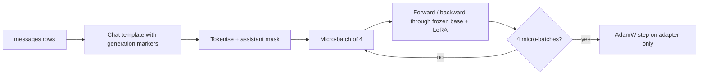

TRL's `SFTTrainer` wraps the Hugging Face `Trainer` with the parts SFT needs. It applies the chat template, builds the loss mask, optionally packs sequences, and wraps the model with your LoRA config. You give it a model, a dataset and an `SFTConfig`. Getting the run right mostly means choosing a dozen of those config fields well.

TRL reached v1.0 in March 2026, and this topic was checked against v1.17 (with transformers 5.x). Argument names do change between releases. Pin the versions that work for you, and when something breaks, read the `SFTConfig` reference for your installed version first.

## The fields that matter

| Field | Our value | Why |
|---|---|---|
| `learning_rate` | `2e-4` | LoRA needs about 10x the full-fine-tune rate. TRL's default of `2e-5` is far too low for adapters. |
| `num_train_epochs` | 3 (GPU), 2 (CPU) | Few thousand rows. Watch eval loss and stop early if it turns up. |
| `per_device_train_batch_size` | 4 | Sized to fit memory. |
| `gradient_accumulation_steps` | 4 | Sets the effective batch without extra memory. |
| `max_length` | 512 | From the p95 token length. Rows are pre-filtered, so nothing gets truncated. |
| `assistant_only_loss` | `True` | Loss only on the SQL, not on the schema and question. |
| `packing` | `False` | See below. |
| `fp16` / `bf16` | by hardware | See the precision table. |
| `gradient_checkpointing` | `True` (TRL default) | Trades about a third more compute for much less activation memory. |
| `eval_strategy`, `eval_steps` | `"steps"`, 25 | 15 eval points over the run. |
| `lr_scheduler_type`, `warmup_steps` | `"cosine"`, `0.05` | A float below 1 is read as a fraction of total steps. |

The **effective batch** is the number of examples behind each optimizer step:

$$B_{\text{eff}} = b_{\text{device}} \times g_{\text{accum}} \times n_{\text{GPU}} = 4 \times 4 \times 1 = 16.$$

Gradient accumulation runs four micro-batches of 4, adds up their gradients, and then takes one step. Memory is set by the micro-batch of 4, while the gradient averages over 16 examples. On a CPU you would use $2 \times 8 = 16$: the same effective batch, with a smaller memory peak.

**Assistant-only loss.** [Loss masking](/learn/fine-tuning/instruction-tuning/loss-masking) explains why the model should learn only from the answer tokens. With a conversational dataset, `assistant_only_loss=True` does this. It needs a chat template with `` markers. TRL ships patched templates for common families, Qwen2.5 among them, and swaps them in automatically. For other models, check the TRL chat-templates page. A prompt-completion dataset gets the equivalent, `completion_only_loss`, by default.

**Packing.** [Packing](/learn/fine-tuning/instruction-tuning/packing-and-hyperparameters) concatenates short examples into full-length rows to cut padding. In TRL v1.x the default packing strategy (`"bfd"`) turns on padding-free batching, which needs FlashAttention 2 or 3, and the T4 doesn't support those. Our rows are short and similar in length, so padding waste is modest anyway. Turn packing on when you have an Ampere or newer GPU and lengths that vary a lot.

| Hardware | Base weights | Mixed precision flag |
|---|---|---|
| CPU | fp32 | neither (`bf16=False`), plus `use_cpu=True` |
| T4 (Turing) | NF4, compute fp16 | `fp16=True`, `bf16=False` |
| A100, L4, RTX 30/40 (Ampere+) | NF4 or bf16 | `bf16=True` |

`SFTConfig` sets `bf16=True` by default unless you set `fp16`. On a T4 or a CPU you must override it.

## The full script

```python
# train_sql.py  -- pip install "trl==1.17.*" "peft" "transformers>=5" "datasets" "bitsandbytes" (GPU only)
import torch
from datasets import load_dataset
from peft import LoraConfig
from transformers import AutoModelForCausalLM, AutoTokenizer, BitsAndBytesConfig
from trl import SFTConfig, SFTTrainer

gpu = torch.cuda.is_available()
MODEL = "Qwen/Qwen2.5-1.5B-Instruct" if gpu else "Qwen/Qwen2.5-0.5B-Instruct"

data = load_dataset("json", data_files={"train": "sql_train.jsonl", "eval": "sql_eval.jsonl"})
data = data.remove_columns(["n_tok"])
if not gpu:                                         # CPU: a tenth of the data
    data["train"] = data["train"].select(range(400))
    data["eval"] = data["eval"].select(range(50))

tok = AutoTokenizer.from_pretrained(MODEL)
if gpu:
    bnb = BitsAndBytesConfig(load_in_4bit=True, bnb_4bit_quant_type="nf4",
                             bnb_4bit_use_double_quant=True, bnb_4bit_compute_dtype=torch.float16)
    model = AutoModelForCausalLM.from_pretrained(MODEL, quantization_config=bnb, device_map={"": 0})
else:
    model = AutoModelForCausalLM.from_pretrained(MODEL, dtype=torch.float32)

lora = LoraConfig(r=16, lora_alpha=32, lora_dropout=0.05, target_modules="all-linear", task_type="CAUSAL_LM")

args = SFTConfig(
    output_dir="qwen-sql-lora",
    num_train_epochs=3 if gpu else 2,
    per_device_train_batch_size=4 if gpu else 2,
    gradient_accumulation_steps=4 if gpu else 8,     # effective batch 16 either way
    per_device_eval_batch_size=8,
    learning_rate=2e-4,
    lr_scheduler_type="cosine",
    warmup_steps=0.05,                               # 5% of total steps
    max_length=512,
    assistant_only_loss=True,
    packing=False,
    fp16=gpu, bf16=False,                            # T4: fp16. Ampere+: set bf16=True, fp16=False
    use_cpu=not gpu,
    gradient_checkpointing=True,
    gradient_checkpointing_kwargs={"use_reentrant": False},
    logging_steps=5,
    eval_strategy="steps", eval_steps=25 if gpu else 10,
    save_strategy="steps", save_steps=25 if gpu else 10, save_total_limit=3,
    load_best_model_at_end=True, metric_for_best_model="eval_loss",
    report_to="none",
    seed=42,
)

trainer = SFTTrainer(model=model, args=args, train_dataset=data["train"],
                     eval_dataset=data["eval"], processing_class=tok, peft_config=lora)
trainer.model.print_trainable_parameters()

# Sanity check before training: decode only the tokens that carry loss. Expect just SQL + end token.
row = trainer.train_dataset[0]
mask = row.get("assistant_masks") or [int(l != -100) for l in row.get("labels", [])]
print(repr(tok.decode([t for t, m in zip(row["input_ids"], mask) if m])))

trainer.train()
trainer.save_model("qwen-sql-lora/final")           # saves the adapter only
```

The sanity check is the most useful line in the script. If the decoded string contains the schema or the system prompt, the mask is wrong and the model will spend most of its capacity learning to reproduce `CREATE TABLE` statements. If the string is empty, no token carries loss and training learns nothing. The column names of the prepared dataset can differ between TRL versions, so if neither key exists, print `row.keys()` and adapt the line.



## In practice

- Run with `max_steps=5` first and time it. Seconds per step times total steps gives the real duration, and it checks for memory errors before you commit to a long run.
- On Colab, set `output_dir` to a folder on mounted Google Drive, or the checkpoints disappear when the session ends. [Run Fine-Tuning Yourself](/learn/fine-tuning/run-fine-tuning-yourself) shows how.
- If you get out-of-memory errors, halve `per_device_train_batch_size` and double `gradient_accumulation_steps`. The maths is unchanged and the activation memory halves.

```bughunt
{"q":"This SFT run on the SQL data trains and the loss falls quickly, but the mask sanity check decodes the system prompt, the schema and the SQL. Click the line with the bug.","code":"lora = LoraConfig(r=16, lora_alpha=32, lora_dropout=0.05, target_modules=\"all-linear\", task_type=\"CAUSAL_LM\")\nargs = SFTConfig(\n    output_dir=\"qwen-sql-lora\",\n    per_device_train_batch_size=4,\n    gradient_accumulation_steps=4,                   # effective batch 16\n    learning_rate=2e-4,\n    max_length=512,\n    assistant_only_loss=False,\n    packing=False,\n    fp16=True, bf16=False,                           # T4\n    gradient_checkpointing=True,\n)\ntrainer = SFTTrainer(model=model, args=args, train_dataset=data[\"train\"],\n                     eval_dataset=data[\"eval\"], processing_class=tok, peft_config=lora)","bug":8,"explain":"Line 8: `assistant_only_loss=False` puts the loss on every token of the conversation, so most of the gradient goes into reproducing the system prompt and the `CREATE TABLE` statements rather than the SQL answer. The run looks healthy, and the loss even falls fast on the repetitive schema text, but the model is being trained to write prompts. Fix: `assistant_only_loss=True` (with a chat template that has `` markers, which TRL swaps in for Qwen2.5), then re-run the sanity check until it prints only the SQL and the end token."}
```

```quiz
{"q": "You run on 2 GPUs with `per_device_train_batch_size=2` and `gradient_accumulation_steps=8`. What is the effective batch size?", "options": ["32", "16", "4", "20"], "answer": 0, "explain": "$B_{\\text{eff}} = 2 \\times 8 \\times 2 = 32$. 16 forgets that each of the two GPUs processes its own micro-batches; the gradients from both are averaged in each step."}
```

```quiz
{"q": "Your mask sanity check prints the system prompt, the schema and the SQL. What should you fix?", "options": ["The loss mask: assistant-only loss is not in effect, so check `assistant_only_loss` and the chat template's generation markers", "The learning rate, which is too high", "Nothing; the model needs to see the prompt", "The LoRA rank, which is too small"], "answer": 0, "explain": "Those are the tokens that carry loss, so the model is being trained to generate prompts. The model still *reads* the prompt in the forward pass when masking works; masking only removes it from the loss. Learning rate and rank do not affect which tokens are supervised."}
```
