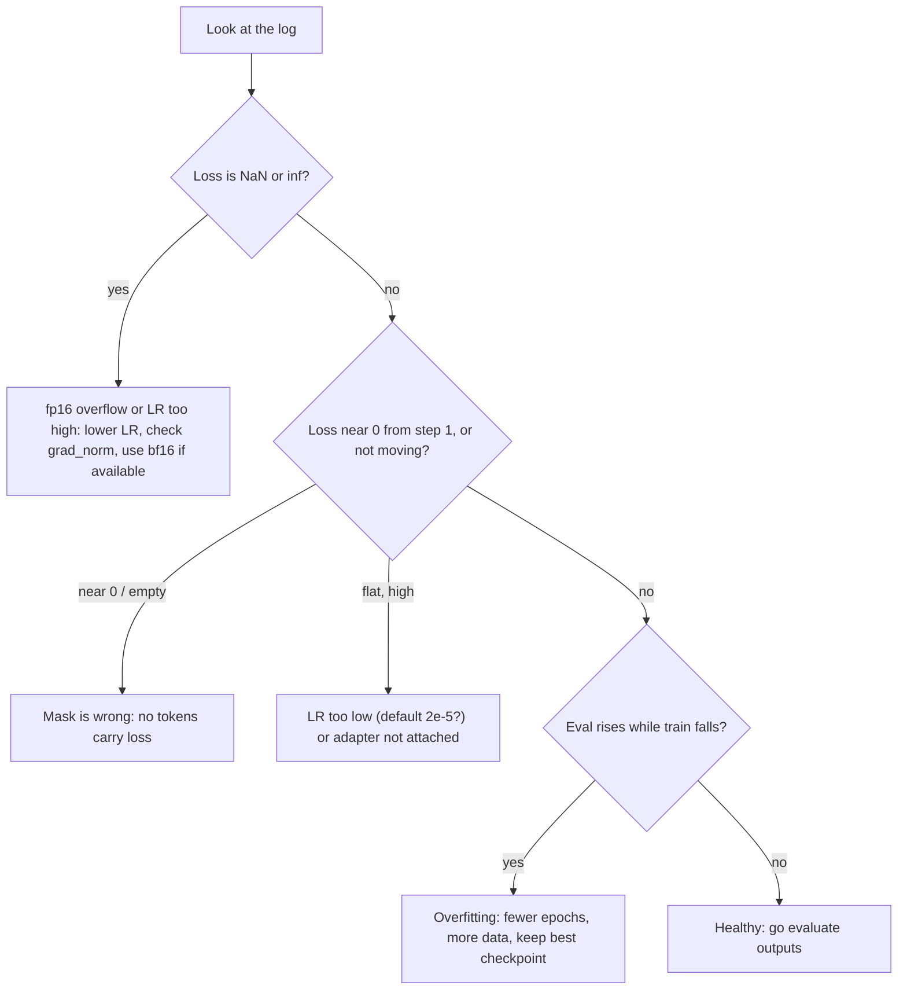

While the run goes, the trainer prints a stream of numbers: `loss`, `grad_norm`, `learning_rate`, `mean_token_accuracy`, and every 25 steps an `eval_loss`. Reading this log is how you notice a broken run after five minutes instead of after three hours. You don't need to read every number. Focus on the shape of two curves and a few warning signs.

The **training loss** is the mean cross-entropy over the assistant tokens in the recent micro-batches. The **eval loss** is the same quantity on the 200 rows the model never trains on. Training loss always keeps falling if you train long enough, because the model can memorise. Eval loss is the one that tells you whether the model is learning the task.

## In everyday life

A batter spends the week in the nets facing the same few bowlers. Scores in the nets keep going up, because the batter learns their habits. On Saturday there is a match against bowlers never seen before. If match scores stop improving while net scores keep climbing, the batter has learned those bowlers, not the game.

Reading a training run is the same check. The **training loss** is a score for how wrong the model is on the examples it practises on, and lower is better. The **eval loss** is the same score on examples it never practises on. Training loss nearly always keeps falling, because the model can memorise. Eval loss tells you whether real learning is happening. One full pass through all the examples is an **epoch**, and a small drop in training loss right after a pass ends is normal, since the second round of the same drills feels easier. Spikes, a loss that turns into not-a-number, or a loss stuck where it began are warning signs, often of a learning rate that is wrong or a marking setup that is broken. A **checkpoint** is a saved copy of the model during training, so you can keep the one from the best week.

Unlike a batter, the model cannot feel that it is overdoing it, so the log is your only warning.

**Where you meet it.** A team fine-tuning a support model glances at the log after five minutes and sees the loss stuck at its starting value. They stop the run, find the learning rate was left at the wrong default, and save hours of GPU time.

```scene
title: Net practice versus the Saturday match
step: 🏏 A batter practises against the same few bowlers in the nets | training examples
step: 📈 Net scores climb each day as habits are learned | training loss falls
step: 🆕 On Saturday comes a match against bowlers never seen | eval loss on unseen rows
step: 🔄 After the first full round of drills, net scores jump | drop at the epoch boundary
step: 🚨 Net scores still climb but match scores flatten or slip | overfitting
step: ✅ The coach picks the week when match form was best | best checkpoint
takeaway: Watch eval loss, not just training loss: one shows learning, while the other can also show plain memorising.
```

## Counting steps before you start

If you know how many optimizer steps the run will take, the log is easier to read: you know where epoch boundaries fall and when each eval comes. With $N_{\text{train}}$ examples and effective batch $B_{\text{eff}}$:

$$S_{\text{epoch}} = \left\lceil \frac{N_{\text{train}}}{B_{\text{eff}}} \right\rceil, \qquad S_{\text{total}} = E \cdot S_{\text{epoch}}.$$

**Worked example (GPU path).** $N_{\text{train}} = 2{,}000$ and $B_{\text{eff}} = 16$ give $S_{\text{epoch}} = 125$. Three epochs make $S_{\text{total}} = 375$ steps. A warmup of 5% is $0.05 \times 375 \approx 19$ steps. Evals every 25 steps give 15 eval points, and the epoch boundaries fall at steps 125 and 250. Each step reads about $16 \times 230 = 3{,}680$ tokens. At an illustrative 2.8 s per step on a T4, the run takes $375 \times 2.8 \approx 1{,}050$ s, close to the 17-minute FLOP estimate from the first topic.

The CPU path has $400 / 16 = 25$ steps per epoch and 50 in total. At 15 to 25 s per step, that is 12 to 20 minutes.

Loss converts to something you can picture. An eval loss of 0.35 nats per token means the model gives the correct next SQL token an average probability of about $e^{-0.35} \approx 0.70$, a perplexity of 1.42. SQL is very predictable, so losses this low are normal for this task. For open-ended chat you would see values from 1 to 2.

## What the curves look like

A healthy run on this task looks roughly like the following (numbers shaped like a real run, rounded):

| Step | Train loss | Eval loss | What is happening |
|---|---|---|---|
| 5 | 1.45 | — | The base already writes SQL but with extra prose |
| 25 | 0.62 | 0.58 | Format learnt: answers are bare SQL |
| 125 | 0.38 | 0.41 | End of epoch 1 |
| 130 | 0.29 | — | Drop at the epoch boundary: the model has seen these rows |
| 250 | 0.24 | 0.40 | End of epoch 2: eval is flat |
| 375 | 0.15 | 0.44 | Eval rising: overfitting |

The step down in training loss right after each epoch boundary is the classic SFT signature. The model is now seeing rows it has already trained on, so it predicts them better, but that gain doesn't carry over to the eval set. The gap between train and eval loss widens. Here the best checkpoint is around step 250, and `load_best_model_at_end=True` will pick it. [Packing and hyperparameters](/learn/fine-tuning/instruction-tuning/packing-and-hyperparameters) has more on overfitting in SFT.

```sim
lr-schedule
{"schedule": "cosine", "peakLr": 0.0002, "warmupSteps": 50, "totalSteps": 1000, "minLrRatio": 0}
```

The sim is a toy loss model, not our run, but it shows the same dynamics. Raise the peak learning rate from 2e-4 to 3e-3 and watch the unstable-steps counter climb. Then set warmup to 0 at that high rate: the early spike gets worse. Back at 2e-4, switch to **constant** and see that the curve never gets the final drop that a decaying schedule gives.

## Failure signatures



- **Spikes and large `grad_norm`.** If the gradient norm jumps from about 0.5 to 20, and the loss jumps with it, the learning rate is too high. Gradient clipping (`max_grad_norm=1.0` by default) limits the damage, but a run that spikes often ends worse. Halve the LR.
- **NaN.** On a T4 the usual cause is fp16 overflow: fp16 tops out at 65,504, so large activations or a high LR push values past it. Lower the LR, or use a GPU with bf16. Once a run has gone NaN it doesn't recover. Restart it from the last good checkpoint.
- **Loss reads exactly 0 or NaN from the first step.** No token carries loss, almost always because of the mask. Go back to the sanity check in the previous topic.
- **Loss barely moves.** Check that you set `learning_rate`. TRL's default is `2e-5`, tuned for full fine-tuning, and at that rate a LoRA adapter learns very slowly.

## In practice

- Keep `logging_steps` small (5) for the first run, so you see trouble early.
- `mean_token_accuracy` is a useful sanity number. On SQL it should climb above 0.9. A model that predicts 90% of tokens can still get only 60% of queries right, though, because a single wrong token breaks a query.
- Low eval loss doesn't mean the task is done. It measures token likelihood, not whether queries run. The next topic measures that.

```quiz
{"q": "You train on 3,000 examples with $B_{\\text{eff}} = 32$ for 2 epochs. How many optimizer steps is that?", "options": ["188", "94", "6,000", "375"], "answer": 0, "explain": "$S_{\\text{epoch}} = \\lceil 3{,}000 / 32 \\rceil = \\lceil 93.75 \\rceil = 94$, and $2 \\times 94 = 188$. 94 is one epoch; 6,000 counts examples seen, not optimizer steps."}
```

```quiz
{"q": "Train loss drops sharply right after step 125 (the end of epoch 1) while eval loss stays flat. What does that mean?", "options": ["The model is starting to memorise rows it has seen; the extra gain does not generalise", "The learning rate warmup just finished", "The eval set is broken", "The model has generalised better in epoch 2"], "answer": 0, "explain": "At the boundary the model meets rows it trained on, so its loss on them falls, but eval loss, measured on unseen rows, does not follow. Warmup ended around step 19, long before; and a real generalisation gain would show up in eval loss too."}
```
