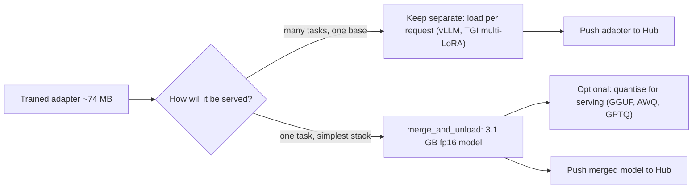

When training finishes, `trainer.save_model(...)` writes only the adapter: an `adapter_config.json`, which records the base model, rank, alpha and targets, and an `adapter_model.safetensors` file with the $A$ and $B$ matrices. The base weights aren't copied. That makes the adapter small, and it means the adapter is useless without the exact base model it was trained on.

From there you have two ways to ship it. Keep it **separate** and load it on top of the base at run time. That costs a little latency, but one base can serve many adapters. Or **merge** it, folding $\frac{\alpha}{r}BA$ into $W$ to get an ordinary model with no PEFT dependency and no extra latency. [Merging an adapter](/learn/fine-tuning/peft-lora/adapters-in-practice) derives why the merge is exact.

## Sizes on disk

The adapter's size is its parameter count times the bytes per stored value. PEFT keeps the trainable adapter weights in fp32 during training and saves them that way by default. With $P_{\text{lora}}$ adapter parameters and $N$ base parameters:

$$\text{adapter} \approx 4\,P_{\text{lora}} \text{ bytes}, \qquad \text{merged (16-bit)} \approx 2N \text{ bytes}.$$

**Worked example.** For Qwen2.5-1.5B at $r = 16$ on all linear layers, $P_{\text{lora}} = 18{,}464{,}768$. The adapter is about $4 \times 18.46\text{M} = 73.9$ MB, or 36.9 MB if you cast it to bf16. A merged fp16 model with $N = 1.54 \times 10^9$ is $2 \times 1.54 = 3.1$ GB. The adapter is about 2.4% of that. Ten task adapters for one base take 740 MB, while ten merged models take 31 GB. On the CPU path, the 0.5B adapter is $4 \times 8.8\text{M} \approx 35$ MB.

## Load, merge, push

```python
import torch
from peft import PeftModel
from transformers import AutoModelForCausalLM, AutoTokenizer

MODEL = "Qwen/Qwen2.5-1.5B-Instruct"      # must be the base the adapter was trained on
ADAPTER = "qwen-sql-lora/final"

# 1. Load the base in 16-bit, NOT 4-bit: merging into NF4 weights would re-quantise and lose the update.
base = AutoModelForCausalLM.from_pretrained(MODEL, dtype=torch.float16)   # CPU is fine for merging
tok = AutoTokenizer.from_pretrained(MODEL)

# 2. Attach the adapter (separate deployment stops here) and share it before merging,
#    because merging rewrites the layers in place. Run `hf auth login` first; start private.
model = PeftModel.from_pretrained(base, ADAPTER)
model.push_to_hub("your-username/qwen2.5-1.5b-sql-lora", private=True)     # adapter only, ~74 MB

# 3. Merge: W <- W + (alpha/r) B A in every adapted layer. Not in place: keep the return value.
merged = model.merge_and_unload()
merged.save_pretrained("qwen-sql-merged")      # ~3.1 GB of safetensors
tok.save_pretrained("qwen-sql-merged")

# 4. Share the merged model if you want it on the Hub (run `hf auth login` first; start private).
# merged.push_to_hub("your-username/qwen2.5-1.5b-sql-merged", private=True); tok.push_to_hub(...)

# 5. Run the merged model like any other.
from transformers import pipeline
gen = pipeline("text-generation", model="qwen-sql-merged", tokenizer=tok)
msgs = [{"role": "system", "content": "Write one SQLite query that answers the question. Output only SQL."},
        {"role": "user", "content": "Schema:\nCREATE TABLE t (x INT);\n\nQuestion: How many rows are in t?"}]
print(gen(msgs, max_new_tokens=50, do_sample=False)[0]["generated_text"][-1]["content"])
```

After merging, re-run a handful of test prompts and check that the merged model gives the same outputs as base-plus-adapter. Greedy outputs should match token for token, apart from rare fp16 rounding differences. If they don't, you probably loaded the wrong base, or a different revision of it.

If you trained with QLoRA, the adapter learned to correct a 4-bit base. Merging into the 16-bit base gives a model that is very close but not identical to what you evaluated. Evaluate the merged model again before you ship it.



## Sharing responsibly

A Hub repository needs a model card. Write down the base model and its license, the dataset (gretelai/synthetic_text_to_sql is Apache-2.0) and its license, the exact `LoraConfig` and `SFTConfig`, the library versions, and your test scores with the base model as a baseline. The adapter inherits the base model's license terms, so read them before you publish. Start every repository as private and make it public only after you have checked what it contains. If you want to serve the merged model cheaply, the [quantization](/learn/inference-and-serving/quantization) lesson covers 4-bit inference formats.

## In practice

- Keep the adapter even after you merge. It is small, and if you ever need to fix the merged model you will want to retrain or re-merge from the adapter.
- Record the base model's revision (commit hash) in the model card. Adapters trained on one revision can behave subtly differently on another.
- For a demo, keep the adapter separate and load it with `PeftModel.from_pretrained`. For a product with one task, merge it, quantise it, and serve the result as an ordinary model.

```parsons
{"title":"Order the steps to share the adapter, merge it and run the merged model","lines":["base = AutoModelForCausalLM.from_pretrained(MODEL, dtype=torch.float16)","model = PeftModel.from_pretrained(base, ADAPTER)","model.push_to_hub(\"your-username/qwen2.5-1.5b-sql-lora\", private=True)","merged = model.merge_and_unload()","merged.save_pretrained(\"qwen-sql-merged\")","gen = pipeline(\"text-generation\", model=\"qwen-sql-merged\", tokenizer=tok)","print(gen(msgs, max_new_tokens=50, do_sample=False)[0][\"generated_text\"][-1][\"content\"])"],"explain":"Load the base in 16-bit (merging into NF4 weights would re-quantise away the update), then attach the adapter. Push the adapter before merging, because `merge_and_unload` folds $\\frac{\\alpha}{r}BA$ into the layers in place and the separate adapter is gone afterwards. Keep its return value, save that folder, and only then can `pipeline` load the merged model by path."}
```

```quiz
{"q": "An adapter has 30M parameters saved in fp32. A merged 7B model is saved in bf16. Roughly what are the two sizes?", "options": ["120 MB and 14 GB", "60 MB and 7 GB", "30 MB and 28 GB", "120 MB and 28 GB"], "answer": 0, "explain": "Adapter: $4 \\times 30\\text{M} = 120$ MB. Merged: $2 \\times 7 \\times 10^9 = 14$ GB. 28 GB would be fp32 for the merged model; the merged model is normally saved in 16-bit."}
```

```quiz
{"q": "Why load the base model in 16-bit rather than 4-bit before calling `merge_and_unload`?", "options": ["Merging into 4-bit weights forces a re-quantisation that rounds away much of the small LoRA update", "4-bit models cannot be loaded with PEFT", "16-bit merges run faster on a GPU", "The adapter is stored in 4-bit and must match"], "answer": 0, "explain": "The update $\\frac{\\alpha}{r}BA$ is small next to $W$; after adding it, the result has to be stored back on the coarse NF4 grid, which rounds away much of the change. PEFT loads adapters on 4-bit bases fine (that is QLoRA), and the adapter itself is fp32, not 4-bit."}
```
