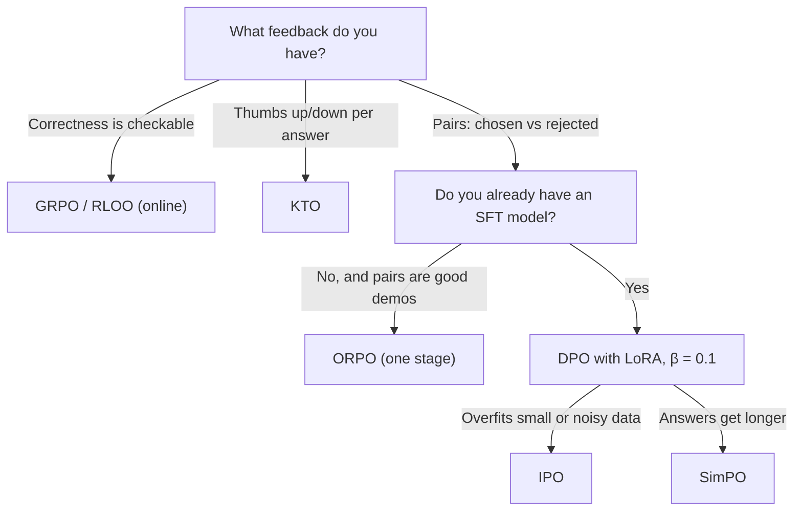

With six or seven methods on the table, the choice can look like a research project. It rarely is. Three questions settle it in most cases: what feedback you have, how much GPU memory you have, and what you are trying to change. Then comes the part that decides whether any of it mattered, which is evaluating the tuned model against the one you started from.

## In everyday life

A travel agency has a new way of writing trip plans and wants to know if it is really better than the old way. It gives reviewers the same trip request, answered both ways, with the writers' names hidden. Reviewers tend to like a thick, detailed plan, so the agency checks whether the new plans simply got longer. It also swaps which plan is shown first, because the first one gets a small edge.

Choosing and checking a preference method follows the same habits. First you pick a method from the feedback you have: pairs, thumbs, or answers a program can check. **DPO** with **LoRA**, a light way to train just a small add-on, is the usual first try. Then you test. The standard test is the **win rate**: show a judge the old model's answer and the new model's answer to the same prompt, and count how often the new one wins, with a tie counting as half a win. A judge, whether a person or a strong model, often favours longer answers, so also compare answers of similar length. Finally, keep a fixed set of real prompts and probes that you never train on, and check that things like JSON formatting still work.

The agency picture stops at scale: a model test needs hundreds of prompts, not a few trips, to give a steady result.

**Where you meet it.** A team tunes its assistant and sees the win rate climb. Then it notices the answers are much longer and some JSON replies break. A length-matched comparison and fixed probes show the gain was mostly length, so the team does not ship that checkpoint.

```scene
title: Judging two trip-planning methods
step: 🧭 The agency picks its method from the feedback it has | decision flow by data type
step: 🗺 The same trip request is answered the old way and the new way | SFT model versus tuned model
step: 🙈 Reviewers see anonymous plans, shown in both orders | judge with swapped order
step: 🏆 Count how often the new plan wins, ties as half | win rate
step: 📏 Reviewers love thick plans, so compare similar lengths | length-matched win rate
step: 🔒 A fixed set of real requests is never used for training | held-out evaluation set
takeaway: Pick the method from your feedback, then prove it worked with a fair, length-aware win rate on prompts you never trained on.
```

## The decision flow



The flow encodes a few rules of thumb:

- **Data decides first.** A method that needs pairs is useless if you have thumbs; converting thumbs to pairs throws most of the data away. If a program can check the answer, online RL learns things no fixed dataset contains; see [GRPO hands-on](/learn/fine-tuning/grpo-hands-on).
- **DPO is the baseline.** It is the best understood, best supported and easiest to debug. Switch only when it shows a specific problem.
- **Memory decides second, and mostly for full fine-tuning.** With LoRA every offline method fits in about the same memory. Without LoRA, the reference-free methods (ORPO, SimPO, CPO) save the reference model's 2 bytes per parameter and its forward pass.
- **Goals decide the variant.** Too verbose after DPO: SimPO. Small, noisy or once-labelled data: IPO. One run from a base model: ORPO.

| Goal | First choice | Why |
|---|---|---|
| Tone, helpfulness, format, from pairs | DPO | Stable, two knobs, strong default |
| The same, but DPO made answers long | SimPO | Length-normalised reward, target margin |
| Learn from product feedback | KTO | Uses unpaired, imbalanced labels |
| Cheapest single run from a base model | ORPO | SFT and preference in one stage |
| Maths, code, tool use with checkers | GRPO or RLOO | Online, verifiable reward |

## Did it work? Win rate against the SFT model

The training loss tells you the model fits the pairs. It does not tell you the model is better. The standard check is a **pairwise win rate**: generate answers from the SFT model and the tuned model on a held-out set of prompts, show both to a judge (people, or a strong model as in [LLM as a judge](/learn/evaluation/llm-as-judge)), and count. With $W$ wins, $T$ ties and $n$ prompts:

$$
\text{win rate} = \frac{W + T/2}{n}, \qquad \text{SE} \approx \sqrt{\frac{p(1 - p)}{n}}
$$

where $p$ is the win rate and SE its standard error (treating ties as half-wins makes this approximate).

```steps
Reading a win rate
200 held-out prompts. The judge says the DPO model wins 112, ties 20, loses 68. Win rate $= (112 + 10)/200 = 0.61$.
---
Standard error $\sqrt{0.61 \times 0.39 / 200} = 0.034$. A 95% interval is about $0.61 \pm 1.96 \times 0.034$, i.e. 54% to 68%. Clearly above 50%, but only roughly measured.
---
Now the lengths: SFT answers average 210 tokens, DPO answers 380, a ratio of 1.8. LLM judges favour longer answers, so part of that 61% may be length, not quality.
---
Length check: keep only the 70 pairs where the two answers are within 20% of each other in length. If the win rate there is still near 60%, the gain is real; if it falls to 50%, the model mostly learned to write more.
```

That last step is the idea behind **length-controlled win rates** (AlpacaEval 2's LC metric fits a regression that removes the effect of the length difference). Also judge both orders of each pair, since judges favour the answer shown first.

```python
import math

def win_rate_report(results, len_a, len_b, band=0.2):
    """results: 'win'/'tie'/'loss' for model A (tuned) vs B (SFT), one per prompt."""
    n = len(results)
    p = (results.count("win") + 0.5 * results.count("tie")) / n
    se = math.sqrt(p * (1 - p) / n)
    # Length-matched subset: answers within +-20% of each other's length.
    matched = [r for r, a, b in zip(results, len_a, len_b) if abs(a - b) <= band * max(a, b)]
    p_m = (matched.count("win") + 0.5 * matched.count("tie")) / max(1, len(matched))
    ratio = sum(len_a) / sum(len_b)
    print(f"win rate {p:.2f} +- {1.96*se:.2f}  | length ratio {ratio:.2f}"
          f"  | length-matched win rate {p_m:.2f} on {len(matched)} pairs")
```

```sim
judge-agreement
{"accuracy": 0.8, "positionBias": 0.1, "verbosityBias": 0.6, "tieBand": 0.1, "swapAverage": true, "seed": 7}
```

This judge is decent (80% accurate) but has a strong pull toward longer answers. Read the "Longer wins" metric: how often the longer answer wins when people preferred the shorter one. Lower the verbosity bias to 0 and watch agreement rise. If your tuned model's answers are longer, a judge like this will inflate its win rate; length-matched comparisons are the cheap guard.

## Common failures

| Symptom | Likely cause | Fix |
|---|---|---|
| Answers much longer, win rate falls on length-matched pairs | Length bias in data or judge, summed rewards | SimPO, length-balanced pairs, or a smaller learning rate |
| Train `rewards/accuracies` near 1, eval flat | Overfitting the pairs | One epoch, larger $\beta$, IPO |
| Chosen log-probability collapses | Likelihood displacement | Add an SFT term, raise $\beta$ |
| Fluent but wrong, more agreeable to wrong user claims | Preference data rewards confidence and agreement | Audit pairs, add factuality and sycophancy probes to the eval |
| JSON or code formatting breaks | Too large a step away from the SFT model | Lower learning rate; reference-based method |
| Win rate rises against the training judge, falls with people | Over-optimisation of a proxy | Different judge for eval, early stopping |

Most of these are the same phenomenon seen from different angles: optimising a proxy for quality until it stops tracking quality. [Reward hacking and over-optimisation](/learn/fine-tuning/preference-tuning/reward-hacking-and-overoptimisation) covers the theory; the practical defence is a fixed evaluation suite you never train on.

## In practice

Keep an evaluation set of 200 to 500 prompts drawn from real traffic, plus 20 to 50 targeted probes (refusals that should not happen, structured output, factual questions where agreeing with the user is wrong). Run it on the SFT model once and on every preference checkpoint, and record win rate, length ratio and the probe pass rates side by side. A preference run that raises win rate by 10 points while doubling length and breaking JSON is a regression.

```quiz
{"q": "On 400 prompts a tuned model wins 220, ties 40 and loses 140 against the SFT model. What is the win rate and roughly its 95% interval?", "options": ["0.60, about 0.55 to 0.65", "0.55, about 0.50 to 0.60", "0.60, about 0.59 to 0.61", "0.65, about 0.60 to 0.70"], "answer": 0, "explain": "$(220 + 20)/400 = 0.60$. SE $= \\sqrt{0.6 \\times 0.4 / 400} \\approx 0.0245$, so $\\pm 1.96 \\times 0.0245 \\approx \\pm 0.048$. 0.55 counts ties as losses; the narrow interval forgets the square root."}
```

```quiz
{"q": "You have 30,000 thumbs-up/down ratings on single answers and an existing SFT model on one 24 GB GPU. Which is the most natural first method?", "options": ["KTO with LoRA", "PPO with a reward model trained on the ratings", "DPO on the ratings as they are", "ORPO from the base model"], "answer": 0, "explain": "KTO uses unpaired binary labels directly and, with LoRA, fits the same memory as DPO. DPO needs chosen and rejected answers to the same prompt, which these ratings mostly are not. PPO needs four models and far more memory. ORPO also needs pairs, and would discard the SFT model you already have."}
```
