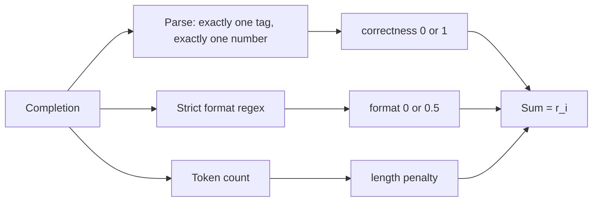

In GRPO the reward function is the whole specification of what you want. The model never sees your intentions, only the numbers your function returns, and it will find the cheapest way to make those numbers go up. Writing a reward function is closer to writing a test suite for an adversary than to writing a metric.

For a maths task such as **GSM8K** (Cobbe et al., 2021: grade-school word problems whose reference answers end in `#### <number>`), two signals are standard. A **correctness reward** parses the model's final answer and compares it with the reference. A **format reward** checks that the output follows the layout you asked for, for example reasoning followed by the answer inside `<answer>...</answer>` tags. The format reward is a scaffold: early on, a small instruct model rarely gets both right, and rewarding the format alone gives the group some variance to learn from.

## In everyday life

Think of a school exam with a marking scheme: ten marks for the right answer, two marks for neat working. The scheme is all the students ever see. They never learn what the teacher really hoped for, only what earns marks. Clever students find the gaps. If any circled answer earns full marks, someone circles three numbers and hopes one is right.

A **reward function** is that marking scheme, written as a small program. It reads the model's answer and returns a number. A **correctness reward** checks the final answer against the known one. A **format reward** checks that the answer follows the layout you asked for, such as the answer inside tags. The model takes any shortcut the program allows, a habit called **reward hacking**, so the rules must be tight. Neatness marks must also stay small next to the marks for being right, or a tidy wrong answer starts to look as good as a right one. Unlike a human marker, the program has no common sense: it rewards exactly what it was written to reward.

**Where you meet it.** A team teaching a small model to solve word problems might write a checker that accepts the last number in the answer. The model then learns to list several candidates, the training score climbs, and real accuracy does not. Demanding exactly one number closes the loophole.

```scene
title: The exam marking scheme
step: 📝 The teacher writes a scheme: marks for the right answer, a few for neat layout | correctness and format rewards
step: 🎓 Students see only the marks, never the teacher's hopes | the reward is the only signal
step: 🎯 One student circles several answers, since any circle earns marks | reward hacking through a loophole
step: 🔒 The teacher rewrites it: exactly one circled answer, or zero | exactly one number in one tag
step: ⚖️ Neatness marks stay small beside marks for being right | format weight below correctness
takeaway: The model chases whatever the checker rewards, so write the checker as if it were for a clever opponent.
```

## The maths: summing components

TRL calls each reward function on the whole batch and adds the results, optionally weighted:

$$
r_i = \sum_{k} w_k \, f_k(o_i), \qquad \hat A_i = \frac{r_i - \mu}{\sigma}
$$

$f_k$ is the $k$-th reward function, $w_k$ its weight (`reward_weights` in `GRPOConfig`, all 1.0 by default) and $o_i$ the $i$-th completion. Because advantages are normalised within the group, only the differences between completions matter, so the relative size of the weights is what shapes behaviour.

Worked example, one group of four with correctness worth 1.0, strict format 0.5 and a length penalty of $-0.001$ per token beyond 200:

| Completion | Correct | Format | Tokens | $r_i$ |
|---|---|---|---|---|
| 1 | 1.0 | 0.5 | 180 | 1.50 |
| 2 | 1.0 | 0.0 | 150 | 1.00 |
| 3 | 0.0 | 0.5 | 400 | 0.30 |
| 4 | 0.0 | 0.0 | 120 | 0.00 |

$\mu = 2.8/4 = 0.70$. Deviations $(0.80, 0.30, -0.40, -0.70)$; squares sum to $0.64 + 0.09 + 0.16 + 0.49 = 1.38$, so $\sigma = \sqrt{0.345} \approx 0.587$. Advantages $(+1.36, +0.51, -0.68, -1.19)$. The ordering is exactly what we want: right and tidy, right but untidy, tidy but wrong and long, wrong. Had format been worth 1.0, completion 3 would have scored 0.8 against completion 2's 1.0, and a wrong answer would sit almost level with a right one. Keep format rewards well below correctness.

## The functions, in TRL's signature

A TRL reward function receives keyword arguments: `prompts`, `completions`, `completion_ids`, plus every extra dataset column by name (here `ground_truth`), and newer versions add things such as `trainer_state`. It returns one float per completion, or `None` for a completion the function does not apply to. Always accept `**kwargs` so new arguments do not break you. With a conversational dataset each completion is a list of messages, so the text is `completion[0]["content"]`.

```python
import re

ANSWER_RE = re.compile(r"<answer>\s*(.*?)\s*</answer>", re.DOTALL)
NUMBER_RE = re.compile(r"-?\d+(?:\.\d+)?")

def _text(completion):
    # Conversational datasets give [{"role": "assistant", "content": "..."}]; plain ones give a string.
    return completion[0]["content"] if isinstance(completion, list) else completion

def _to_number(s):
    s = s.replace(",", "").replace("$", "").strip()
    nums = NUMBER_RE.findall(s)
    # Guard against hedging: "12 or 14" must not count. Exactly one number, or no credit.
    return float(nums[0]) if len(nums) == 1 else None

def correctness_reward(completions, ground_truth, **kwargs):
    rewards = []
    for c, gt in zip(completions, ground_truth):
        tags = ANSWER_RE.findall(_text(c))
        if len(tags) != 1:                 # zero or several answer blocks: no credit
            rewards.append(0.0)
            continue
        pred = _to_number(tags[0])
        rewards.append(1.0 if pred is not None and abs(pred - float(gt)) < 1e-6 else 0.0)
    return rewards

STRICT_RE = re.compile(r"^\s*\S.{20,}?\s*<answer>[^<]+</answer>\s*$", re.DOTALL)

def format_reward(completions, **kwargs):
    # Some reasoning text (at least ~20 characters), then exactly one answer block at the very end.
    return [0.5 if STRICT_RE.match(_text(c)) and _text(c).count("<answer>") == 1 else 0.0
            for c in completions]

def length_penalty(completion_ids, **kwargs):
    # -0.001 per token beyond 200; completion_ids are lists of token ids.
    return [-0.001 * max(0, len(ids) - 200) for ids in completion_ids]
```

GSM8K's reference is the text after `####`, so the dataset mapping in the next topic stores `ground_truth = answer.split("####")[-1].strip().replace(",", "")`.

## Partial credit, and when not to give it

A **soft format reward** (0.25 if an `<answer>` tag appears anywhere) helps when strict format starts at 0% and every group ties. A partial correctness reward, such as credit for a number within 1% of the truth, is tempting but usually wrong for GSM8K: answers are exact integers, and closeness rewards sloppy arithmetic. Partial credit makes sense where quality is genuinely graded, for example the fraction of unit tests passed in a coding task.

## Reward hacking, and the guards

Every gap in the checker becomes a behaviour. The general theory is in [Reward hacking and over-optimisation](/learn/fine-tuning/preference-tuning/reward-hacking-and-overoptimisation); these are the GSM8K versions.

| Exploit the model finds | Guard |
|---|---|
| Lists several candidates: `<answer>12 or 14</answer>` | Require exactly one number in exactly one tag |
| Empty reasoning, just the tag, to collect format reward cheaply | Require some text before the tag; keep format reward small |
| Rambles to the token limit; truncated outputs score 0 anyway | Length penalty, or `mask_truncated_completions=True` |
| Repeats the question's numbers until one matches | Parse only the tagged answer, never the whole text |
| Writes `<answer>` tags inside the reasoning | Count tags; the final one must end the output |



## In practice

Test reward functions before training: feed them a dozen hand-written completions (correct, wrong, hedged, untagged, truncated) and check every number. A bug here costs hours of GPU time and teaches the model the bug. TRL logs each function separately (`rewards/correctness_reward/mean` and so on), which is the first place a hack shows: format reward climbs to its maximum while correctness stays flat. Finally, read 20 random completions every few hundred steps. Numbers tell you something changed; samples tell you what.

```bughunt
{"q":"During GRPO on GSM8K, `rewards/correctness_reward/mean` climbs to 0.8, but held-out greedy accuracy barely moves and the logged completions end in things like `<answer>12 or 14</answer>`. Click the line with the bug.","code":"def _to_number(s):\n    s = s.replace(\",\", \"\").replace(\"$\", \"\").strip()\n    nums = NUMBER_RE.findall(s)\n    return float(nums[-1]) if nums else None\ndef correctness_reward(completions, ground_truth, **kwargs):\n    rewards = []\n    for c, gt in zip(completions, ground_truth):\n        tags = ANSWER_RE.findall(_text(c))\n        if len(tags) != 1:                 # zero or several answer blocks: no credit\n            rewards.append(0.0)\n            continue\n        pred = _to_number(tags[0])\n        rewards.append(1.0 if pred is not None and abs(pred - float(gt)) < 1e-6 else 0.0)\n    return rewards","bug":4,"explain":"Line 4 takes the last number in the tag whenever there is at least one, so a hedged answer that lists several candidates earns full credit when the last one happens to be right. Hedging raises the expected reward, so GRPO learns to hedge, and the training reward climbs while real accuracy does not. Fix: `return float(nums[0]) if len(nums) == 1 else None`, exactly one number or no credit."}
```

```quiz
{"q": "Correctness is worth 1.0 and format 1.0. Your correctness check accepts the last number in the text, tagged or not. In a group, completion A is right but ignores the format ($r = 1.0$) and completion B follows the format but is wrong ($r = 1.0$). What does GRPO learn from this pair?", "options": ["Nothing distinguishes them: equal rewards give equal advantages", "It prefers the correct one, because correctness is checked first", "It prefers the tagged one, because format is easier", "It learns both, because the rewards are summed"], "answer": 0, "explain": "Advantages depend only on the summed reward, so two completions with $r = 1.0$ get the same $\\hat A$ no matter how they earned it. Order of evaluation does not matter. The fix is to make format worth much less than correctness, for example 0.5 or 0.2."}
```

```quiz
{"q": "Which reward function signature is safest with TRL's `GRPOTrainer`?", "options": ["`def f(completions, ground_truth, **kwargs)`", "`def f(prompt, completion)` called once per sample", "`def f(completions)` returning one float for the whole batch", "`def f(**kwargs)` returning a tensor of logits"], "answer": 0, "explain": "TRL passes batches as keyword arguments (`prompts`, `completions`, `completion_ids`, dataset columns such as `ground_truth`, and more) and expects a list with one float (or `None`) per completion. `**kwargs` absorbs arguments you do not use. A single float for the batch would give every completion the same reward."}
```
