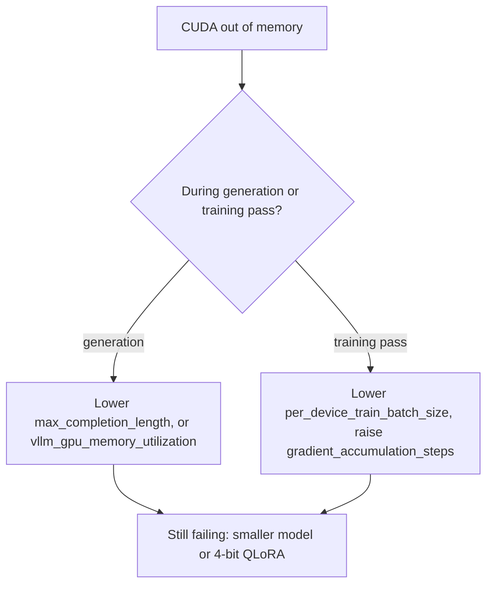

A free Colab T4 has a 16 GB card with roughly 15 GB usable, no fast bf16, and a session that can end after a few hours (Google does not guarantee any of this; as of late 2026 it is what you usually get). GRPO is both a training job and an inference job inside one loop, so its memory bill has items that SFT does not: a KV cache for $G$ completions at once, and a logits tensor that is huge for models with big vocabularies. Do the sum before you press run.

## In everyday life

Before a flight you weigh your bags. The big suitcase is always there and takes most of the allowance. On top of it come the small things that get forgotten: the cabin bag, the water bottle, the shopping you picked up on the way. If the total is over the limit, the airline does not care which item was heavy. You have to take something out.

Training on a small free GPU is the same. GPU memory, called **VRAM**, is your allowance, and a free notebook gives you only about fifteen gigabytes. The model's **weights** are the big suitcase. GRPO adds extras that ordinary fine-tuning does not have. One is the **KV cache**, the notes the model keeps about text it has already written so it need not reread it. Another is the **logits**, a long list of scores over every word the model could say next, produced for each position. Writing answers is also slow, because the model produces one word at a time. So you add up every item before you press run, and you know in advance what to cut if the sum is too high.

**Where you meet it.** Someone with only a free cloud GPU starts a training run and sees an out-of-memory error an hour in. Doing the sum first shows which setting to shrink, such as the answer length or the group size, before any time is wasted.

```scene
title: Packing under the baggage limit
step: ⚖️ The airline allows a fixed weight, whatever you pack | GPU memory limit
step: 🧳 The big suitcase is always there and takes most of it | model weights
step: 🎒 Small extras add up: cabin bag, bottle, shopping | KV cache and logits
step: 🧮 You weigh everything at home before leaving | memory sum before the run
step: 🚫 Overweight at the desk, so you remove items | cut batch size or completion length
step: 🪶 Or you swap in a lighter suitcase | 4-bit quantised base model
takeaway: Add up weights, cache and logits before the run, and know which setting to cut when memory runs out.
```

## The memory sum

For LoRA on a half-precision base model, the main terms are

$$
M \approx \underbrace{2P}_{\text{fp16 weights}} + \underbrace{16P_{\text{LoRA}}}_{\text{adapter, grads, Adam}} + \underbrace{2 \cdot L \cdot h_{kv} \cdot d_h \cdot 2 \cdot N_{\text{gen}} \cdot T}_{\text{KV cache}} + \underbrace{4 \cdot b \cdot T_c \cdot V}_{\text{logits (fp32)}} + \text{activations} + \text{overhead}
$$

$P$ is the number of base parameters, $P_{\text{LoRA}}$ the adapter parameters, $L$ layers, $h_{kv}$ KV heads, $d_h$ head size, $N_{\text{gen}}$ completions generated together, $T$ prompt plus completion tokens, $b$ the training micro-batch, $T_c$ completion tokens and $V$ the vocabulary. The leading 2 in the KV term counts keys and values, the trailing 2 is bytes per fp16 number.

Worked example: Qwen2.5-1.5B-Instruct ($P = 1.54$B, $L = 28$, $h_{kv} = 2$, $d_h = 128$, $V = 151{,}936$, hidden size 1,536, MLP size 8,960) with the previous topic's settings: $N_{\text{gen}} = 32$, $b = 8$, prompts about 150 tokens, $T_c = 256$, so $T \approx 406$.

| Item | Arithmetic | Size |
|---|---|---|
| fp16 weights | $1.54 \times 10^9 \times 2$ B | 3.1 GB |
| LoRA $r = 16$, all linear layers | 18.5M params $\times$ 16 B | 0.3 GB |
| KV cache while generating | $2 \times 28 \times 2 \times 128 \times 2 = 28{,}672$ B/token $\times\ 32 \times 406$ | 0.37 GB |
| Logits for one micro-batch | $8 \times 256 \times 151{,}936 \times 4$ B, plus a softmax copy | 1.2 to 2.5 GB |
| Activations, checkpointed | one $8 \times 406 \times 1{,}536$ fp16 tensor per layer, plus one layer recomputed | about 0.5 GB |
| CUDA context, fragmentation | | about 1 GB |
| **Total** | | **about 6.5 to 8 GB** |

That fits a T4 with room to spare. Two things stand out. The KV cache is small, because Qwen2.5 uses grouped-query attention with only 2 KV heads. And the logits are the biggest item after the weights: a 151,936-word vocabulary makes every token position cost 0.6 MB in fp32. For Qwen2.5-0.5B the weights shrink to 1 GB but the logits do not shrink at all, because the vocabulary is the same.

Unsloth's published rule of thumb for GRPO with 4-bit QLoRA is that VRAM in GB is roughly the parameter count in billions (about 1.5 GB for a 1.5B model) plus extra for long completions and many generations, and that 16-bit LoRA needs at least four times more. Unsloth gets there by quantising the base weights and computing the logits in chunks so the full tensor never exists at once. A T4 runs GRPO on 1B to 4B models comfortably that way.

```sim
kv-cache-memory
{"model": "llama3-1b", "attn": "native", "seqLen": 512, "batch": 32, "kvBytes": "2", "gpu": "l4", "gpuCount": 1}
```

The sim has no T4 or Qwen preset, so it uses Llama-3.2-1B on a 24 GB L4 as a stand-in: 32 sequences of 512 tokens need about half a gigabyte of KV cache. Switch the attention variant to MHA and watch the cache grow four-fold; then raise the context to 4,096 and the batch to 64 to see when the cache, not the weights, becomes the problem. That is the regime of long reasoning traces.

## Where the time goes

Generation is sequential: 256 completion tokens means 256 forward passes, one after another, each reading all the weights. The training pass, by contrast, processes all tokens in parallel. A lower bound for one decoding step on a T4 (about 320 GB/s of memory bandwidth) is $3.1\ \text{GB} / 320\ \text{GB/s} \approx 10$ ms, so 256 steps take at least 2.5 s; plain Hugging Face `generate` typically runs several times slower than that bound for small models, so 8 to 15 s is realistic. The training pass for 32 completions (reference forward, forward, recompute, backward, about $8P$ FLOPs per token) is about $8 \times 1.54 \times 10^9 \times 13{,}000 \approx 1.6 \times 10^{14}$ FLOPs, roughly 10 s at a realistic quarter of the T4's 65 TFLOPS fp16 peak.

Two consequences follow. Decoding time depends on completion length, not on how many completions run in parallel, so raising $G$ is cheaper than raising `max_completion_length`. And long reasoning traces make generation dominate, which is why vLLM (much faster batched decoding) is the standard accelerator. TRL logs `step_time`; expect a few tens of seconds per step for this configuration, so 300 steps take two to three hours. Measure 5 steps and extrapolate before trusting any estimate, including these.

## What to cut when you run out of memory



| Cut | Saves | Costs |
|---|---|---|
| `per_device_train_batch_size` 8 to 4, accumulation 4 to 8 | Half the logits and activations | Nothing in maths; slightly slower |
| `max_completion_length` 512 to 256 | KV cache, logits, time | Long correct reasoning gets truncated and scores 0 |
| `num_generations` 8 to 4 | KV cache, generation batch | Noisier advantages, more all-tied groups |
| 1.5B to 0.5B model | 2 GB of weights | Lower starting accuracy; logits unchanged |
| 4-bit base (QLoRA, or Unsloth) | About 75% of weight memory | Slight quality loss, needs bitsandbytes on CUDA |

## In practice

Start with the 0.5B model, 4 generations and 128 completion tokens, confirm the loop runs and rewards are non-zero, then scale one knob at a time. Watch `nvidia-smi` during the first generation and the first backward pass separately: they peak at different moments. And save checkpoints to Google Drive or the Hub, because a Colab disconnect at step 280 of 300 is the most common way to lose a run.

```quiz
{"q": "Qwen2.5-1.5B has 28 layers, 2 KV heads and head size 128. How much fp16 KV cache do 16 completions of 1,000 tokens each need?", "options": ["About 0.46 GB", "About 0.23 GB", "About 2.8 GB", "About 46 MB"], "answer": 0, "explain": "Per token: $2 \\times 28 \\times 2 \\times 128 \\times 2 = 28{,}672$ B. Times $16 \\times 1{,}000$ tokens is $4.6 \\times 10^8$ B, about 0.46 GB. Forgetting the factor of 2 for keys and values gives 0.23 GB."}
```

```quiz
{"q": "Your GRPO run on a T4 is too slow. Which change shortens each step most while keeping the same number of prompts per step?", "options": ["Halve `max_completion_length`", "Halve `num_generations` and double the prompts", "Double `per_device_train_batch_size`", "Raise `beta`"], "answer": 0, "explain": "Decoding is sequential, so generation time scales with completion length; halving it roughly halves generation time and also shrinks the training pass. Halving $G$ while doubling prompts keeps the same 32 completions, so generation time barely changes. A larger micro-batch changes memory, not total work. `beta` only adds a reference forward pass."}
```
