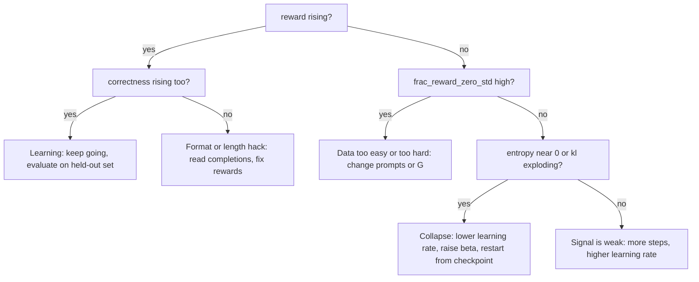

An SFT run has one curve that matters, the loss. A GRPO run has no such curve: the loss hovers near zero by construction, because advantages are centred on each group's mean. Instead you read a small dashboard of signals that together say whether the model is learning, stalling, collapsing or cheating. TRL logs all of them every `logging_steps`.

| Logged metric | What it is | Healthy pattern |
|---|---|---|
| `reward` | Mean summed reward over the batch | Rises, noisy, then flattens |
| `rewards/<function>/mean` | Each reward function separately | Correctness rises, not just format |
| `reward_std` | Spread of rewards | Stays well above 0 |
| `frac_reward_zero_std` | Share of groups whose rewards all tie | Low; rising means the data is too easy or too hard |
| `completions/mean_length` | Completion tokens | Drifts; may grow on reasoning tasks |
| `completions/clipped_ratio` | Share that hit `max_completion_length` | Low; rising means you are truncating answers |
| `kl` | KL to the reference (only when `beta` > 0) | Grows slowly and stays small |
| `entropy` | Mean per-token entropy of the policy | Falls gently, never to near 0 |

## The maths of a dead group

With a pass/fail reward and per-question success rate $p$, a group of $G$ independent samples ties (all right or all wrong) with probability

$$
P(\text{tie}) = p^{G} + (1-p)^{G}.
$$

A tied group has $\sigma = 0$, every $\hat A_i = 0$, and contributes no gradient. Worked example with $G = 8$:

| $p$ | $p^8$ | $(1-p)^8$ | $P(\text{tie})$ |
|---|---|---|---|
| 0.05 | $4 \times 10^{-11}$ | 0.663 | 66% |
| 0.3 | 0.00007 | 0.058 | 5.8% |
| 0.5 | 0.0039 | 0.0039 | 0.8% |
| 0.9 | 0.430 | $10^{-8}$ | 43% |

So `frac_reward_zero_std` tells you where your questions sit. Near the start a weak model on hard questions wastes most groups; as training succeeds, easy questions start tying at 100% and the signal dries up from the other end. When it passes roughly half, move to harder prompts (or filter out questions the model always solves) rather than training longer. The format reward softens this, because it splits groups that tie on correctness.

## The shape of a good run

A typical small-model GSM8K run looks like this: for the first 20 to 50 steps the format reward climbs as the model learns the `<answer>` convention; then correctness starts to rise; after a few hundred steps both flatten. Completion length often dips early (the model stops rambling to fit the format) and then, on harder reasoning, grows again. That later growth is the small-scale echo of the "aha" behaviour reported for DeepSeek-R1, where response length rose steadily over thousands of steps as the model learned to check and redo its work. With a 0.5B or 1.5B model and 256 tokens you will see a modest version at most, and `completions/clipped_ratio` tells you when length growth has hit your cap: past 10 to 20%, either raise `max_completion_length` or accept that you are penalising long correct reasoning.



## Signs of trouble

**Reward hacking** shows up as one reward function maxing out while correctness stalls, or as completions that look odd: empty reasoning, repeated tags, numbers listed in a row. The fix is always in the reward function (previous topics), never in the optimiser settings. **Collapse** shows up as entropy dropping towards zero, `reward_std` falling with it, and the logged completions becoming near-identical, often the same phrasing for every question. KL usually spikes at the same time if `beta > 0`. Lower the learning rate, roll back to the last good checkpoint, and consider `beta` above zero. **No learning** with healthy variance usually means the learning rate is too low for LoRA (TRL's default $10^{-6}$ is tuned for full fine-tuning).

## Evaluate on held-out questions

Training reward is measured on prompts the model is being optimised on, with temperature 1.0 and your reward function's quirks. The real test is GSM8K's 1,319-question test split, scored with the same parser, before and after training. Report two numbers. **Greedy accuracy**: one answer per question at temperature 0. **pass@k**: the probability that at least one of $k$ samples is right, estimated without bias from $n \ge k$ samples of which $c$ are correct ([Programmatic checks and pass@k](/learn/evaluation/reference-scoring/programmatic-checks)):

$$
\text{pass@}k = 1 - \binom{n-c}{k} \Big/ \binom{n}{k}.
$$

Worked example: $n = 8$ samples, $c = 2$ correct, $k = 4$: $1 - \binom{6}{4}/\binom{8}{4} = 1 - 15/70 = 0.786$. GRPO often raises greedy accuracy and pass@1 more than pass@8, because it sharpens answers the model could already reach occasionally rather than teaching new ones; watch both.

```python
from math import comb

def pass_at_k(n, c, k):
    return 1.0 if n - c < k else 1 - comb(n - c, k) / comb(n, k)

def evaluate(generate_fn, test_rows, n=8, k=4):
    # generate_fn(prompt, n, temperature) -> list of n completion strings (HF generate or vLLM)
    greedy_hits, pk = 0, 0.0
    for row in test_rows:                                 # rows built with to_prompt() from topic 3
        g = generate_fn(row["prompt"], 1, 0.0)
        greedy_hits += correctness_reward(g, [row["ground_truth"]])[0]
        samples = generate_fn(row["prompt"], n, 1.0)
        c = int(sum(correctness_reward(samples, [row["ground_truth"]] * n)))
        pk += pass_at_k(n, c, k)
    return greedy_hits / len(test_rows), pk / len(test_rows)

print(pass_at_k(8, 2, 4))   # 0.786
```

Mind the error bar. At 45% accuracy on 1,319 questions the standard error is $\sqrt{0.45 \times 0.55 / 1319} \approx 0.0137$, so a 95% interval is about $\pm 2.7$ points. A 2-point gain is not yet evidence; because both models answer the same questions, a paired comparison is sharper ([Comparing systems](/learn/evaluation/comparing-systems/paired-comparisons)).

```sim
pass-at-k
{"p": 0.4, "k": 8, "tasks": 50, "spread": 0.5}
```

Start at $p = 0.4$ and slide $k$ from 1 to 8: pass@8 is far above pass@1. Then set the spread to 1: some tasks become nearly impossible, and pass@k stops climbing. Those are the questions on which GRPO groups always tie at zero.

## In practice

Stop when held-out accuracy stops improving across two or three checkpoints, not when training reward flattens; and stop immediately if accuracy falls while reward rises, which is reward hacking by definition. Keep the best checkpoint, not the last. Also re-run a few general prompts outside maths: narrow RL can make a small model terse or odd elsewhere.

```quiz
{"q": "Midway through a run, `frac_reward_zero_std` climbs from 0.1 to 0.6 while held-out accuracy has stopped improving. Training reward is high. What is the best next step?", "options": ["Switch to harder prompts or drop questions the model always solves", "Lower the temperature to 0.3", "Raise `beta` to 0.5", "Train for twice as many steps"], "answer": 0, "explain": "Most groups now tie, almost certainly at full marks since reward is high, so they give zero advantage and the model has stopped receiving signal. Harder data restores mixed groups. Training longer on the same data adds steps that mostly do nothing; lowering the temperature makes ties even more common."}
```

```quiz
{"q": "From $n = 10$ samples a question has $c = 3$ correct. What is the unbiased pass@2?", "options": ["$1 - \\binom{7}{2}/\\binom{10}{2} \\approx 0.53$", "$1 - 0.7^2 = 0.51$", "$0.3$", "$2 \\times 0.3 = 0.6$"], "answer": 0, "explain": "$\\binom{7}{2} = 21$ and $\\binom{10}{2} = 45$, so pass@2 $= 1 - 21/45 \\approx 0.533$. $1 - 0.7^2$ samples with replacement from the 10 and is slightly biased; $0.3$ is pass@1; $0.6$ double-counts the case where both samples are right."}
```
