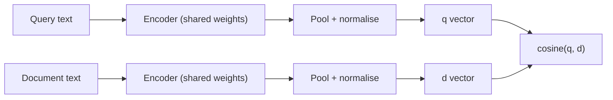

```predict
{"q":"all-MiniLM-L6-v2 has about 22.7M parameters. Roughly what share of them is the vocabulary (token embedding) table?","options":["About 5%","About 20%","About half","About 90%"],"answer":2,"reveal":"About half: the token table is $30{,}522 \\times 384 \\approx 11.7$M parameters. The step-by-step count under \"How big is a small model?\" rebuilds the whole number."}
```

A language model reads text and predicts the next token. An **embedding model** reads text and returns one fixed-length vector, chosen so that texts with related meanings point in similar directions. The two share the same transformer body. What differs is the last step (how the per-token states become one vector) and, more importantly, the objective the weights were trained on.

You already met the pieces in module 1: [contextual hidden states and mean pooling](/learn/model-foundations/embeddings/static-and-contextual) and [cosine similarity](/learn/model-foundations/embeddings/dot-product-and-cosine). This lesson is about the training: how a model is taught to produce good sentence vectors, and how you adapt one to your own domain on a laptop.

## The bi-encoder

Most embedding models are **bi-encoders**: the query and the document are encoded *separately* by the same network, and only their vectors meet, through a dot product or cosine. That separation is the whole point. You can embed a million documents once, store the vectors, and at query time run the model on the query alone. The alternative, a **cross-encoder**, feeds query and document into the model together and outputs a relevance score. It is more accurate, because attention can compare the two texts token by token, but it must run once per (query, document) pair, so it is used to re-rank a short list, not to search a collection. Sentence-BERT (Reimers and Gurevych, 2019) made the bi-encoder practical by fine-tuning BERT in a siamese setup so that cosine similarity of pooled outputs became meaningful.



## Pooling: three ways to get one vector

The transformer produces final hidden states $\mathbf{h}_1, \dots, \mathbf{h}_n \in \mathbb{R}^d$ for a text of $n$ tokens. A **pooling** step turns them into one vector $\mathbf{s}$:

| Pooling | Formula | Used by |
|---|---|---|
| Mean | $\mathbf{s} = \frac{1}{n}\sum_{i=1}^{n} \mathbf{h}_i$ (padding masked out) | all-MiniLM-L6-v2, E5 |
| CLS | $\mathbf{s} = \mathbf{h}_1$, the state of a special first token | BGE |
| Last token | $\mathbf{s} = \mathbf{h}_n$ | embedding models built from decoder-only LLMs |

Last-token pooling is the natural choice for a decoder-only model: with a causal mask, only the final position has attended to the whole text. Mean pooling over a causal model would give the early tokens, which saw almost nothing, as much say as the last. The pooling a model was trained with is part of the model. Swap it and quality drops sharply, which is why sentence-transformers stores the pooling configuration in the saved model folder.

Finally the vector is usually **normalised** to unit length, $\hat{\mathbf{s}} = \mathbf{s} / \|\mathbf{s}\|$, so that a dot product equals the cosine and the index can use the cheaper operation.

## Why a generic model underperforms on your domain

A public embedding model learned "similar" from its training mix: web questions and answers, Wikipedia, forum titles, paraphrase pairs. Your notion of similar may be different. In a contract archive, "termination for convenience" and "termination for cause" are near-opposites in effect, yet they share most of their words and look close to a generic model. In a codebase, two error messages with the same stack trace matter more than two that share vocabulary. Rare jargon, product codes and abbreviations were seen a handful of times in pretraining, so their vectors sit in a vague region.

```sim
embedding-space
{"mode": "neighbours", "a": "puppy", "b": "kitten"}
```

Look at the neighbours of "puppy" and at cos(puppy, kitten). These toy vectors put young animals close together because "young" is one of their axes. Now imagine a pet-food shop, where a puppy query should land near dog products, not cat products: the same geometry is wrong for that task. Switch word b to "dog" and compare the two cosines: about 0.99 for kitten against 0.85 for dog. Fine-tuning is how you tell the model which axis matters for you.

Fine-tuning fixes this by showing the model *your* pairs: this question goes with this passage. A few thousand pairs and minutes of compute often move retrieval quality by several points, because you are not teaching language, only re-drawing the neighbourhoods.

## How big is a small model?

all-MiniLM-L6-v2 is a 6-layer BERT-style encoder with $d = 384$, a feed-forward width of 1,536 and a 30,522-token vocabulary. Its model card lists about 22.7M parameters. You can rebuild that number:

```steps
Counting all-MiniLM-L6-v2's parameters
Token embeddings: $30{,}522 \times 384 = 11{,}720{,}448$. Position embeddings: $512 \times 384 = 196{,}608$. Plus a tiny token-type table and LayerNorm.
---
Attention per layer: four $384 \times 384$ matrices with biases, $4 \times (384^2 + 384) = 590{,}592$.
---
Feed-forward per layer: $384 \times 1{,}536 + 1{,}536 + 1{,}536 \times 384 + 384 = 1{,}181{,}568$. With two LayerNorms ($1{,}536$), one layer is $1{,}773{,}696$.
---
Six layers: $10{,}642{,}176$. Add the embeddings and a $384 \times 384$ pooler and you land at about $22.7$M, matching the card. Half the model is the vocabulary table.
---
Full fine-tuning in fp32 with Adam needs weight, gradient and two moments, $4 \times 4 = 16$ bytes per parameter: $16 \times 22.7 \times 10^6 \approx 363$ MB, plus activations. Any laptop has that.
```

Compare that with the 128 GB of states for an 8B model in [Sizing your first run](/learn/fine-tuning/start-here/sizing-your-first-run). Embedding models are small enough that you train every weight; LoRA buys little here. A base-size model such as BAAI/bge-base-en-v1.5 (about 110M parameters, 768 dimensions) needs about 1.8 GB of states, still CPU-feasible but slow, and a free T4 GPU makes it comfortable.

```python
from sentence_transformers import SentenceTransformer

model = SentenceTransformer("sentence-transformers/all-MiniLM-L6-v2", device="cpu")
print(model)                                   # Transformer -> Pooling(mean) -> Normalize
print(sum(p.numel() for p in model.parameters()))   # about 22.7 million

vecs = model.encode(
    ["How do I cancel my plan?", "Steps to end a subscription", "Quarterly revenue grew 12%"],
    normalize_embeddings=True,                 # unit length, so dot product = cosine
)
print(vecs.shape)                              # (3, 384)
print(vecs @ vecs.T)                           # pairwise cosines: first two high, third low
```

## In practice

- **Start from a model already trained for embeddings**, not from a raw BERT or a chat LLM. The contrastive pretraining those models received (hundreds of millions of pairs for E5 and BGE) is far more than you can redo; your fine-tune is the last mile.
- **Respect the model's conventions.** E5 expects the prefixes `query: ` and `passage: `; BGE v1.5 recommends an instruction prefix on queries. Use them both when measuring the baseline and when fine-tuning, or your comparison is unfair.
- **Check the maximum sequence length.** all-MiniLM-L6-v2 truncates at 256 word pieces by default. Long documents need chunking before embedding, whatever you train.

```quiz
{"q": "You turn a decoder-only LLM into an embedding model. Why is last-token pooling usually preferred over mean pooling?", "options": ["With a causal mask only the last position has attended to the whole text", "The last token always has the largest norm", "Mean pooling cannot be normalised", "Decoder-only models have no first token"], "answer": 0, "explain": "In a causal model position $i$ sees only tokens $1..i$, so the final state is the only one that summarises everything. Mean pooling would weight early states, which saw almost nothing, equally. Norms have nothing to do with it, and any pooled vector can be normalised."}
```

```quiz
{"q": "Roughly how much memory do the model states take for full fine-tuning of a 110M-parameter embedding model in fp32 with Adam?", "options": ["About 1.8 GB", "About 440 MB", "About 220 MB", "About 16 GB"], "answer": 0, "explain": "Weight, gradient and two Adam moments at 4 bytes each make 16 bytes per parameter: $16 \\times 1.1 \\times 10^8 \\approx 1.76$ GB. 440 MB counts only the fp32 weights and forgets the gradient and optimiser state."}
```
