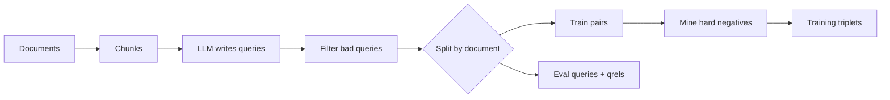

The loss from the previous topic needs one thing from you: a list of (anchor, positive) pairs where the positive is what a good model should return for the anchor. Everything about the fine-tuned model's notion of similarity comes from these pairs. Get them right and a few thousand are enough; get them wrong and the model learns your mistakes faithfully.

## Where pairs come from

Look for pairs your data already contains before generating any:

| Source | Anchor | Positive |
|---|---|---|
| Support tickets | customer question | the help article an agent linked |
| Documentation | section heading | section body |
| Search logs | query | the result users clicked and stayed on |
| FAQ pages | question | answer |
| Code | docstring or commit message | function body or diff |

When you have documents but no queries, the standard trick is **synthetic queries**: chunk the documents, ask an LLM to write a question each chunk answers, and use (generated question, chunk) as the pair. This is cheap and works well, provided you control two failure modes. First, generated questions tend to copy phrases from the chunk, which teaches keyword matching rather than meaning; ask for questions "in the words a user would use, without quoting the text". Second, some questions are answerable by many chunks; filter them by checking that the base model ranks the source chunk reasonably high, or by asking a second LLM call whether the chunk alone answers the question.

## Hard negatives

In-batch negatives are mostly easy: a random passage about holiday policy is obviously not the answer to a question about API rate limits. A **hard negative** is a passage that looks relevant but is not, such as the rate-limit page for a *different* product. Dense Passage Retrieval (Karpukhin et al., 2020) showed that adding one such negative per question, there taken from BM25 results that did not contain the answer, improved retrieval accuracy markedly over in-batch negatives alone.

The usual way to find them is to **mine with the base model**: embed the corpus, retrieve the top $k$ passages for each anchor, drop the known positive, and take one from what remains. With a hard negative the batch becomes $B$ triplets, and each anchor now has $2B - 1$ negatives: the $B - 1$ other positives plus all $B$ mined negatives.

```steps
Mining a hard negative, and the trap
Anchor: "What is the refund window for annual plans?" Known positive: passage P17 (annual plan refunds). Base model's top 5: P17 (0.83), P42 (0.81), P09 (0.74), P51 (0.70), P03 (0.66).
---
Drop P17. The hardest candidate is P42 at 0.81. Read it: "Annual subscriptions can be refunded within 30 days of purchase." It answers the question. It is a **false negative**.
---
If you train on it, the loss pushes a correct answer away from the query. With many such cases, the model learns to rank good duplicates down.
---
Guard: skip candidates whose similarity is within a margin of the positive's. With a relative margin of 5%, any candidate scoring above $0.83 \times 0.95 = 0.789$ is rejected. P42 (0.81) is dropped; P09 (0.74) becomes the hard negative.
```

The margin rule is a heuristic, not a guarantee. The safest corpora for mining are ones without near-duplicate content; when a collection has many overlapping documents (versioned manuals, templated pages), deduplicate first, or use a cross-encoder to score candidates and discard any that it rates as relevant.

sentence-transformers ships a helper for this. The argument names below match the current reference; check the docs for your installed version.

```python
from datasets import load_dataset
from sentence_transformers import SentenceTransformer
from sentence_transformers.util import mine_hard_negatives

# 7,000 (question, context) pairs about one company's annual report
pairs = load_dataset("philschmid/finanical-rag-embedding-dataset", split="train")
pairs = pairs.rename_columns({"question": "anchor", "context": "positive"})

base = SentenceTransformer("sentence-transformers/all-MiniLM-L6-v2", device="cpu")

triplets = mine_hard_negatives(
    pairs,
    base,
    range_min=1,            # skip the very closest candidate after the positive
    range_max=20,           # only look in the top 20
    relative_margin=0.05,   # reject candidates scoring within 5% of the positive
    num_negatives=1,        # one hard negative per anchor
    sampling_strategy="top",
    output_format="triplet",
)
print(triplets)             # columns: anchor, positive, negative
```

## How many pairs?

Fine-tuning an existing embedding model is not pretraining. Reported domain fine-tunes typically use from about 1,000 to 50,000 pairs. As a rough guide:

- **Under ~500 pairs**: high variance; you may be measuring noise. Use them as an evaluation set first.
- **1,000 to 10,000 pairs**: the sweet spot for a domain adaptation. One to three epochs.
- **Above that**: gains continue but flatten; quality of pairs beats quantity.

With batch size $B$ and $N$ pairs, one epoch is $\lceil N / B \rceil$ steps. For $N = 6{,}300$ and $B = 32$ that is $\lceil 196.9 \rceil = 197$ steps.

## The train and evaluation split

Split by **document**, not by pair. If chunk P17 has five synthetic questions, all five go to the same side. Otherwise the model sees P17 paired with four questions in training and is tested on the fifth: the evaluation then measures memorisation of P17, not generalisation to new documents. Hold out 10 to 20% of documents, and keep the full corpus (train and test documents alike) as the search space at evaluation time so the test stays realistic.



## In practice

- **Read 50 pairs by eye** before training. Ambiguous questions and wrong positives show up immediately and cost far more to discover after a run.
- **Mine with the base model, once.** Re-mining with the fine-tuned model can find harder negatives, but it also finds more false negatives; only do it if the first round clearly helped.
- **Keep the evaluation set human-checked** even if training pairs are synthetic. A synthetic test written by the same LLM shares its biases and flatters the model.

```quiz
{"q": "A batch has $B = 32$ triplets (anchor, positive, hard negative). How many negatives does each anchor see under MultipleNegativesRankingLoss?", "options": ["63", "31", "32", "1"], "answer": 0, "explain": "The candidates for each anchor are all 32 positives and all 32 negatives in the batch, 64 passages, of which one is correct: $64 - 1 = 63$ negatives. 31 counts only the other positives and forgets the mined negatives, which are shared across the batch."}
```

```quiz
{"q": "You generate 4 synthetic questions per chunk and split the resulting pairs 80/20 at random. The tuned model's evaluation score jumps by 15 points. What is the most likely problem?", "options": ["Test questions share chunks with training questions, so the score measures memorised chunks", "The batch was too small", "The model should have used CLS pooling", "Synthetic questions are always too easy to learn from"], "answer": 0, "explain": "A random pair-level split puts questions about the same chunk on both sides, so the model has already been trained to pull that chunk towards similar questions. Split by document instead. Batch size and pooling do not create a leak of this kind."}
```
