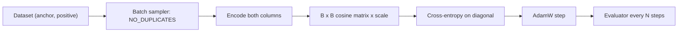

With pairs in hand, the training loop is short. sentence-transformers wraps the Hugging Face `Trainer` in a `SentenceTransformerTrainer` that knows how to feed text columns to a loss, run an evaluator during training and save a model folder that `SentenceTransformer(...)` can load again. You supply four things: a model, a dataset, a loss and training arguments.

This topic gives a complete script that runs on a laptop CPU with all-MiniLM-L6-v2, then shows what to change for a larger model on a T4. If you have not set up a Python environment for training yet, [Run fine-tuning yourself](/learn/fine-tuning/run-fine-tuning-yourself) covers it.

## In everyday life

Think of a driving school taking on a learner who already drives a little. The instructor needs four things: the learner, a syllabus of exercises, a way of scoring each exercise, and a plan for the course, covering how long each lesson lasts, how gently to start and how many weeks to run. Before any lesson, the instructor does a test drive to record where the learner stands. Lessons start gently, because a big correction on day one can undo habits that already work. Partway through, a mock test checks progress. At the end, the final test is compared with the first one.

Training an embedding model with the sentence-transformers library has the same shape. You provide a **model** (one that already works), a **dataset** of pairs, a **loss** (the scoring rule from the contrastive lesson) and **training arguments** (the course plan). The **learning rate** is how big each correction is, and **warmup** is the gentle start. An **evaluator** is the mock test that runs during training. Take care with the syllabus format: the trainer treats the first column as the question and the second as the answer, whatever the columns are called.

**Where you meet it.** Before tuning a search model on company documents, you test it and write down the score. After training, the same test shows whether it improved. If it did not beat the first score, you keep the original model and avoid shipping a worse one.

```scene
title: A driving school course plan
step: 🚗 Before any lesson, the instructor records the learner's starting test | baseline evaluation
step: 📋 The syllabus lists question first, answer second, in that order | dataset column order
step: 🐢 The first lessons are gentle, then the pace picks up | warmup, then the learning rate
step: 🧩 No two cards in one lesson show the same exercise | no-duplicates batch sampler
step: 📝 A mock test runs partway through the course | evaluator during training
step: 🏁 The final test is compared with the first | before and after score
takeaway: Measure the base model first, feed pairs in the right column order, and keep the tuned model only if it beats that baseline.
```

## How the trainer reads your dataset

The trainer does not look at column *names* to decide roles; it uses column *order*. For `MultipleNegativesRankingLoss` the first column is the anchor, the second the positive and any further columns are negatives. Any column called `label` or `score` is treated as a label, which this loss does not want. So select and order columns explicitly before training.



## The hyperparameters, and the arithmetic behind them

The learning rate for fine-tuning an already-trained embedding model is small, typically $1 \times 10^{-5}$ to $5 \times 10^{-5}$; the official training example uses $2 \times 10^{-5}$. A **warmup** ramps the rate linearly from $0$ over the first fraction of steps, which protects the pretrained geometry from large early updates computed with a fresh (zero) Adam state.

For $N = 6{,}300$ training pairs, batch $B = 32$ and $E = 3$ epochs:

$$
\text{steps} = E \cdot \left\lceil \frac{N}{B} \right\rceil = 3 \times 197 = 591, \qquad \text{warmup} = 0.1 \times 591 \approx 59 \text{ steps}
$$

A rough cost estimate follows the usual training rule of about $6$ FLOPs per parameter per token. Excluding the 11.7M-parameter vocabulary table (a lookup, not a matrix multiply), MiniLM has about $11$M parameters doing work. One step encodes $2B = 64$ texts; if they average 128 tokens that is $8{,}192$ tokens, so

$$
6 \times 1.1 \times 10^{7} \times 8{,}192 \approx 5.4 \times 10^{11} \text{ FLOPs per step}
$$

A laptop CPU sustaining something like $50$ to $200$ GFLOP/s in PyTorch takes roughly 3 to 11 seconds per step, so 591 steps is on the order of half an hour to two hours. Shorter texts make it proportionally faster. The same run on a T4 takes a few minutes. Treat these as order-of-magnitude estimates and time the first 20 steps of your own run.

| Setup | Model | Batch | Rough time for 591 steps |
|---|---|---|---|
| Laptop CPU, fp32 | all-MiniLM-L6-v2 (22.7M) | 32 | 30 min to 2 h |
| T4, fp16 | all-MiniLM-L6-v2 | 64 to 128 | a few minutes |
| T4, fp16 | bge-base-en-v1.5 (~110M) | 32 to 64 | roughly 10 to 30 min |

## The script

The import paths below are the ones the current documentation recommends (sentence-transformers v5.4 and later moved losses, evaluators and training arguments under `sentence_transformers.sentence_transformer`). Older versions use `sentence_transformers.losses`, `sentence_transformers.evaluation` and `sentence_transformers.training_args`; the new versions still accept the old paths with a deprecation warning. Check the current docs if an import fails.

```python
import random
import torch
from datasets import load_dataset
from sentence_transformers import (
    SentenceTransformer,
    SentenceTransformerTrainer,
    SentenceTransformerTrainingArguments,
)
try:   # v5.4+ layout
    from sentence_transformers.sentence_transformer.losses import MultipleNegativesRankingLoss
    from sentence_transformers.sentence_transformer.training_args import BatchSamplers
    from sentence_transformers.sentence_transformer.evaluation import InformationRetrievalEvaluator
except ImportError:   # older v3-v5 layout
    from sentence_transformers.losses import MultipleNegativesRankingLoss
    from sentence_transformers.training_args import BatchSamplers
    from sentence_transformers.evaluation import InformationRetrievalEvaluator

BASE = "sentence-transformers/all-MiniLM-L6-v2"
GPU = torch.cuda.is_available()

# 1. Data: (question, context) pairs, renamed to the order the loss expects
ds = load_dataset("philschmid/finanical-rag-embedding-dataset", split="train")
ds = ds.rename_columns({"question": "anchor", "context": "positive"}).select_columns(["anchor", "positive"])

# 2. Split by document (context), not by pair, so no test passage is seen in training
contexts = sorted(set(ds["positive"]))
random.Random(0).shuffle(contexts)
test_ctx = set(contexts[: len(contexts) // 10])
train_ds = ds.filter(lambda r: r["positive"] not in test_ctx)
test_ds = ds.filter(lambda r: r["positive"] in test_ctx)

# 3. Evaluator: test queries searched against the WHOLE corpus
corpus = {f"d{i}": c for i, c in enumerate(contexts)}
doc_id = {c: k for k, c in corpus.items()}
queries = {f"q{i}": r["anchor"] for i, r in enumerate(test_ds)}
relevant = {f"q{i}": {doc_id[r["positive"]]} for i, r in enumerate(test_ds)}
evaluator = InformationRetrievalEvaluator(queries, corpus, relevant, name="fin-test")

# 4. Model, loss, baseline score
model = SentenceTransformer(BASE, device="cuda" if GPU else "cpu")
loss = MultipleNegativesRankingLoss(model, scale=20.0)       # temperature 0.05
before = evaluator(model)
print("baseline", evaluator.primary_metric, round(before[evaluator.primary_metric], 4))

# 5. Training arguments
args = SentenceTransformerTrainingArguments(
    output_dir="models/minilm-finance",
    num_train_epochs=3,
    per_device_train_batch_size=32,      # 64-128 on a T4 for this model
    learning_rate=2e-5,
    warmup_steps=0.1,                    # a float below 1 is a ratio in current versions; older ones: warmup_ratio=0.1
    fp16=GPU,                            # mixed precision only on a GPU
    batch_sampler=BatchSamplers.NO_DUPLICATES,   # no repeated texts inside a batch
    eval_strategy="steps",
    eval_steps=0.25,                     # evaluate four times per run
    save_strategy="epoch",
    save_total_limit=1,
    logging_steps=20,
    seed=0,
)

# 6. Train, re-evaluate, save
trainer = SentenceTransformerTrainer(
    model=model, args=args, train_dataset=train_ds, loss=loss, evaluator=evaluator,
)
trainer.train()
after = evaluator(model)
print("tuned   ", evaluator.primary_metric, round(after[evaluator.primary_metric], 4))
model.save_pretrained("models/minilm-finance/final")
```

The dataset is a public set of 7,000 questions written over one company's annual SEC filing; its card does not state a license, so treat it as a learning example and use your own pairs for anything real. To train with the mined triplets from the previous topic instead, pass the triplet dataset as `train_dataset`; the loss picks up the third column as a negative automatically.

## What `NO_DUPLICATES` does

The default sampler shuffles rows and cuts them into batches. If two rows share a passage, as happens when several questions point to the same chunk, they can land in the same batch. Then that passage is the positive for one anchor and, through its duplicate, a negative for another anchor that it also answers: a guaranteed false negative. `BatchSamplers.NO_DUPLICATES` builds each batch so that no text value appears twice. Sampling is a little slower, and the batches near the end of an epoch can come out uneven when many rows share a passage; both are a fine trade for clean negatives.

## In practice

- **Always evaluate the base model first** with the same evaluator. A fine-tune is only worth keeping if it beats that number on held-out documents.
- **Expect a fast rise, then a plateau.** Most of the gain usually arrives in the first epoch. If the score falls in later epochs, you are overfitting the training passages; keep the best checkpoint.
- **On CPU, cap the sequence length** (`model.max_seq_length = 128`) if your passages are long. Attention cost grows with length squared, and many retrieval chunks fit in 128 tokens.
- **Change one thing at a time.** Batch size, learning rate and hard negatives all move the score; changing them together makes the result unexplainable.

```bughunt
{"q":"In this dataset several questions point to the same context passage. The run trains without errors, but the tuned model barely beats the baseline and ranks some correct passages lower than before. Click the line with the bug.","code":"model = SentenceTransformer(BASE, device=\"cuda\" if GPU else \"cpu\")\nloss = MultipleNegativesRankingLoss(model, scale=20.0)       # temperature 0.05\nbefore = evaluator(model)\nargs = SentenceTransformerTrainingArguments(\n    output_dir=\"models/minilm-finance\",\n    num_train_epochs=3,\n    per_device_train_batch_size=32,\n    learning_rate=2e-5,\n    warmup_steps=0.1,\n    fp16=GPU,\n    batch_sampler=BatchSamplers.BATCH_SAMPLER,\n    eval_strategy=\"steps\", eval_steps=0.25,\n)\ntrainer = SentenceTransformerTrainer(model=model, args=args, train_dataset=train_ds, loss=loss, evaluator=evaluator)","bug":11,"explain":"Line 11 uses the plain `BatchSamplers.BATCH_SAMPLER`, which shuffles rows and cuts them into batches. When two questions about the same passage land in one batch, that passage is the positive for one anchor and an in-batch negative for the other, so `MultipleNegativesRankingLoss` pushes a correct answer away: a guaranteed false negative. Fix: `batch_sampler=BatchSamplers.NO_DUPLICATES`, which keeps every text value unique within a batch."}
```

```quiz
{"q": "You train on 12,800 pairs with batch 64 for 2 epochs and 10% warmup. How many warmup steps is that?", "options": ["40", "400", "20", "200"], "answer": 0, "explain": "Steps per epoch: $12{,}800 / 64 = 200$. Two epochs: 400 steps. Ten percent of 400 is 40. 20 applies the warmup to one epoch only; 400 is the whole run."}
```

```quiz
{"q": "Your dataset's columns are (positive, anchor) in that order, and you train with MultipleNegativesRankingLoss without reordering. What happens?", "options": ["Training runs, but passages are used as anchors and questions as candidates", "The trainer raises an error because the names are wrong", "The trainer reorders the columns by name", "The loss ignores the dataset and uses labels"], "answer": 0, "explain": "The trainer assigns roles by column position, not by name, so it silently trains passage-to-question retrieval. That is not what you will query with at inference. The trainer only treats columns named `label` or `score` specially; it does not reorder others."}
```
