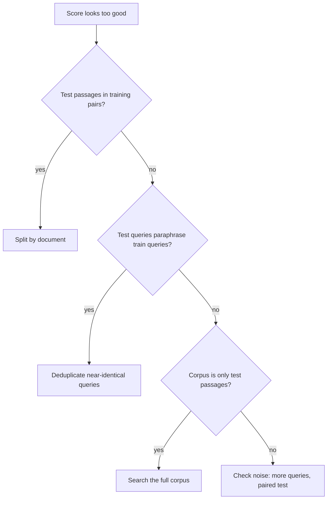

A fine-tuned embedding model is only better if it ranks the right passages higher for queries it has never seen. Training loss cannot tell you that: it falls on any dataset the model can memorise. What you need is a fixed retrieval test, run on the base model and the tuned model with identical settings, and a handful of ranking metrics that summarise where the correct passage landed.

## In everyday life

At a railway station's lost-and-found counter, you describe your bag and the clerk brings out items one by one, best guess first. What matters is how soon yours appears. Third on the trolley is good. Fortieth is nearly useless, because you would have given up. A clerk who is right on the first try beats one who gets there eventually.

Checking whether a retrained search model really improved is the same exercise. For each test question, the model sorts every passage from best guess to worst, and you note the **rank**, the position of the correct passage. Averaging over many questions gives scores such as **recall** (how often the right passage is in the top few), **MRR** (the average of one divided by the rank, which rewards being first) and **NDCG** (a score that rewards high positions and gives less credit as the position falls). The test must also be fair. Use questions the model never trained on, and search the whole storeroom, not a tiny shelf where anyone would look good.

**Where you meet it.** A team that tuned a search model on company documents wants to know whether it helped. They run the old and the new model on the same held-out questions against the whole collection and compare. A big jump on a tiny test shelf proves very little.

```scene
title: The lost-and-found counter
step: 🎒 You describe your bag and the clerk lays out guesses in order | model ranks passages by similarity
step: 🥇 You note the position where your own bag appears | rank of the correct passage
step: 🔟 Only the first few items on the trolley count | top-k cutoff
step: 📊 Many visitors are averaged, and earlier finds score higher | recall, MRR, NDCG
step: 🔁 Old and new clerk are tested on the same visitors | baseline and tuned, same evaluator
step: 🏬 The test searches the whole storeroom, not a tiny shelf | full corpus, no leakage
takeaway: Judge a tuned model by where the right answer lands for unseen questions, on a realistic collection.
```

## The test: queries, corpus, relevance judgements

A retrieval evaluation has three parts:

- **Queries**: held-out questions, ideally written or checked by a person.
- **Corpus**: every passage the model will search over, including passages that never appeared in training.
- **Relevance judgements** (often called **qrels**): for each query, the set of passage IDs that count as correct.

For each query the model embeds it, scores it against every corpus passage by cosine, and sorts. The metrics then look at the rank of the relevant passages in that sorted list. sentence-transformers' `InformationRetrievalEvaluator` takes exactly these three dictionaries, which is what the training script in the previous topics built.

## The metrics

Let $\text{rank}_q$ be the position (1 = top) of the first relevant passage for query $q$, and $Q$ the number of queries.

**Recall@k** is the fraction of a query's relevant passages that appear in the top $k$, averaged over queries. With one relevant passage per query it is simply the share of queries whose answer is in the top $k$ (the evaluator also reports this as accuracy@k).

**MRR@10** (mean reciprocal rank) rewards putting the answer near the very top:

$$
\text{MRR@10} = \frac{1}{Q}\sum_{q=1}^{Q} \frac{1}{\text{rank}_q} \quad (\text{counted as } 0 \text{ if } \text{rank}_q > 10)
$$

**NDCG@10** (normalised discounted cumulative gain) discounts each relevant hit by the log of its position and divides by the best possible score:

$$
\text{DCG@10} = \sum_{i=1}^{10} \frac{\text{rel}_i}{\log_2(i + 1)}, \qquad \text{NDCG@10} = \frac{\text{DCG@10}}{\text{IDCG@10}}
$$

where $\text{rel}_i$ is 1 if the passage at position $i$ is relevant and 0 otherwise, and IDCG is the DCG of a perfect ranking. With a single relevant passage, IDCG $= 1/\log_2 2 = 1$, so NDCG@10 is just $1/\log_2(\text{rank}+1)$. NDCG is the usual headline metric (the MTEB retrieval leaderboard reports it) because it handles several relevant passages and graded relevance.

```steps
Three queries, one relevant passage each
The model ranks the correct passage at position 1 for query A, position 3 for query B and position 12 for query C.
---
Recall@1 $= 1/3 \approx 0.33$ (only A). Recall@5 $= 2/3 \approx 0.67$ (A and B). Recall@10 is still $0.67$; C is outside.
---
MRR@10 $= (1/1 + 1/3 + 0)/3 = 1.333/3 \approx 0.444$.
---
NDCG@10: A gives $1/\log_2 2 = 1$, B gives $1/\log_2 4 = 0.5$, C gives 0. Mean $= 1.5/3 = 0.5$.
---
Now suppose fine-tuning moves B to position 2 and C to position 8. NDCG@10 becomes $(1 + 1/\log_2 3 + 1/\log_2 9)/3 = (1 + 0.631 + 0.315)/3 \approx 0.649$. MRR@10 becomes $(1 + 0.5 + 0.125)/3 \approx 0.542$.
```

```python
import math

def metrics(ranks, k=10):
    """ranks: position (1-based) of the single relevant passage for each query."""
    q = len(ranks)
    recall = {n: sum(r <= n for r in ranks) / q for n in (1, 5, 10)}
    mrr = sum(1 / r for r in ranks if r <= k) / q
    ndcg = sum(1 / math.log2(r + 1) for r in ranks if r <= k) / q
    return recall, round(mrr, 3), round(ndcg, 3)

print(metrics([1, 3, 12]))   # recall 0.33 / 0.67 / 0.67, MRR 0.444, NDCG 0.5
print(metrics([1, 2, 8]))    # recall 0.33 / 0.67 / 1.0, MRR 0.542, NDCG 0.649
```

## Comparing baseline and tuned

Run one evaluator on both models. The evaluator returns a dictionary whose keys combine its `name`, the score function and the metric, for example `fin-test_cosine_ndcg@10`; print the whole dictionary once to see the exact keys in your version.

```python
from sentence_transformers import SentenceTransformer
# `evaluator` is the InformationRetrievalEvaluator built in the training script

for path in ["sentence-transformers/all-MiniLM-L6-v2", "models/minilm-finance/final"]:
    m = SentenceTransformer(path, device="cpu")
    res = evaluator(m)                                 # same evaluator object for both
    print(path, {k.split("_", 1)[1]: round(v, 3) for k, v in res.items()
                 if k.endswith(("ndcg@10", "mrr@10", "recall@10"))})

# For a Matryoshka model, sweep the size with the same queries and corpus
for d in [384, 256, 128, 64]:
    m = SentenceTransformer("models/minilm-finance-mrl/final", truncate_dim=d)
    print(d, round(evaluator(m)[evaluator.primary_metric], 3))
```

A results table for the write-up looks like this; fill it from your own run:

| Model | Dims | NDCG@10 | MRR@10 | Recall@10 |
|---|---|---|---|---|
| Base | 384 | your number | | |
| Fine-tuned | 384 | | | |
| Fine-tuned, Matryoshka | 128 | | | |

Gains of a few NDCG points on a specialist domain are common; much larger jumps deserve suspicion before celebration.

## Leakage: the ways a test lies



- **Shared passages.** If a test query's passage was a training positive, the model was trained to move that passage toward questions like it. Split by document, as in [Building training pairs](/learn/fine-tuning/fine-tuning-embedding-models/building-training-pairs).
- **Near-duplicate queries.** LLM-generated questions often come in near-identical variants. Deduplicate across the split.
- **A toy corpus.** Searching only the 700 test passages makes every model look good. Search everything, including the training passages, because that is what production does.
- **Too few queries.** With 100 queries, one query moving changes recall by a full point. Use a paired comparison over the same queries and enough of them; [Comparing systems](/learn/evaluation/comparing-systems) covers the statistics.

## In practice

- **Freeze the evaluation set before you start iterating.** Every change to the test makes earlier numbers incomparable.
- **Check out-of-domain retention too.** A small general set (a few hundred queries from a public benchmark) shows whether the fine-tune damaged general ability. A small drop is normal; a large one means too many epochs or too high a learning rate.
- **Look at the failures.** Sort test queries by how much their rank changed. The ten biggest losers usually reveal a labelling error or a false negative in the training data.

```quiz
{"q": "Four queries each have one relevant passage, ranked 1, 2, 4 and 20. What is MRR@10?", "options": ["0.4375", "0.4500", "0.5833", "0.3500"], "answer": 0, "explain": "Reciprocal ranks within the cut-off: $1 + 0.5 + 0.25 + 0 = 1.75$, divided by 4 gives $0.4375$. Counting the fourth query as $1/20$ gives $1.80/4 = 0.45$, but MRR@10 scores ranks beyond 10 as zero."}
```

```quiz
{"q": "A tuned model scores NDCG@10 of 0.91 against 0.62 for the base, using a corpus made only of the test passages. Why is this comparison unreliable?", "options": ["The small corpus removes most distractors, inflating both scores and their gap", "NDCG cannot be computed on a small corpus", "The base model should be scored with a different metric", "Tuned models always score higher on any corpus"], "answer": 0, "explain": "In production the model must find the answer among all passages, including the training ones that compete for the top slots. A test-only corpus removes those distractors, which overstates quality. NDCG itself works on any corpus size; the problem is the realism of the search space."}
```
