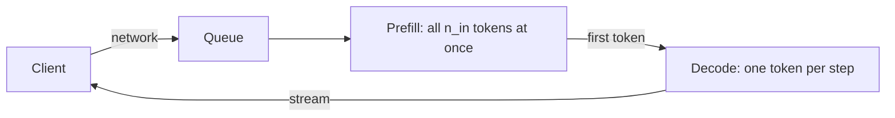

```callout-before
Before you start
You need two facts from the foundations module: a model reads the whole prompt in one parallel pass (prefill), then writes the answer one token at a time (decode), reusing the KV cache. Everything in this module builds on that split.
```

Think of ordering at a busy coffee bar. You walk in (travel time), wait behind other customers (queue), the barista reads your whole order and sets up (preparation), then hands you drinks one at a time (delivery). How long it took depends on which part you measure: the moment the first cup lands in your hand, or the moment the last one does.

An LLM request has exactly the same shape. Users of a chat product care first about how quickly *something* appears on screen, then about how smoothly the rest flows. A batch job summarising a million documents cares only about the total. Before optimising anything, you need words and formulas for each phase.

## Four phases

A streamed request passes through four stages before the last token reaches the user:

1. **Network**: the request travels from the client to the server, and each streamed token travels back.
2. **Queue**: the server is busy, so the request waits for a slot in the next batch.
3. **Prefill**: the model processes all $n_{in}$ prompt tokens in one parallel forward pass, builds the KV cache, and produces the first output token.
4. **Decode**: the model generates the remaining $n_{out} - 1$ tokens one step at a time, each step reading the weights and the growing KV cache.



## The two numbers that describe it

**Time to first token (TTFT)** is the wall-clock time from sending the request to receiving the first output token. It includes everything before decoding starts:

$$
\text{TTFT} = t_{net} + t_{queue} + t_{prefill}
$$

where $t_{net}$ is network time (one way, plus connection setup if any), $t_{queue}$ the wait before the server starts work, and $t_{prefill}$ the prefill compute.

**Time per output token (TPOT)** is the average gap between consecutive output tokens after the first. Once you have both, the **end-to-end latency** for an answer of $n_{out}$ tokens is

$$
T_{e2e} = \text{TTFT} + (n_{out} - 1)\cdot \text{TPOT}
$$

The minus one matters: the first token is already paid for by TTFT, so only $n_{out}-1$ decode gaps remain.

```steps
One request, worked
A user sends a 2,000-token prompt (system prompt plus retrieved documents) and the model answers with 300 tokens. Measured: network 40 ms, queue 60 ms, prefill 150 ms, TPOT 25 ms.
---
TTFT: $40 + 60 + 150 = 250$ ms. The user sees the first word a quarter of a second after pressing Enter.
---
Decode: $(300 - 1) \times 25 = 7{,}475$ ms of streaming after the first token.
---
End to end: $T_{e2e} = 0.250 + 7.475 = 7.725$ s. Notice that decode is 97% of the total, even though prefill processed almost seven times as many tokens.
```

That last observation is the single most important fact about LLM latency. Prefill handles thousands of tokens in one pass; decode handles one token per pass. A long answer is expensive in time; a long prompt is mostly expensive in compute.

## See it

```sim
latency-breakdown
{"model": "llama3-8b", "gpu": "h100", "promptTokens": 2000, "outputTokens": 300, "networkMs": 40, "queueMs": 60}
```

Start with a prompt of about 2,000 tokens and an output of about 300 tokens. Then try three experiments. First, double the output length and confirm the total roughly doubles while TTFT does not move. Second, multiply the prompt length by four and watch TTFT grow while the decode bar stays almost the same. Third, add queue time: it shifts TTFT and end-to-end latency by exactly the same amount, which is why a busy server feels slow before a single token is computed.

## Rearranging the formula

Engineers often measure only the first-token timestamp and the last-token timestamp. TPOT then falls out of the same equation:

$$
\text{TPOT} = \frac{T_{e2e} - \text{TTFT}}{n_{out} - 1}
$$

For the example: $(7.725 - 0.250) / 299 = 0.025$ s, back to 25 ms. The reciprocal, $1/\text{TPOT}$, is the **per-user decode speed**: $1/0.025 = 40$ tokens per second for this user.

| Quantity | Formula | Example value |
|---|---|---|
| TTFT | $t_{net} + t_{queue} + t_{prefill}$ | 250 ms |
| TPOT | $(T_{e2e} - \text{TTFT})/(n_{out}-1)$ | 25 ms |
| Per-user speed | $1/\text{TPOT}$ | 40 tokens/s |
| End to end | $\text{TTFT} + (n_{out}-1)\,\text{TPOT}$ | 7.725 s |

## In practice

Serving dashboards show TTFT and TPOT as separate panels because they fail for different reasons. TTFT rises when the queue grows (not enough capacity) or prompts get longer (more prefill). TPOT rises when the server packs more users into each decode step (bigger batches) or when contexts get longer (more KV cache to read each step). A common mistake is reporting a single "latency" number for an LLM endpoint: it mixes prompt length, output length and load into one figure that you cannot act on.

The second common mistake is forgetting output length when comparing models. A model that writes twice as many tokens per answer has twice the decode time even at identical TPOT. When a team says "the new model is slower", the first thing to check is whether it is simply more verbose.

```quiz
{"q": "TTFT is 400 ms, TPOT is 20 ms and the answer is 501 tokens long. What is the end-to-end latency?", "options": ["10.4 s", "10.42 s", "10.02 s", "0.42 s"], "answer": 0, "explain": "$T = 0.4 + (501 - 1) \\times 0.020 = 0.4 + 10.0 = 10.4$ s. Using $n_{out}$ instead of $n_{out}-1$ gives 10.42 s, double-counting the first token that TTFT already includes."}
```

```quiz
{"q": "You move from 1,000-token prompts to 8,000-token prompts, output length unchanged, server not overloaded. Which metric changes most?", "options": ["TTFT, because prefill processes eight times as many tokens", "TPOT, because decode reprocesses the prompt every step", "Neither, because the KV cache absorbs prompt length", "Network time, because the request body is larger"], "answer": 0, "explain": "Prefill work scales with prompt length, so TTFT grows. TPOT does rise a little because each decode step reads a longer KV cache, but decode never reprocesses the prompt from scratch, which is the point of the cache. A few extra kilobytes of request body are negligible on the network."}
```
