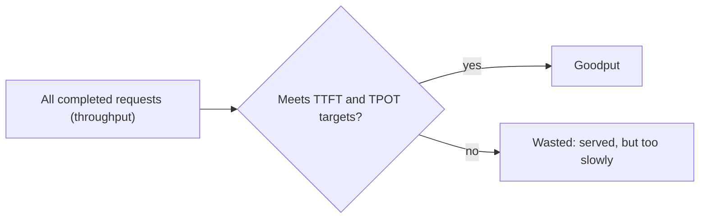

A motorway can carry the most cars per hour when it is packed bumper to bumper at moderate speed. But if every driver arrives late, the record traffic count is not a success. Counting cars that arrive *on time* is the more honest measure.

LLM servers have the same trap. **Throughput** counts work done per second, regardless of how long each user waited. You can almost always raise it by packing more requests into each batch, and almost always at the cost of making each request slower. **Goodput** counts only the work that met your latency targets. It is the number that tells you how many users you can actually serve well.

## Throughput, three ways

Throughput is quoted in three units, and mixing them up is a classic source of confusion:

- **Requests per second** $\lambda$: completed requests per second.
- **Output tokens per second**: $\lambda \cdot \bar{n}_{out}$, where $\bar{n}_{out}$ is the mean answer length. This is what "tokens/s" usually means for a server.
- **Total tokens per second**: $\lambda (\bar{n}_{in} + \bar{n}_{out})$, counting prompt tokens too. Prompt tokens are far cheaper per token than output tokens (they are processed in parallel during prefill), so this number flatters workloads with long prompts.

For example, a server completing 12 requests per second with 1,500-token prompts and 250-token answers delivers $12 \times 250 = 3{,}000$ output tokens/s and $12 \times 1750 = 21{,}000$ total tokens/s. Both are true; only one is comparable to a benchmark that used 100-token prompts.

Server throughput and per-user speed are different quantities. If $B$ sequences are decoding together and each step takes $t_{step}$, then

$$
\text{per-user speed} = \frac{1}{t_{step}}, \qquad \text{server output throughput} = \frac{B}{t_{step}}
$$

With $B = 32$ and $t_{step} = 32$ ms, each user gets $1/0.032 \approx 31$ tokens/s and the server produces $32/0.032 = 1{,}000$ tokens/s.

## Goodput

Pick a **service-level objective (SLO)**: a target on one or more latency metrics, such as TTFT $\le$ 500 ms and TPOT $\le$ 50 ms. Goodput is the rate of requests that satisfy *every* part of it:

$$
\text{goodput} = \lambda \cdot P(\text{TTFT} \le \tau_1 \;\text{and}\; \text{TPOT} \le \tau_2)
$$

where $\lambda$ is the completed-request rate and $\tau_1, \tau_2$ are the SLO thresholds. Counting requests that met a joint condition is stricter than checking each percentile separately, since a request can pass TTFT and fail TPOT.

```steps
Two configurations, one SLO
SLO: TTFT $\le 500$ ms and TPOT $\le 50$ ms. You benchmark two batch-size limits on the same GPU.
---
Config A (max batch 32): completes 10 requests/s; 90% meet the SLO. Goodput $= 10 \times 0.90 = 9.0$ requests/s.
---
Config B (max batch 128): completes 14 requests/s; only 40% meet the SLO because TPOT climbs past 50 ms for most users. Goodput $= 14 \times 0.40 = 5.6$ requests/s.
---
B wins on throughput by 40%, and loses on goodput by almost 38%. If the SLO reflects what users need, A is the better configuration, and the throughput chart would have picked the wrong one.
```



## The usual shape

As you increase load (or the batch limit), throughput rises and then flattens as the GPU saturates. Goodput rises with it at first, then *falls*, because each extra request slows everybody down until many of them miss the target. The best operating point is near the peak of the goodput curve, not the throughput curve. The batching lesson draws this curve with real numbers.

| Load | Throughput (req/s) | Fraction within SLO | Goodput (req/s) |
|---|---|---|---|
| Light | 4 | 99% | 3.96 |
| Moderate | 9 | 95% | 8.55 |
| Heavy | 12 | 70% | 8.4 |
| Overloaded | 13 | 30% | 3.9 |

## See it

```sim
latency-breakdown
{"model": "llama3-8b", "gpu": "h100", "promptTokens": 1500, "outputTokens": 250, "batch": 32}
```

Keep the prompt and output fixed and raise the queue delay step by step, as if load were climbing. Watch TTFT cross a 500 ms line: every request beyond that point still counts towards throughput but drops out of goodput.

## In practice

Benchmarks published by engine and hardware vendors usually report peak throughput, often at batch sizes no interactive product would run. Before trusting one, ask: what were the prompt and output lengths, what was the batch size, and what were TTFT and TPOT at that throughput? Better still, re-run with your own SLO and report goodput. For offline work (nightly summarisation, evaluation sweeps, embedding a corpus) there is no per-request latency target, and raw throughput is exactly the right metric: run the largest batches that fit.

```quiz
{"q": "A server completes 20 requests/s. 75% meet the TTFT target, 80% meet the TPOT target, and 65% meet both. What is the goodput?", "options": ["13 requests/s", "15 requests/s", "12 requests/s", "16 requests/s"], "answer": 0, "explain": "Goodput counts requests meeting the whole SLO: $20 \\times 0.65 = 13$. Using only the TTFT fraction gives 15 and only the TPOT fraction gives 16. Multiplying $0.75 \\times 0.80 = 0.60$ (12/s) wrongly assumes the two failures are independent; they are usually correlated through load."}
```

```quiz
{"q": "Doubling the batch limit raises output throughput from 2,000 to 3,000 tokens/s while TPOT goes from 25 ms to 45 ms. The SLO is TPOT ≤ 40 ms. What happened to goodput?", "options": ["It likely fell, because typical requests now break the TPOT target", "It rose 50%, matching throughput", "It is unchanged because TTFT did not move", "It cannot change, since goodput only depends on TTFT"], "answer": 0, "explain": "If TPOT is around 45 ms for typical requests, most of them violate the 40 ms target, so the fraction counted in goodput collapses even though more tokens are produced. Goodput tracks throughput only while the SLO is still met."}
```
