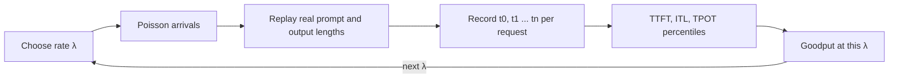

Two engineers benchmark the same model on the same GPU and report numbers that differ by a factor of three. Neither is lying. One sent short prompts from 8 parallel clients that waited politely for each answer; the other replayed a day of production traffic arriving at random. Serving numbers are meaningless without the **workload** and the **load pattern** that produced them.

A trustworthy benchmark answers one question: *at the request rate I expect, with prompts and answers like mine, what are the TTFT and TPOT percentiles and the goodput?* Everything below is about making that question precise.

## Closed loop versus open loop

A **closed-loop** load generator runs $C$ virtual users. Each sends a request, waits for the full answer, optionally "thinks" for $Z$ seconds, then sends the next. The request rate is not something you choose; it is whatever the system allows. By the **response-time law**,

$$
\lambda = \frac{C}{W + Z}
$$

where $\lambda$ is the achieved request rate, $C$ the number of concurrent users, $W$ the mean response time and $Z$ the think time. With $C = 50$, $W = 8$ s and $Z = 2$ s, $\lambda = 50/10 = 5$ requests per second.

The catch: if the server slows down, $W$ grows, so $\lambda$ automatically *drops*. The load generator backs off exactly when real users would not, and the queueing that would have happened never shows up. This effect is often called **coordinated omission**.

An **open-loop** generator sends requests on a fixed schedule regardless of how the server is doing, the way independent users do. Real arrivals are often modelled as a **Poisson process** with rate $\lambda$: the gaps between arrivals are independent and exponentially distributed with mean $1/\lambda$. You can generate a gap from a uniform random number $U \in (0, 1)$ as

$$
\Delta t = -\frac{\ln U}{\lambda}
$$

For $\lambda = 5$ req/s and $U = 0.5$, $\Delta t = -\ln(0.5)/5 = 0.693/5 = 0.139$ s; for $U = 0.05$, $\Delta t = 2.996/5 = 0.599$ s. Bursts happen naturally, which is what exposes the queue.



## The checklist

```steps
A benchmark you can defend
**Use your length distribution.** Sample prompt and output lengths from production logs, not a single fixed value. A mix with a few 30k-token prompts behaves very differently from a constant 1k.
---
**Control output length.** Models stop at different places. Either replay real outputs or force a target length (many engines can ignore the end-of-sequence token for benchmarking), so two models are compared on equal work.
---
**Warm up, then measure.** Discard the first minute: kernels compile, caches fill, memory pools grow. Then run long enough to collect at least several hundred requests per load level.
---
**Sweep the rate.** Run open-loop at increasing $\lambda$ until the SLO breaks. Plot p95 TTFT, p95 TPOT and goodput against $\lambda$. The useful capacity is the highest rate where the SLO still holds.
---
**Measure from the client and record everything.** Keep per-request timestamps so you can compute any percentile later and slice by prompt length.
```

## Code: a minimal open-loop driver

```python
import random, math

def poisson_schedule(rate, duration_s, seed=0):
    """Arrival times (s) for a Poisson process of the given rate."""
    rng, t, times = random.Random(seed), 0.0, []
    while True:
        t += -math.log(1.0 - rng.random()) / rate   # exponential gap
        if t > duration_s:
            return times
        times.append(t)

arrivals = poisson_schedule(rate=5, duration_s=600)
print(len(arrivals), "requests; expected about", 5 * 600)
# For each arrival: sleep until its time, send the request asynchronously,
# record t0 and every token timestamp, then compute TTFT/ITL/TPOT offline.
```

Using `1.0 - rng.random()` keeps the argument of the logarithm strictly positive, since `random()` can return exactly 0.

## See it

```sim
latency-breakdown
{"model": "llama3-8b", "gpu": "h100", "promptTokens": 2000, "outputTokens": 300, "queueMs": 300}
```

Use the queue control to imitate what an open-loop benchmark reveals and a closed-loop one hides: at the same model speed, a burst that adds a few hundred milliseconds of queueing pushes TTFT over a 1 s target while the decode portion is untouched.

## In practice

The most common benchmarking errors are: quoting throughput from a closed-loop test with a handful of clients; using one fixed prompt so that a prefix cache makes every prefill nearly free; comparing two engines whose outputs had different lengths; and running for thirty seconds so that the p99 rests on a single request. Publish the workload with the result: model, precision, GPU, engine version, prompt and output length distributions, arrival process, rate, and the SLO used for goodput. A number without these is an anecdote.

```quiz
{"q": "A closed-loop test with 64 concurrent users and no think time measures a mean response time of 16 s. What request rate did the server actually see?", "options": ["4 requests/s", "64 requests/s", "16 requests/s", "0.25 requests/s"], "answer": 0, "explain": "By the response-time law, $\\lambda = C/(W+Z) = 64/(16+0) = 4$ req/s. 64/s would mean each user sent one request per second; 0.25 is the inverse of the right answer."}
```

```quiz
{"q": "Why does a closed-loop benchmark tend to understate tail latency compared with real traffic?", "options": ["When the server slows, clients send fewer requests, so the queue never builds up as it would with independent users", "Closed-loop clients use shorter prompts", "It measures on the server side", "It disables the KV cache"], "answer": 0, "explain": "Each closed-loop client waits for its answer before sending again, so load falls exactly when the system struggles (coordinated omission). Real users arrive independently, which is what open-loop Poisson arrivals model. Prompt length and measurement point are separate choices."}
```
