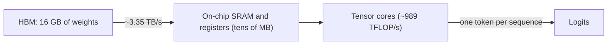

Imagine a chef who can chop a vegetable in one second but whose ingredients are kept in a warehouse across town. Each dish needs one delivery truck to bring every ingredient. However fast the chef chops, the dish takes as long as the truck. Buying a faster knife changes nothing; a bigger truck, or cooking for many tables per delivery, does.

A GPU is that chef. Its arithmetic units are extremely fast, but the model's weights live in **high-bandwidth memory (HBM)**, gigabytes of DRAM next to the chip. The on-chip caches are tiny by comparison (tens of megabytes), so a multi-gigabyte model cannot stay close to the arithmetic units. Every decode step must stream the weights from HBM again.

## The decode step reads every weight

Generating one token means running the full forward pass, which multiplies the token's activations by every weight matrix in the model. Each weight must travel from HBM to the compute units. For one sequence, the step therefore moves at least

$$
\text{bytes per step} \approx N \cdot b + \text{KV bytes read}
$$

where $N$ is the parameter count, $b$ the bytes per parameter (2 for BF16 or FP16), and the KV term is the cached keys and values for the context (next topics). If the GPU's memory bandwidth is $\beta$ bytes per second, the step cannot be faster than

$$
t_{token} \ge \frac{N b + \text{KV bytes}}{\beta}
$$

The arithmetic for one token takes microseconds; the reading takes milliseconds. Decode speed at batch size 1 is, to a good approximation, **memory bandwidth divided by model size**.

```steps
Decode speed of an 8B model on an H100
Llama 3 8B has about $8.03 \times 10^{9}$ parameters. In BF16, $b = 2$, so the weights occupy $8.03 \times 10^{9} \times 2 = 16.06 \times 10^{9}$ bytes, about 16 GB.
---
An H100 SXM has approximately 3.35 TB/s of HBM3 bandwidth, $\beta = 3.35 \times 10^{12}$ B/s.
---
Time to read the weights once: $16.06 \times 10^{9} / 3.35 \times 10^{12} = 4.79 \times 10^{-3}$ s, about 4.8 ms.
---
Ceiling on single-user speed: $1 / 0.00479 \approx 209$ tokens per second, before counting the KV cache or any overhead.
---
Compare the arithmetic: $2N = 1.6 \times 10^{10}$ FLOPs at approximately $989 \times 10^{12}$ FLOP/s takes $16$ µs. Reading takes about 300 times longer than computing.
```

## Same model, different GPUs

Because the bound is bandwidth over size, you can estimate single-stream decode speed for any pairing from two spec-sheet numbers. The figures below are approximate peak bandwidths; real kernels achieve a fraction of them.

| GPU (approx. bandwidth) | 8B in BF16 (16 GB) | 8B in 4-bit (~4.5 GB) | 70B in BF16 (140 GB) |
|---|---|---|---|
| H100 SXM (~3.35 TB/s) | ~4.8 ms, ~209 tok/s | ~1.3 ms | does not fit on one 80 GB GPU |
| A100 80GB SXM (~2.0 TB/s) | ~8.0 ms, ~125 tok/s | ~2.2 ms | does not fit |
| H200 (~4.8 TB/s, 141 GB) | ~3.3 ms, ~300 tok/s | ~0.9 ms | ~29 ms, but 140 GB leaves almost no room for a KV cache |

Two lessons jump out. Halving the bytes per weight (quantization, lesson 4) roughly halves decode time, while a GPU with more FLOP/s but the same bandwidth would not help at all. And a model larger than one GPU's memory must be split across GPUs, which also adds their bandwidths together (lesson 6).

## See it

```sim
roofline
{"gpu": "h100", "model": "llama3-8b", "tokens": 1, "precision": "bf16"}
```

Pick the H100 and place decode at batch size 1. Note how far below the compute ceiling it sits: it is on the sloped, bandwidth-limited part of the chart. Now raise the batch size and watch the point move to the right and up. Every extra sequence in the batch uses the same weight bytes that were already being fetched, so it gets its arithmetic almost free. That observation is the foundation of batching.



## Why not just keep the weights on chip?

The fast on-chip memory of a modern data-centre GPU is measured in tens of megabytes: the L2 cache plus the shared memory and registers spread across the streaming multiprocessors. A 16 GB model is hundreds of times larger. Some specialised inference chips take the other route and hold the whole model in on-chip SRAM spread over many chips, trading capacity and cost for bandwidth. On GPUs, the weights must stream from HBM every step.

## In practice

When someone quotes tokens per second for a model, ask for the batch size. At batch 1 the number is set by bandwidth and bytes per weight, so it barely depends on how optimised the arithmetic is. A useful sanity check: if a claimed single-stream speed implies reading the weights faster than the GPU's peak bandwidth, either the model is quantized, speculative decoding is in use, or the number is wrong. The measured fraction of peak bandwidth is called **memory bandwidth utilisation (MBU)**; topic 6 computes it.

```quiz
{"q": "A 13B-parameter model in FP16 runs on a GPU with about 2.0 TB/s of bandwidth. What is the approximate ceiling on single-user decode speed?", "options": ["About 77 tokens/s", "About 154 tokens/s", "About 13 tokens/s", "About 38 tokens/s"], "answer": 0, "explain": "Weights: $13 \\times 10^9 \\times 2 = 26$ GB. Time per token $\\ge 26 / 2000 = 0.013$ s, so about 77 tokens/s. 154 tokens/s forgets that FP16 is 2 bytes per weight; 13 tokens/s inverts the units."}
```

```quiz
{"q": "A vendor offers a GPU with twice the FLOP/s of your current one and the same memory bandwidth. What happens to single-user decode speed for a 7B model?", "options": ["Almost nothing: batch-1 decode is limited by memory bandwidth", "It roughly doubles", "It halves, because more compute units contend for memory", "It doubles only for long prompts"], "answer": 0, "explain": "At batch 1 the step time is dominated by streaming the weights, about bytes divided by bandwidth. Doubling compute shortens the already-tiny arithmetic part. Prefill (long prompts) would speed up, since it is compute-bound, but that is TTFT, not decode speed."}
```
