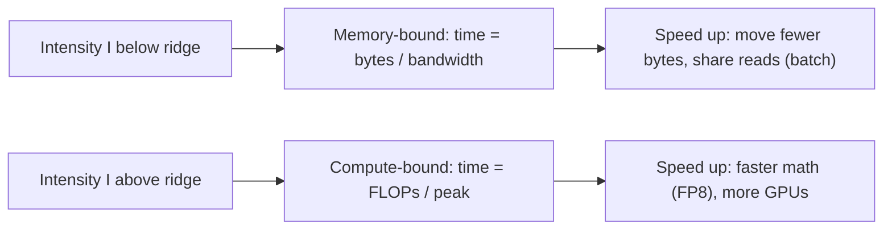

Arithmetic intensity tells you which limit you are near. The **roofline model** turns that into a picture you can read at a glance: one chart per GPU, with every workload you care about plotted as a point. It was introduced for multicore CPUs in 2009 and has become the standard way to reason about GPU kernels, including LLM inference.

The idea fits in one sentence: a workload can run no faster than the slower of two limits, the arithmetic the chip can do and the arithmetic that memory can feed it.

## The formula

With peak compute $P$ (FLOP/s), memory bandwidth $\beta$ (byte/s) and a workload of intensity $I$ (FLOP/byte), the **attainable performance** is

$$
P_{att}(I) = \min\left(P,\; I \cdot \beta\right)
$$

The term $I \cdot \beta$ is how many FLOP/s memory can sustain: bytes per second times FLOPs per byte. Plotted on log-log axes, $I\beta$ is a straight line of slope 1 (the sloped "roof") and $P$ is a horizontal line (the flat roof). They meet at the ridge point $I^{*} = P/\beta$.

From attainable performance you get a time estimate for any operation with $F$ FLOPs and $M$ bytes:

$$
t \ge \max\left(\frac{F}{P},\; \frac{M}{\beta}\right)
$$

This is the same statement in time units: the operation takes at least as long as its compute, and at least as long as its memory traffic. The larger term wins.

```steps
Reading the H100 roofline
Peak $P \approx 989$ TFLOP/s, bandwidth $\beta \approx 3.35$ TB/s, ridge $I^{*} \approx 295$ FLOP/byte.
---
Decode at batch 8, BF16, 8B model: $I \approx 8$. $P_{att} = \min(989,\, 8 \times 3.35) = 26.8$ TFLOP/s. Under 3% of peak.
---
Time for that step: $F = 2N \times 8 = 1.28 \times 10^{11}$ FLOPs, $M \approx 16.06 \times 10^{9}$ bytes. $F/P = 0.13$ ms, $M/\beta = 4.79$ ms. Memory wins: about 4.8 ms per step, giving 8 tokens per 4.8 ms, roughly 1,670 tokens/s for the server.
---
Prefill of a 4,000-token prompt: $I \approx 4000$. $P_{att} = \min(989,\, 4000 \times 3.35) = 989$ TFLOP/s, the flat roof. $F = 2N \times 4000 = 6.4 \times 10^{13}$, so $t \ge 6.4 \times 10^{13} / 9.89 \times 10^{14} = 65$ ms at peak; real kernels reach perhaps half to two-thirds of peak, so roughly 100 to 130 ms.
---
The two phases of one request sit at opposite ends of the same chart.
```



## See it

```sim
roofline
{"gpu": "h100", "model": "llama3-8b", "tokens": 8, "precision": "bf16"}
```

This starts at the batch-8 decode from the walkthrough. Compare the ideal pass time the sim reports with the 4.8 ms above. Now try:

1. Raise tokens per pass to 4,000 (a prefill) and watch "compute-bound" flip on. The pass time is now set by FLOPs.
2. Return to 8 tokens and switch the GPU to the A100 and then the H200. Decode time follows the bandwidth, not the FLOP/s.
3. Switch precision to FP8 at 4,000 tokens: the compute roof doubles on GPUs with FP8 tensor cores, so prefill speeds up. At 8 tokens, FP8 helps for a different reason: half the weight bytes.

## What the roofline leaves out

The model is an upper bound. Real kernels fall below the roof because of launch overheads, imperfect overlap of compute and memory, limited cache reuse, and, for small batches, simply too little parallel work to fill every core. Multi-GPU work adds a third roof, interconnect bandwidth, which the parallelism lesson covers. And the roofline treats a whole forward pass as one point, whereas it is really a mix: weight matrices with intensity near $B$, attention with intensity near 1, and small element-wise operations with even less. Engineers draw separate points for each kernel when they profile.

| Regime | What limits you | Levers that work | Levers that do nothing |
|---|---|---|---|
| Decode, small batch | HBM bandwidth | Fewer bytes per weight, larger batch, more GPUs' bandwidth | More FLOP/s |
| Prefill, long prompt | Tensor-core FLOP/s | FP8 math, more GPUs, prefix caching (skip the work) | More bandwidth |
| Attention, long context | KV bytes | KV quantization, GQA/MQA models, FlashAttention-style kernels | Larger batch |

## In practice

When a benchmark result looks surprising, place it on the roofline. If a decode benchmark claims more FLOP/s than $I\beta$ allows, check whether the batch is far larger than stated or the weights are quantized. If prefill is well below the flat roof, the kernels are inefficient or the prompt is too short to fill the GPU. A one-line roofline estimate catches most impossible numbers before anyone spends a day reproducing them.

```quiz
{"q": "On a GPU with $P = 1000$ TFLOP/s and $\\beta = 4$ TB/s, a kernel has intensity 50 FLOP/byte. What is its attainable performance?", "options": ["200 TFLOP/s", "1000 TFLOP/s", "50 TFLOP/s", "250 TFLOP/s"], "answer": 0, "explain": "$\\min(1000,\\, 50 \\times 4) = 200$ TFLOP/s; the ridge is at 250 FLOP/byte, so this kernel is memory-bound. 1000 assumes it is compute-bound; 250 is the ridge point's value in FLOP/byte, not a performance."}
```

```quiz
{"q": "Using $t \\ge \\max(F/P, M/\\beta)$: an operation does $2 \\times 10^{12}$ FLOPs and moves $2 \\times 10^{9}$ bytes on an H100 (989 TFLOP/s, 3.35 TB/s). Which term dominates and what is the bound?", "options": ["Compute: about 2.0 ms", "Memory: about 0.6 ms", "Memory: about 2.0 ms", "Compute: about 0.6 ms"], "answer": 0, "explain": "$F/P = 2\\times10^{12}/9.89\\times10^{14} = 2.02$ ms; $M/\\beta = 2\\times10^{9}/3.35\\times10^{12} = 0.60$ ms. The larger one, compute, sets the bound. Its intensity is 1,000 FLOP/byte, above the 295 ridge, consistent with being compute-bound."}
```
