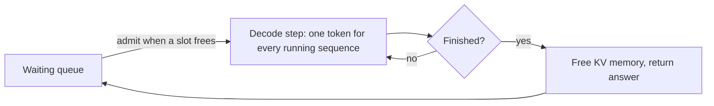

Picture a lift that will not open its doors until everyone inside has reached their floor. The person going to floor 2 rides all the way to floor 30 and back, and nobody new can get on until the last passenger leaves. That is **static batching**: a group of requests starts together and the batch is released only when the longest one finishes.

LLM answers vary wildly in length. One user asks for "yes or no", another for a 2,000-word report. If they share a static batch, the short answer's slot sits idle for most of the run, and the people waiting in the queue cannot use it.

## How much static batching wastes

Suppose a batch holds $B$ requests with output lengths $n_1, \dots, n_B$. A static batch runs for $\max_i n_i$ decode steps, and in each step all $B$ slots are reserved. The fraction of slot-steps doing useful work is

$$
U_{static} = \frac{\sum_{i=1}^{B} n_i}{B \cdot \max_i n_i}
$$

```steps
Four requests, one static batch
Output lengths 50, 100, 200 and 400 tokens, batch of $B = 4$.
---
The batch runs for $\max n_i = 400$ steps and reserves $4 \times 400 = 1{,}600$ slot-steps.
---
Useful work: $50 + 100 + 200 + 400 = 750$ token-steps.
---
Utilisation: $U = 750/1600 = 0.469$. More than half the decode capacity produced nothing.
---
The 50-token user is not slowed (their answer streamed and finished at step 50), but their slot stays reserved for 350 more steps, so whoever is next in the queue waits that long to start.
```

The waste grows with the spread of lengths. If lengths are very uneven (a few long answers among many short ones), static utilisation can fall well below 50%.

## Continuous batching

**Continuous batching**, also called **iteration-level scheduling** (introduced by the Orca system), makes the scheduling decision at every decode step instead of once per batch. After each step:

1. Sequences that produced an end-of-sequence token, or hit their length limit, leave the batch and their KV memory is freed.
2. Waiting requests are admitted into the free slots: their prompts are prefilled and they join the next decode step.



With a steady supply of requests, the batch stays full and utilisation approaches 100% of the slots. Equally important for users, a new request no longer waits for a whole batch to drain; it waits for one step plus its own prefill. Queueing delay, and therefore TTFT under load, drops sharply.

| | Static batching | Continuous batching |
|---|---|---|
| When requests join | Only when the whole batch finishes | After any decode step |
| Slot utilisation | $\sum n_i / (B \max n_i)$, often under 50% | Near 100% under load |
| Queue wait | Up to a whole batch's duration | About one step plus prefill |
| Complexity | Simple | Needs per-sequence KV management and a scheduler |

## The catch: prefill has to fit in

Admitting a request means running its prefill, which is compute-heavy and can take tens to hundreds of milliseconds. Early continuous-batching systems paused decoding while they prefilled newcomers, so every running user saw a stall each time someone joined. Modern engines mix prefill chunks into decode steps (chunked prefill, topic 6). The other catch is memory: admitting sequences whose final length you do not know risks running out of KV space mid-answer, which is what PagedAttention and preemption deal with (topics 3 and 6).

## See it

```sim
llm-batching
{"model": "llama3-8b", "gpu": "h100", "batch": 32, "promptTokens": 1000, "outputTokens": 300, "gpuPrice": 2.5}
```

The sim assumes the batch is kept full, which is what continuous batching achieves. To see the cost of static batching, take the replica throughput it reports at batch 32 and multiply by a static utilisation such as 0.47 from the walkthrough: that is the throughput you would lose with uneven answer lengths. Then compare it with the throughput at batch 16: a static batch of 32 can be worse than a full continuous batch of half the size.

## In practice

Every mainstream open-source serving engine (vLLM, SGLang, TensorRT-LLM, Text Generation Inference and others) uses continuous batching by default; serving an LLM with a generic "collect requests for 50 ms, run them as one batch" server is one of the classic early mistakes. Static batching still makes sense in offline jobs where all prompts are known up front and you can sort them by expected length, so each batch has similar lengths and little waste.

```quiz
{"q": "A static batch holds requests with output lengths 100, 100, 100 and 900. What is its slot utilisation?", "options": ["One third (about 33%)", "75%", "About 89%", "25%"], "answer": 0, "explain": "$\\sum n_i = 1200$; $B \\max n_i = 4 \\times 900 = 3600$; $1200/3600 = 0.333$. 75% counts sequences rather than steps; 89% is $800/900$, not a meaningful ratio here."}
```

```quiz
{"q": "Under heavy load, what is the main TTFT benefit of continuous batching over static batching?", "options": ["New requests join after the next step instead of waiting for the longest answer in the current batch to finish", "Prefill becomes memory-bound", "It removes the need for a KV cache", "It halves the FLOPs per token"], "answer": 0, "explain": "With iteration-level scheduling a freed slot is reused after one step, so queueing delay shrinks from a whole batch duration to roughly a step plus prefill. The FLOPs per token and the KV cache are unchanged."}
```
