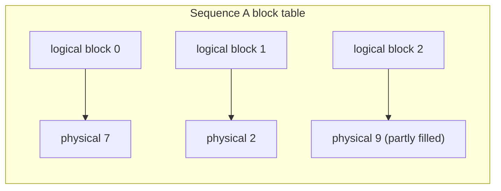

Continuous batching keeps slots busy, but each slot needs KV-cache memory, and memory is what limits the batch size. Early serving systems allocated that memory the simple way: when a request arrived, reserve one contiguous chunk big enough for the longest answer it might produce. Most answers are much shorter than the maximum, so most of the reserved memory never held anything.

Operating systems solved the same problem decades ago with **virtual memory**: give each program the illusion of a contiguous address space, but back it with small fixed-size pages placed anywhere in physical memory and allocated only when touched. **PagedAttention**, introduced with the vLLM engine, applies that idea to the KV cache.

## Three kinds of waste

With contiguous pre-allocation, a sequence's reserved region wastes memory in three ways:

- **Reservation waste**: space reserved for tokens not generated yet (and possibly never).
- **Internal fragmentation**: the request finishes early, so the tail of its region was never used.
- **External fragmentation**: free memory is split into gaps too small for a new contiguous region.

Suppose the server reserves $n_{max}$ tokens per sequence but the average sequence ends up using $\bar{n}$. The fraction of KV memory holding real data is at best

$$
U_{contig} \le \frac{\bar{n}}{n_{max}}
$$

before even counting external fragmentation.

## Pages (blocks)

PagedAttention divides the KV cache into **blocks** of a fixed number of tokens $S$ (16 is a common default). Each sequence has a **block table** mapping its logical token positions to physical blocks anywhere in GPU memory. A new block is allocated only when the previous one is full. The attention kernel follows the block table to gather keys and values.

The only waste is the unfilled part of each sequence's last block, at most $S - 1$ tokens and on average about $S/2$:

$$
U_{paged} \approx \frac{\bar{n}}{\bar{n} + S/2}
$$

```steps
Contiguous versus paged, worked
An 8B model with 128 KiB of KV per token. The server allows up to $n_{max} = 4096$ tokens per sequence; real sequences average $\bar{n} = 600$ tokens.
---
Contiguous: each sequence reserves $4096 \times 128$ KiB $= 512$ MiB. Only 600 tokens (75 MiB) hold data, so $U \le 600/4096 = 14.6\%$.
---
With 60 GB of KV memory, contiguous allocation fits $60 \times 1024 / 512 = 120$ sequences.
---
Paged with $S = 16$: average waste is 8 tokens per sequence, $U \approx 600/608 = 98.7\%$. Each sequence uses about $608 \times 128$ KiB $= 76$ MiB.
---
Same 60 GB now fits about $61{,}440 / 76 \approx 808$ sequences, roughly 6.7 times as many. Memory, not compute, was limiting the batch, so throughput rises accordingly.
```

The vLLM paper measured that earlier systems kept well under half of their KV memory filled with actual token data, and that paging brought waste down to a few percent. The resulting larger batches were the main source of its throughput gains.



## Sharing for free

Block tables also make **sharing** cheap. If several sequences start with the same prompt prefix (a shared system prompt, or several samples from one prompt), their tables can point at the same physical blocks. A block is copied only when a sequence needs to write something different into it (**copy-on-write**). This is the mechanism behind prefix caching in lesson 5 and makes parallel sampling and beam search much cheaper in memory.

## Choosing the block size

Smaller blocks waste less memory but mean longer block tables and more scattered memory reads, which can slow the attention kernel. Larger blocks read more efficiently but waste up to $S - 1$ tokens per sequence and make prefix sharing coarser (sharing works in whole blocks). With $\bar{n}$ in the hundreds or thousands, $S = 16$ wastes about 1%, so the default is rarely worth changing.

## See it

```sim
llm-batching
{"model": "llama3-8b", "gpu": "h100", "batch": 128, "promptTokens": 2000, "outputTokens": 500, "gpuPrice": 2.5}
```

The sim assumes paged allocation: the maximum batch it reports comes from free memory divided by the KV size of each sequence's actual length. Imagine instead that every sequence reserved 8,000 tokens; work out the batch that would fit (free memory divided by $8000 \times 128$ KiB) and compare it with the sim's maximum. The gap is what PagedAttention bought.

## In practice

Engines expose the KV pool as a fraction of GPU memory (vLLM calls it the GPU memory utilisation setting) and log how many blocks are free. If the pool runs out mid-generation, the scheduler must **preempt** a sequence: either swap its blocks to CPU memory or drop them and recompute the prefill later. Frequent preemption shows up as latency spikes for unlucky users; it means the batch limit is too high for the context lengths you are seeing.

```quiz
{"q": "Sequences average 300 tokens, and a contiguous allocator reserves 2,048 tokens each. What fraction of KV memory holds real data at best?", "options": ["About 14.6%", "About 98%", "About 85%", "About 50%"], "answer": 0, "explain": "$300/2048 = 0.146$. 98% is roughly what paged allocation achieves ($300/308$ with 16-token blocks); 85% is the waste fraction, not the useful fraction."}
```

```quiz
{"q": "With a block size of 16 tokens, what is the maximum KV memory wasted per sequence, in tokens?", "options": ["15", "16", "8", "0"], "answer": 0, "explain": "Only the last block can be partly empty, and it holds at least one token, so at most $16 - 1 = 15$ slots are unused. The average is about 8 (half a block); zero would require every length to be a multiple of 16."}
```
