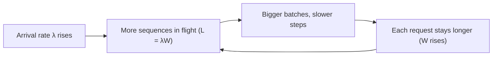

A coffee shop serves 2 customers per minute, and each customer spends 10 minutes inside from entering to leaving. How many people are inside at any moment, on average? Twenty. You did not need to know anything about the queue, the menu or how many baristas there are. That is **Little's law**, one of the few results in queueing theory that holds almost unconditionally.

For LLM serving it answers the question every capacity discussion eventually reaches: *how many sequences will be in flight at once?* That number is the batch the engine actually runs, and it decides both per-user speed and whether the KV cache fits.

## The law

For any stable system (one where, over the long run, as many items leave as arrive):

$$
L = \lambda W
$$

- $L$: the average number of items in the system (here, requests being served or waiting).
- $\lambda$: the average arrival rate (requests per second).
- $W$: the average time an item spends in the system (seconds per request).

It holds regardless of the arrival pattern, the distribution of service times, or the scheduling order, provided all three are long-run averages over the same system boundary.

## Applied to decode

Draw the boundary around "sequences currently decoding". A request is inside from its first decode step to its last, roughly $W \approx n_{out} \cdot \text{TPOT}$. Then the average decode batch is

$$
\bar{B} = \lambda \cdot \bar{n}_{out} \cdot \text{TPOT}
$$

```steps
How many users share each step?
Traffic: $\lambda = 5$ requests/s, average answer $\bar{n}_{out} = 400$ tokens, TPOT 20 ms.
---
Time each request spends decoding: $W = 400 \times 0.020 = 8$ s.
---
Little's law: $\bar{B} = 5 \times 8 = 40$ sequences decoding at once, on average.
---
KV check (8B model, 128 KiB per token, average context around 2,000 tokens, so 0.262 GB each): $40 \times 0.262 = 10.5$ GB. Comfortably fits beside 16 GB of weights on an 80 GB GPU.
---
Consistency check: at batch 40, the previous topics' model gives a step time of about $(16.06 + 40 \times 0.262)/3350 = 7.9$ ms ideal. A measured 20 ms TPOT would suggest the efficiency or the context assumptions need revisiting, which is exactly the kind of cross-check Little's law makes cheap.
```

## The feedback loop

Little's law has a sting. TPOT depends on batch size, and batch size depends on TPOT through $\bar{B} = \lambda \bar{n}_{out} \text{TPOT}$. Under rising load:



Below capacity this loop settles: a little more load means slightly bigger batches and slightly slower tokens. Near capacity it runs away: either the KV cache fills and new requests queue (TTFT explodes) or the scheduler preempts sequences. That cliff is why capacity planning targets a utilisation well below 100%.

## Using it backwards

Little's law also tells you the maximum sustainable rate for a given in-flight limit. If an engine can hold at most $L_{max}$ concurrent sequences (from KV memory) and each spends $W$ seconds in the system, then

$$
\lambda_{max} = \frac{L_{max}}{W}
$$

With a cap of 64 sequences and $W = 10$ s per request, the replica can sustain at most $64/10 = 6.4$ requests per second. Beyond that, requests must wait in a queue, and the queue itself obeys Little's law: if 3 requests are queued on average and the queue drains at $\lambda = 6.4$/s, each waits $3/6.4 \approx 0.47$ s, added straight to TTFT.

## See it

```sim
llm-batching
{"model": "llama3-8b", "gpu": "h100", "batch": 40, "promptTokens": 1600, "outputTokens": 400, "gpuPrice": 2.5}
```

The sim starts at the batch of 40 from the walkthrough. Read the per-user speed, convert it to TPOT ($1/\text{speed}$), and plug it back into $\bar{B} = \lambda \bar{n}_{out} \text{TPOT}$ with $\lambda = 5$. If the result is lower than 40, the system has spare speed and the true batch would settle lower; raise $\lambda$ in your head until the two agree. That fixed point is where the real system will sit.

## In practice

Little's law is the quickest sanity check in serving. If a dashboard shows 12 requests/s, 6-second average latency and 30 running sequences, something is off: $12 \times 6 = 72$, so either requests are queued outside the engine, the latency metric covers a different boundary, or the numbers come from different windows. It is also how you set concurrency limits on a client or gateway: to keep $L$ sequences busy with latency $W$, a client needs about $\lambda = L/W$ requests per second, and a load test with fixed concurrency $C$ will achieve only $C/W$.

```quiz
{"q": "A replica serves 8 requests/s, and each request spends on average 12 s in the system. How many requests are in the system on average?", "options": ["96", "1.5", "0.67", "20"], "answer": 0, "explain": "$L = \\lambda W = 8 \\times 12 = 96$. Dividing either way (1.5 or 0.67) misapplies the law; 20 adds the numbers."}
```

```quiz
{"q": "KV memory limits a replica to 120 concurrent sequences. Requests average 600 output tokens at a TPOT of 25 ms. What is the maximum sustainable request rate, ignoring queueing and prefill time?", "options": ["8 requests/s", "4.8 requests/s", "200 requests/s", "0.125 requests/s"], "answer": 0, "explain": "$W = 600 \\times 0.025 = 15$ s, so $\\lambda_{max} = L_{max}/W = 120/15 = 8$ req/s. 4.8 req/s divides 120 by 25 (treating the TPOT in ms as the whole latency); 200 confuses tokens with requests."}
```
