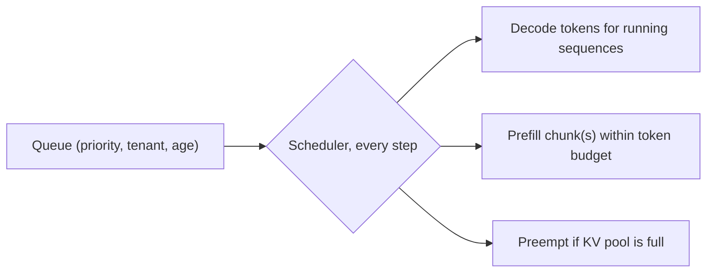

Continuous batching decides *when* requests can join. A **scheduler** decides *which* work goes into each step: whose prefill runs now, how much of it, who waits, and who gets evicted when memory runs out. Two engines with identical kernels can have very different p99 latencies purely because of these decisions.

Think of a kitchen during dinner rush. A table of twelve orders at once. If the chef stops everything to prepare all twelve dishes, every other table's food goes cold. If the chef slots one of the twelve dishes between each round of other orders, the big table waits a little longer and nobody else notices. That is chunked prefill.

## The prefill stall

Without chunking, admitting a request with a long prompt means running its whole prefill in one step. Every sequence in the batch waits for it. The stall is the prefill time:

$$
t_{stall} \approx \frac{2 N n_{in}}{\eta_c P}
$$

with $N$ parameters, $n_{in}$ prompt tokens, peak compute $P$ and achieved fraction $\eta_c$.

## Chunked prefill

**Chunked prefill** caps the number of prompt tokens processed per step at a budget $c$. A long prompt is split into $\lceil n_{in}/c \rceil$ chunks, one per step, each riding along with the regular decode tokens. Each step now costs its usual decode time plus the chunk's compute:

$$
t_{step} \approx t_{decode} + \frac{2 N c}{\eta_c P}
$$

Because decode steps are memory-bound and leave the tensor cores mostly idle, a moderate chunk partly overlaps with work the GPU was doing anyway, so the real added time is often less than this simple sum.

```steps
One 8,000-token prompt arrives at a busy server
8B model on an H100, $\eta_c P \approx 0.6 \times 989 = 593$ TFLOP/s. Thirty-two users are decoding at about 8 ms per step.
---
No chunking: $t_{stall} = 2 \times 8.03\times10^{9} \times 8000 / 5.93\times10^{14} = 217$ ms. All 32 users see one inter-token gap of about 225 ms.
---
Chunks of $c = 512$: $\lceil 8000/512 \rceil = 16$ chunks, each adding $2 \times 8.03\times10^{9} \times 512 / 5.93\times10^{14} = 13.9$ ms.
---
During those 16 steps the other users' ITL is about $8 + 13.9 \approx 22$ ms instead of 8 ms: slower, but no visible freeze. Their max ITL drops from about 225 ms to about 22 ms.
---
The newcomer's TTFT rises from about 217 ms to about $16 \times 22 \approx 350$ ms, since its prefill is spread over 16 shared steps. The chunk size trades the newcomer's TTFT against everyone else's ITL.
```

| Chunk budget $c$ | Added per step | Steps for 8,000 tokens | Newcomer's prefill time | Others' worst ITL |
|---|---|---|---|---|
| no chunking | 217 ms once | 1 | ~217 ms | ~225 ms |
| 2,048 | 55 ms | 4 | ~250 ms | ~63 ms |
| 512 | 13.9 ms | 16 | ~350 ms | ~22 ms |
| 128 | 3.5 ms | 63 | ~720 ms | ~11.5 ms |

(Simple additive model; overlap with decode makes real numbers somewhat better.)

## When memory runs out: preemption

Continuous batching admits sequences without knowing how long they will become. If the KV pool fills, the scheduler must evict someone. Two options:

- **Swap**: copy the sequence's KV blocks to CPU memory and bring them back later. Cost: PCIe transfer time in both directions.
- **Recompute**: drop the blocks and later redo the prefill over prompt plus already-generated tokens. Cost: compute, but no transfer.

Either way, the preempted user sees a long pause. Usually the most recently admitted sequence is evicted (it has done the least work). A rising preemption count is a signal that the batch limit is too high for current context lengths.

## Who goes first: priorities and fairness

The default order is **first come, first served**. Alternatives:

- **Priority classes**: interactive traffic before batch traffic, paid tier before free tier. Batch work fills the gaps and is preempted first.
- **Shortest job first**: favour requests expected to finish quickly, which lowers average latency. Output length is unknown in advance, so this needs a predictor (or a user-supplied limit), and long requests can starve without an ageing rule.
- **Fairness per tenant**: cap each customer's share of the batch so one heavy user cannot fill it.
- **Cache-aware placement**: route requests that share a prompt prefix to the replica that already holds it (lesson 5).



## See it

```sim
llm-batching
{"model": "llama3-8b", "gpu": "h100", "batch": 32, "promptTokens": 8000, "outputTokens": 300, "gpuPrice": 2.5}
```

With 8,000-token prompts, read the maximum batch the KV cache allows. Lower the prompt to 1,000 and see it grow. Long prompts hurt twice: their prefill steals compute from decoders, and their KV cache shrinks the batch for everyone. Now practise end to end: the lab has you configure a real-shaped chat service and tune its batch limit and chunk size to an SLO, and the sandbox lets you replay traffic against a serving setup and watch TTFT, ITL and goodput move.

```lab
serve-a-chat-model
```

```sandbox
llm-serving-basic
```

## In practice

Typical engine knobs: maximum concurrent sequences, maximum tokens per step (the chunk budget plus decode tokens), whether chunked prefill is on, the KV pool size, and the preemption mode. Tune them with an open-loop load test at your real prompt and output length mix, looking at p99 ITL as well as TPOT. If ITL spikes line up with arrivals of long prompts, lower the token budget; if TTFT for long prompts is too high, raise it or route long-prompt traffic to its own pool.

```quiz
{"q": "With the walkthrough's numbers ($\\eta_c P \\approx 593$ TFLOP/s, 8B model), how much time does a 1,024-token prefill chunk add to a step?", "options": ["About 27.7 ms", "About 13.9 ms", "About 217 ms", "About 1.4 ms"], "answer": 0, "explain": "$2 \\times 8.03\\times10^9 \\times 1024 / 5.93\\times10^{14} = 0.0277$ s. 13.9 ms is the 512-token chunk; 217 ms is the whole 8,000-token prefill."}
```

```quiz
{"q": "After enabling chunked prefill with a small chunk size, p99 inter-token latency improves but p95 TTFT for long prompts gets worse. Why?", "options": ["Each long prompt's prefill is now spread over many shared steps, so its first token arrives later", "Chunking increases the total FLOPs of prefill", "Chunking disables continuous batching", "The KV cache is recomputed for every chunk"], "answer": 0, "explain": "The same prefill FLOPs are executed, but interleaved with decode steps, so the long request finishes its prefill later in wall-clock time. That is the intended trade: bounded stalls for everyone in exchange for slightly later first tokens on long prompts. Earlier chunks' KV is kept, not recomputed."}
```
