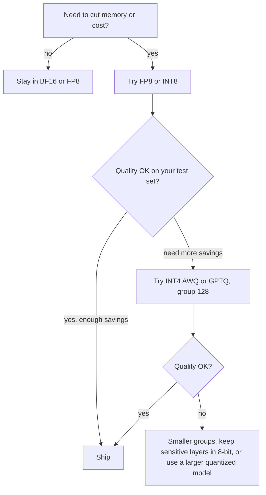

Quantization is a trade: you pay in quality and get memory, speed and money back. The skill is measuring the price accurately. "Perplexity went up by 2%" and "the model now fails 8% more of our invoices" are both true statements about the same quantized model, and only the second one matters to a product.

## Perplexity as a first signal

The cheapest check compares **perplexity** on held-out text before and after quantization. For $T$ tokens with the model assigning probability $p_t$ to the true token $t$:

$$
\text{PPL} = \exp\!\left( -\frac{1}{T} \sum_{t=1}^{T} \ln p_t \right)
$$

The exponent is the average negative log-likelihood (the cross-entropy loss, in nats). A perplexity of 6 means the model is, on average, as uncertain as a fair 6-way choice per token. Quantization raises the loss slightly.

```steps
Reading a perplexity change
BF16 baseline: PPL $= 6.00$. After INT4: PPL $= 6.12$.
---
Relative increase: $6.12/6.00 - 1 = 2.0\%$.
---
In loss terms: $\ln 6.12 - \ln 6.00 = 1.8115 - 1.7918 = 0.0198$ nats per token. The log form is the honest comparison, since perplexity is an exponential of it.
---
Rule of thumb widely observed in practice: 8-bit is nearly indistinguishable from 16-bit, good 4-bit methods add a few percent of perplexity on larger models, 3-bit adds clearly more, and 2-bit is usually unusable without special techniques. Smaller models lose more than larger ones at the same bit width.
```

Perplexity is a smooth, stable number, which makes it good for comparing quantization settings against each other. It is a weak predictor of the specific skills your product relies on: long-context retrieval, arithmetic, strict output formats and rare languages tend to degrade earlier than average perplexity suggests.

## Evaluate on your own task

The reliable method is the one from the evaluation module: run a fixed test set through the BF16 model and each candidate, score both with the same metric, and compare with confidence intervals. For a pass rate $\hat{p}$ on $n$ test cases the standard error is $\sqrt{\hat{p}(1-\hat{p})/n}$. With $n = 400$ and $\hat{p} = 0.90$, SE $= \sqrt{0.09/400} = 0.015$, so a 95% interval is about $\pm 3$ points. A drop from 90% to 88.5% is then well within noise; you would need a bigger test set (or paired comparison) to detect a 1.5-point regression.

| Precision | 8B weights | Decode ceiling (H100, batch 1) | Typical quality effect |
|---|---|---|---|
| BF16 | 16.1 GB | ~209 tokens/s | Reference |
| FP8 / INT8 | 8.0 GB | ~417 tokens/s | Near-lossless in most reports |
| INT4 (g128) | 4.1 GB | ~810 tokens/s | Small loss; test on your task |
| INT3 / INT2 | 3.0 / 2.1 GB | ~1,100 / ~1,600 tokens/s | Noticeable to severe loss |

## A decision procedure



Often the better move at a fixed memory budget is a *larger model quantized harder* rather than a smaller model at full precision. A 4-bit 13B model (about 6.7 GB) usually beats a 16-bit 7B model (14 GB) on quality while using half the memory, because model size tends to buy more quality than extra bits do. The exception is below about 3 bits, where the damage outweighs the size advantage.

## See it

```sim
quantization
{"paramsB": 13, "format": "int4", "groupSize": "128", "outliers": true, "seed": 2}
```

Read the weight memory for a 13B model at INT4 (about 6.7 GB) and its perplexity proxy. Then set the model to 7B and BF16: compare memory and proxy. Sweep the format downward through INT8, INT4, INT3 and INT2 at 13B and find the bit width where the quality proxy starts to climb steeply. Finally, try the lab below, which has you pick the cheapest precision that meets a quality threshold.

```lab
shrink-the-model
```

## In practice

Teams usually ship quantized models in three steps: pick candidates from published quantizations of the model they want, run their own regression suite against BF16 including long-context and structured-output cases, and run a canary rollout comparing live metrics. Keep the BF16 build available so you can roll back, and record the quantization method, group size and calibration set with the model version; two "INT4" files can differ in quality more than one INT4 and one INT8 do.

```quiz
{"q": "A BF16 model scores perplexity 8.00 and an INT4 version 8.40. What is the increase in average loss per token, in nats?", "options": ["About 0.049", "0.40", "5%", "About 0.84"], "answer": 0, "explain": "$\\ln 8.40 - \\ln 8.00 = 2.1282 - 2.0794 = 0.0488$ nats. 0.40 is the raw perplexity difference and 5% the relative perplexity increase; neither is a loss difference."}
```

```quiz
{"q": "Your quantized model passes 88.5% of 400 test cases versus 90.0% for BF16. What can you conclude?", "options": ["Not much: the 1.5-point gap is smaller than the roughly ±3 point 95% interval", "INT4 definitely loses 1.5 points of quality", "INT4 is better, since the sample is small", "The test set must be wrong"], "answer": 0, "explain": "With $n = 400$ and $\\hat{p} \\approx 0.9$ the standard error is about 1.5 points, so the 95% interval is about ±3. A difference of 1.5 is within noise. A paired comparison on the same cases, or more cases, would be needed to resolve it."}
```
