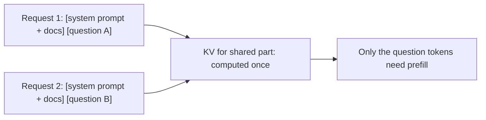

Most real prompts are mostly the same text. A support bot sends the same 6,000-token instructions and policy documents with every question. A coding assistant resends the same file context turn after turn. A chat app resends the entire conversation so far, plus one new message. Recomputing the KV cache for text the model has already processed a moment ago is pure waste.

**Prefix caching** (also called KV reuse) keeps the KV cache of recently processed prompts. When a new request begins with exactly the same tokens as a cached one, the server skips prefill for that shared **prefix** and computes only the new tail.

## Why it works, and why only prefixes

In a causal transformer, the key and value vectors of token $t$ depend only on tokens $1 \dots t$. They do not depend on anything after $t$. So if two requests share their first $P$ tokens, their KV entries for those $P$ positions are *identical*, and one copy can serve both. This holds only for a *prefix*: if the shared text sits after a difference, every token after the difference has different context and therefore different keys and values.



## How engines find a match

With PagedAttention-style blocks of $S$ tokens, each full block is identified by a hash of its tokens *and the hash of the block before it*, so a block's identity encodes the entire prefix. A new request hashes its blocks in order and reuses cached blocks until the first miss. Another design, a **radix tree** over token sequences, does the same walk node by node. Both reuse whole blocks, so the last partial block is always recomputed.

```steps
The saving, for one request
8B model, H100, effective compute about $5.93 \times 10^{14}$ FLOP/s (60% of 989 TFLOP/s). Prompt: 8,000-token shared prefix plus a 500-token question.
---
Prefill with no cache: $2 \times 8.03\times10^{9} \times 8500 = 1.365 \times 10^{14}$ FLOPs, so $0.230$ s. TTFT is at least 230 ms.
---
With a cache hit on the prefix (8,000 is a multiple of 16, so 500 full blocks are reused): only 500 tokens need prefill, $2 \times 8.03\times10^{9} \times 500 / 5.93\times10^{14} = 0.0135$ s, about 14 ms. A 94% reduction in prefill compute.
---
Memory the cached prefix occupies: $8000 \times 131{,}072$ bytes $= 1.05$ GB of KV, held in the pool until evicted. The saving is paid for in memory, not in compute.
---
If the prefix were 8,007 tokens, the last 7 tokens do not fill a block and are recomputed (negligible).
```

The generic formula: with a prefix of $P$ tokens, a unique suffix of $S_u$ tokens and hit probability $h$, the expected prefill tokens are

$$
\mathbb{E}[\text{tokens prefilled}] = S_u + (1 - h)\,P
$$

At $h = 0.8$, $P = 8000$, $S_u = 500$: $500 + 0.2 \times 8000 = 2{,}100$ instead of 8,500, a 75% reduction.

## See it

```sim
prompt-cache
{"prefixTokens": 8000, "suffixTokens": 500, "outputTokens": 300, "hitRate": 0.8, "readDiscount": 0.1, "writePremium": 0.25, "priceIn": 3}
```

Watch the TTFT saved when the hit rate is 0.8 and compare it with the 230 ms to 14 ms reasoning above (the sim also adds fixed overheads). Slide the hit rate to zero and then one. TTFT falls in proportion to the share of the prompt that is cached, but decode time does not change at all: caching removes prefill work only.

## What gets in the way

| Cause of a miss | What happens | Remedy |
|---|---|---|
| A single token differs early (a timestamp, user name, request ID in the system prompt) | Everything after it misses | Move variable text after the stable text |
| Different tool or document ordering | The prefix diverges at the first difference | Canonical ordering |
| Eviction | The pool needs the blocks for running sequences | More KV memory, cache-aware routing |
| Request lands on a different replica | That replica has not seen the prefix | Route by prefix hash (session or prompt affinity) |
| Prefix shorter than a block or below the provider's minimum | Not cached | Pool short prefixes into one longer shared prefix |

## In practice

Self-hosted engines enable prefix caching with a flag, and it costs little when there is nothing to reuse. The thing to monitor is the **hit rate** in tokens: cached prompt tokens divided by total prompt tokens. A workload with a long shared system prompt should be above 70 to 90%; a figure near zero usually means something early in the prompt varies on every request. Multi-turn chat benefits automatically, because each turn's prompt starts with the previous turn's prompt and its answer.

```quiz
{"q": "A 6,000-token shared prefix plus a 400-token question. With the prefix cached, roughly what fraction of prefill FLOPs remains?", "options": ["About 6.3%", "About 94%", "50%", "About 15%"], "answer": 0, "explain": "Only the 400 new tokens are prefilled: $400/6400 = 6.25\\%$. 94% is the fraction saved, not the fraction remaining."}
```

```quiz
{"q": "Why can't a cached KV block be reused when two prompts share the same paragraph but differ in the text before it?", "options": ["Each token's keys and values depend on all earlier tokens, so the paragraph's KV differs", "The paragraph's token IDs would be different", "Caches only store whole requests", "The hash function is random"], "answer": 0, "explain": "In a causal model, a token's key and value are computed from its context to the left. The same words after different preceding text have different KV entries. Token IDs are identical, which is a common misconception; it is the context that changes."}
```
