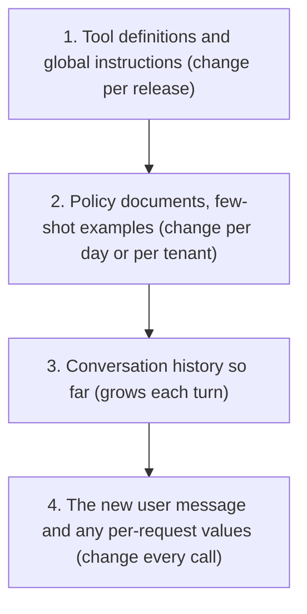

Prefix caching rewards structure. You do not get hits by turning a flag on; you get them by building prompts whose beginnings are stable and by sending traffic often enough that cached entries are still alive when the next request arrives. Both are design decisions you control.

## Order the prompt from stable to volatile

Because only a shared *prefix* is reusable, arrange content by how often it changes, most stable first:



Anything that varies per request (current time, request ID, user name, retrieved passages that differ per query) belongs at the end. A common bug is a line like "Current date and time: ..." at the top of the system prompt: it changes every second, so no two requests ever share more than that line.

For multi-turn chat the structure comes for free if you only append: turn $k$'s prompt is turn $k-1$'s prompt plus the model's answer plus the new message, so the whole earlier conversation is a cached prefix. Editing or trimming earlier messages (for example dropping the oldest turn to save tokens) breaks the prefix from that point on, which can cost more in lost cache hits than it saves in tokens.

## The cache has a lifetime

Cached KV entries are evicted when memory is needed (self-hosted) or after a time-to-live (TTL) without use (hosted APIs, commonly minutes). If requests that share a prefix arrive as a Poisson stream with rate $\lambda$ per minute, and each use refreshes a TTL of $T$ minutes, then the probability that the next request arrives before the entry expires is

$$
P(\text{hit}) = 1 - e^{-\lambda T}
$$

since $e^{-\lambda T}$ is the probability of a gap longer than $T$ with no arrivals.

```steps
How much traffic keeps a prefix warm?
TTL $T = 5$ minutes. One shared prefix (one tenant's system prompt).
---
$\lambda = 2$ requests per minute: $1 - e^{-10} = 99.995\%$ of requests hit (the first after a quiet period misses).
---
$\lambda = 0.2$ per minute (one every 5 minutes): $1 - e^{-1} = 63.2\%$.
---
$\lambda = 0.1$ per minute (one every 10 minutes): $1 - e^{-0.5} = 39.3\%$.
---
$\lambda = 0.02$ per minute (one an hour): $1 - e^{-0.1} = 9.5\%$. At this rate, with a write premium of 25% and a 90% read discount, the break-even hit rate of 21.7% is not reached: caching would cost slightly more.
```

Two practical consequences. First, low-traffic tenants or rarely used features may not benefit and can even lose slightly if writes carry a premium; enable caching where the arrival rate justifies it. Second, you can sometimes *buy* hits with a cheap keep-alive: for an 8,000-token prefix at \$3 per million input tokens, re-writing it at a 25% premium costs $8000 \times 3.75\times10^{-6} = \$0.030$, while a keep-alive request that merely reads it costs about $8000 \times 0.3\times10^{-6} = \$0.0024$. Pinging every four minutes costs \$0.0024 per ping, which pays off only if a real request is likely to arrive soon after; otherwise you are paying to keep an unused entry alive. Calculate with your own prefix size and prices.

## Routing for locality

If you run several replicas, each has its own cache. A load balancer that sprays requests uniformly across $R$ replicas reduces each replica's per-prefix arrival rate to $\lambda/R$, which lowers $P(\text{hit})$ and duplicates the cached prefix in every replica's memory. **Prefix-aware** (or session-affinity) routing sends requests with the same prefix hash to the same replica, concentrating them. The cost is some load imbalance: a very popular prefix can overload its replica, so good routers fall back to the least-loaded replica when the preferred one is busy.

| Routing | Hit rate | Memory | Load balance |
|---|---|---|---|
| Round robin | Lower (each replica sees $\lambda/R$) | Prefix duplicated on all replicas | Even |
| Prefix hash | Higher | One copy per prefix | Can be skewed |
| Hash with load-aware fallback | High | A few copies of hot prefixes | Good |

## See it

```sim
prompt-cache
{"prefixTokens": 4000, "suffixTokens": 300, "outputTokens": 200, "hitRate": 0.4, "readDiscount": 0.1, "writePremium": 0.25, "priceIn": 3}
```

This starts at a hit rate of 0.4, like a prefix that is reused every 10 minutes. Raise the hit rate to 0.63 and then 0.99 and read the saving at each: that is the value of enough traffic to keep the cache alive. Then lengthen the prefix to 20,000 tokens: with a bigger shared prefix, each hit saves more, so even a modest hit rate pays back.

## In practice

Audit your prompts with a diff: take 100 consecutive production requests, compute the longest common prefix of each with the previous one, and plot its length in tokens. A flat line at a large value means the structure is good; a value that collapses to a few tokens points straight at the volatile text near the top. Move it down, redeploy, and watch the cached-token share in your usage metrics rise.

```quiz
{"q": "Requests sharing a prefix arrive at 0.4 per minute and the cache TTL (refreshed on each use) is 5 minutes. What is the approximate hit probability?", "options": ["About 86%", "40%", "About 63%", "About 99%"], "answer": 0, "explain": "$\\lambda T = 0.4 \\times 5 = 2$, so $P = 1 - e^{-2} = 0.865$. 63% is the value for $\\lambda T = 1$; 99% would need $\\lambda T \\approx 4.6$."}
```

```quiz
{"q": "A system prompt begins with \"Today is <current timestamp>.\" and is followed by 5,000 tokens of fixed instructions. What happens to prefix caching, and what is the fix?", "options": ["Almost no hits, because the timestamp differs from the first tokens; move it to the end of the prompt", "Full hits, since the instructions are identical", "Half the prompt hits; there is nothing to fix", "Hits only on Mondays"], "answer": 0, "explain": "KV for every token after the first difference depends on that difference, so the 5,000 instruction tokens, though textually identical, have different KV entries each time. Placing the volatile line after the stable instructions restores the shared prefix."}
```
