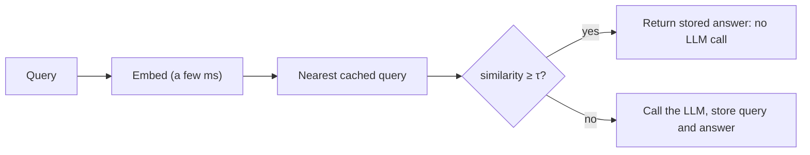

Prefix caching skips *computation* the model has already done on identical text. A **semantic cache** goes a step further: it skips the model entirely when a new question means the same thing as one it has already answered. "How do I reset my password?" and "I forgot my password, how can I change it?" are different strings with the same answer, so why pay for a second model call?

## How it works

1. Embed each incoming query as a vector $\mathbf{q}$ using a small, cheap embedding model.
2. Search the store of previously answered queries $\mathbf{c}_1, \dots, \mathbf{c}_m$ for the nearest one by cosine similarity.
3. If the best similarity is at least a **threshold** $\tau$, return the stored answer (a *hit*). Otherwise call the LLM, return its answer, and store the new query and answer (a *miss*).

Cosine similarity measures the angle between two vectors:

$$
\cos(\mathbf{q}, \mathbf{c}) = \frac{\mathbf{q}\cdot\mathbf{c}}{\lVert\mathbf{q}\rVert\,\lVert\mathbf{c}\rVert}
$$

It is 1 for identical directions, 0 for unrelated ones. For a quick check with 3-dimensional toy vectors, $\mathbf{q} = (0.6, 0.8, 0)$ and $\mathbf{c} = (0.8, 0.6, 0)$ both have length 1, so $\cos = 0.48 + 0.48 = 0.96$: above a threshold of 0.95, a hit.



## What a hit saves

A hit costs one embedding plus a vector lookup, perhaps a few milliseconds and a fraction of a cent per thousand queries, versus hundreds of milliseconds to seconds and about a cent for a full model call. With hit rate $H$, LLM cost $c$ per call and lookup cost $e$ per query (paid on every query, hit or miss):

$$
\mathbb{E}[\text{cost per query}] = e + (1 - H)\, c
$$

and the mean latency drops likewise.

```steps
Savings at a 30% hit rate
$c = \$0.010$ per LLM call (1,500-token prompt, 300-token answer on a mid-priced model), $e = \$0.00002$ per embedding and lookup, $H = 0.30$, 100,000 queries per day.
---
Without the cache: $100{,}000 \times 0.010 = \$1{,}000$ per day.
---
With it: $100{,}000 \times (0.00002 + 0.70 \times 0.010) = 100{,}000 \times 0.00702 = \$702$ per day. A 29.8% saving.
---
Latency: a hit returns in about 10 ms instead of about 2 s. The mean falls from 2 s to $0.3 \times 0.01 + 0.7 \times 2 = 1.4$ s, and the p50 falls much more than the p95.
---
The catch is that this arithmetic assumes every hit returns a *correct* answer. The next topic puts a price on the ones that do not.
```

## What is a good thing to cache?

Semantic caching works best when answers are context-free and stable: product FAQs, documentation questions, definitions, policy lookups. It is dangerous when the right answer depends on who is asking or on changing state ("What's my balance?", "Where is my order?"), because two queries can be semantically near-identical and need different answers. Personalisation, user data and time-sensitivity all argue against caching the final answer, or for keying the cache by user or tenant.

| Query type | Cache the answer? | Why |
|---|---|---|
| "What is your return policy?" | Yes | Same answer for everyone, rarely changes |
| "Summarise this document" (different documents) | No | Meaning of the query is identical, the answer is not |
| "What's my order status?" | No | Depends on user and time |
| "Explain how DNS works" | Yes | Stable general knowledge |

## See it

```sandbox
semantic-cache
```

The sandbox lets you set a similarity threshold, send a stream of similar and not-so-similar queries and watch hits, misses, savings and wrong answers. Begin at a threshold of 0.95 and note the hit rate. Lower it to 0.85 and see the hit rate climb, along with the share of answers that are wrong. The next topic makes that trade-off quantitative.

## In practice

Start with an *exact-match* cache (normalised text, such as lower-cased and whitespace-trimmed) in front of everything, since it has no false hits. Add a semantic layer only if your traffic has many paraphrases, and measure the false-hit rate on labelled pairs before enabling it. Keep stored entries tagged with the model, prompt and knowledge version, so a change to any of them invalidates the right entries. Return a header or flag marking cached answers; it is invaluable when debugging a user complaint.

```quiz
{"q": "A semantic cache has a 25% hit rate, an LLM call costs \\$0.02, and each lookup costs \\$0.0001. What is the expected cost per query?", "options": ["\\$0.0151", "\\$0.015", "\\$0.0051", "\\$0.0201"], "answer": 0, "explain": "Every query pays the lookup: $0.0001 + 0.75 \\times 0.02 = 0.0001 + 0.015 = \\$0.0151$. Leaving out the lookup gives \\$0.015; \\$0.0051 would assume 25% of the *cost* remains."}
```

```quiz
{"q": "Which query is the worst candidate for a semantic answer cache?", "options": ["\"Where is my order?\" asked by many different customers", "\"What are your opening hours?\"", "\"How do I reset my password?\"", "\"What does API stand for?\""], "answer": 0, "explain": "The phrasing is identical across customers but the correct answer depends on the user and the current state of their order. A semantic cache would happily return another customer's answer. The other three have the same answer for everyone."}
```
