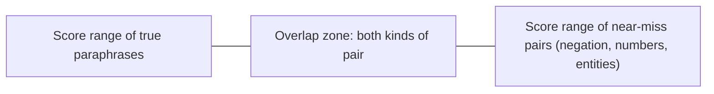

A semantic cache has a failure mode a prefix cache does not: it can return a fluent, confident, **wrong** answer. "How do I cancel my order?" and "How do I cancel my subscription?" sit very close together in embedding space, because they share almost every word, yet they need different answers. Embedding similarity measures *topical closeness*, not *interchangeability of answers*.

Names for the outcomes of a lookup at threshold $\tau$:

- **Hit**: best similarity $\ge \tau$. The cached answer is returned. Of all queries, a fraction $H(\tau)$ are hits.
- **Correct hit**: the cached answer would also have been acceptable for this query.
- **False hit**: the answer is returned but is wrong for this query. Among hits, a fraction $\varphi(\tau)$ are false.

Raising $\tau$ makes hits rarer and more reliable; lowering it does the opposite. Both $H$ and $\varphi$ are *measured* on labelled data, not derived.

## Why the same score can mean different things

Embedding models compress meaning into a few hundred numbers, and some distinctions are small in that space: negation ("can" versus "cannot"), numbers and dates ("refund within 30 days" versus "60 days"), entities (two products), and scope ("my account" versus "any account"). Pairs like these can score 0.93 to 0.98. Genuine paraphrases with different wording can score 0.85 to 0.92. The score ranges overlap, so no threshold separates them perfectly.



## The expected-value calculation

Let $c$ be the cost saved by one correct hit (an avoided LLM call), $L$ the cost of showing a user a wrong answer (a support escalation, a refund, a lost customer), and $e$ the lookup cost paid on every query. Per query, the expected net benefit of the cache is

$$
V(\tau) = H(\tau)\,\big[(1 - \varphi(\tau))\,c - \varphi(\tau)\,L\big] - e
$$

The first term inside the brackets is the saving on correct hits, the second the damage from false ones. Because $L$ is typically many times larger than $c$, a small $\varphi$ can wipe out a large $H$.

Suppose you labelled 500 query pairs and measured the following (illustrative) behaviour, with $c = \$0.01$, $L = \$0.20$ (a wrong answer costs 20 LLM calls' worth) and $e = \$0.00002$:

| Threshold $\tau$ | Hit rate $H$ | False share of hits $\varphi$ | Wrong answers as % of all queries ($H\varphi$) | Net $V$ per query |
|---|---|---|---|---|
| 0.99 | 4% | 0% | 0% | +\$0.00038 |
| 0.97 | 10% | 1% | 0.10% | +\$0.00077 |
| 0.95 | 18% | 3% | 0.54% | +\$0.00065 |
| 0.92 | 25% | 7% | 1.75% | $-$\$0.00120 |
| 0.90 | 31% | 12% | 3.72% | $-$\$0.00473 |
| 0.85 | 45% | 25% | 11.25% | $-$\$0.01915 |

```steps
Verifying one row of the table
Take $\tau = 0.95$: $H = 0.18$, $\varphi = 0.03$, $c = 0.01$, $L = 0.20$, $e = 0.00002$.
---
Correct-hit saving: $H(1-\varphi)c = 0.18 \times 0.97 \times 0.01 = 0.001746$.
---
False-hit damage: $H\varphi L = 0.18 \times 0.03 \times 0.20 = 0.001080$.
---
Net: $0.001746 - 0.001080 - 0.00002 = +0.000646$ per query, about \$65 per 100,000 queries.
---
At $\tau = 0.90$ the saving is $0.31 \times 0.88 \times 0.01 = 0.002728$ but the damage is $0.31 \times 0.12 \times 0.20 = 0.00744$. Net $-0.00473$: the cache would lose \$473 per 100,000 queries.
```

The best threshold here is 0.97, not 0.85 where the hit rate looks most impressive. The optimum moves with $L/c$: if wrong answers were cheap (a casual chatbot, $L = c$), a threshold of 0.90 might be the best; for medical, legal or financial queries, where $L$ is huge, the only safe semantic cache is one with $\tau$ so high it rarely fires, or none.

## Reducing false hits without giving up hits

- **Guard conditions**: only serve a hit if extracted entities, numbers and intents match (cheap rule-based or small-model check), or if a cheap reranker agrees.
- **Scope the cache**: key by tenant, language, product and model version, so near-misses across scopes cannot collide.
- **Per-category thresholds**: stricter for sensitive categories, looser for chit-chat.
- **Shadow mode**: serve every answer from the LLM, but record what the cache *would* have returned and compare. This measures $H$ and $\varphi$ on real traffic with zero user risk before you turn it on.

## See it

```sandbox
semantic-cache
```

Use the sandbox as the labelled data: step the threshold through 0.99, 0.95 and 0.90 and note, at each, the hit rate and how many hits were wrong. Plug those into $V(\tau)$ with your own choice of $c$ and $L$ and find the maximum. Then double $L$ and see how the best threshold moves.

## In practice

The headline metric to report is not hit rate but **correct-hit rate** and **wrong-answer rate per 1,000 queries**. Review a random sample of hits weekly, since query distributions drift and a threshold tuned in March can be wrong by June. Keep an easy way to purge an entry: when a user reports a bad cached answer, delete it and its near neighbours.

```quiz
{"q": "At $\\tau = 0.95$: $H = 0.20$, $\\varphi = 0.02$, $c = \\$0.01$, $L = \\$0.25$, $e \\approx 0$. What is $V$ per query?", "options": ["+\\$0.000960", "+\\$0.00200", "+\\$0.00196", "$-$\\$0.0010"], "answer": 0, "explain": "$0.20 \\times [0.98 \\times 0.01 - 0.02 \\times 0.25] = 0.20 \\times [0.0098 - 0.0050] = 0.20 \\times 0.0048 = 0.00096$. Ignoring false hits gives 0.00196 ($0.2 \\times 0.0098$); ignoring the correct-hit adjustment gives 0.002."}
```

```quiz
{"q": "Which statement about similarity thresholds is correct?", "options": ["Raising the threshold lowers the hit rate and the false-hit share, and the best value depends on how costly a wrong answer is", "A higher threshold always gives more savings", "Cosine similarity of 0.95 guarantees the answers are interchangeable", "The best threshold is the same for every application"], "answer": 0, "explain": "The score measures closeness in embedding space, not whether one answer fits the other question, so near-misses can score high. The best $\\tau$ maximises expected value and shifts with $L/c$."}
```
