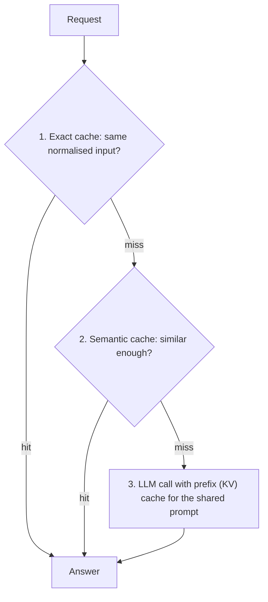

There is an old joke that the two hard problems in computing are naming things and cache invalidation. LLM systems add a twist: the thing being cached (a model's answer, or its internal KV state) depends on the model version, the prompt text, the retrieved documents and sometimes the user. Change any of them and the cached value can be stale or wrong.

## A stack of caches

A well-designed serving path layers caches from cheapest and most certain to most speculative:



| Layer | Skips | Risk of wrong answer | Typical hit source |
|---|---|---|---|
| Prefix / KV cache | Prefill compute for a shared prefix | None: the output is exactly what you would have got | Long system prompts, multi-turn chat |
| Exact response cache | The entire call | None if the answer is deterministic and the key includes everything that matters | Repeated identical queries, retries |
| Semantic response cache | The entire call | Yes, measured by $\varphi$ | Paraphrased FAQs |

The prefix cache is safe by construction (it reproduces the same computation), which is why you enable it first. Response caches change what users see and need keys, expiry and measurement.

## What goes in the cache key

An exact response cache is correct only if the key contains every input that can change the answer:

$$
\text{key} = H\big(\text{model id},\ \text{prompt template version},\ \text{normalised user input},\ \text{retrieved document versions},\ \text{decoding parameters},\ \text{tenant id}\big)
$$

where $H$ is a cryptographic hash. Forgetting one component is how stale answers survive a model upgrade or a policy change. Decoding parameters matter: with temperature above zero the model gives different answers on each call, so a cache turns a random answer into a fixed one. That is often fine, and sometimes a behaviour change you should choose deliberately.

## Staleness: choosing a time to live

Entries should expire. A simple model: if the underlying facts change at rate $\mu$ per day (say, a policy that changes about once every 50 days, $\mu = 0.02$), an entry of age $a$ days is still valid with probability $e^{-\mu a}$. With a TTL of 7 days, the worst-case entry is valid with probability $e^{-0.14} = 87\%$, so up to 13% of the oldest hits could be stale, and the average over a uniform age in $[0, 7]$ is about $93\%$. For static documentation a long TTL is fine; for prices or stock, use seconds or do not cache.

Better than time alone is **event-driven invalidation**: when a source document, prompt version or model version changes, drop the entries tagged with it. Tag every cached answer with the document IDs and versions it used.

```steps
A policy changes on Tuesday
A returns policy document changes from 30 to 60 days. The FAQ answer "You have 30 days to return items" is cached, tagged with `doc:returns-policy@v7`.
---
Without invalidation: for the TTL (say 7 days) every semantically similar question receives the old, now wrong answer.
---
With tags: the publish step for `returns-policy@v8` deletes all entries tagged `@v7`. The next question misses, calls the LLM with the new document, and caches the new answer.
---
Also record the model version and prompt version in the key. A prompt rewrite that fixes a bug should not leave the old, buggy answers served for a week.
```

## Privacy and isolation

Caches can leak. A shared prefix cache holds KV state computed from one customer's text; if another tenant could hit it, timing differences (a much faster first token) could reveal that someone else sent that prefix. Providers address this by scoping caches to an organisation or workspace; self-hosted deployments should scope by tenant (include the tenant ID in the block hash salt) when tenants are mutually untrusted. For a response cache, never share entries across users when answers contain personal data, and apply the same retention and deletion rules as for any stored user data, since cached prompts and answers are stored user data.

## See it

```sim
prompt-cache
{"prefixTokens": 6000, "suffixTokens": 400, "outputTokens": 300, "hitRate": 0.7, "readDiscount": 0.1, "writePremium": 0.25, "priceIn": 3}
```

Think of this as the bottom layer of the stack. Set the hit rate to 0.7, note the saving, then imagine the exact and semantic caches in front of it removing, say, 20% of requests entirely: those requests no longer reach the prefix cache at all, so the remaining traffic has a lower arrival rate for each prefix, which can lower its hit rate. Layers interact; measure the whole stack, not each layer in isolation.

## In practice

Instrument each layer separately: requests entering, hits, misses, evictions, tokens saved, and for response caches the sampled wrong-answer rate. A single "cache hit rate" number hides which layer is working. Review the key schema in design review like any other API: it is the contract that decides when users see old answers.

```quiz
{"q": "A cached answer depends on a policy document that is updated, but the cache key contains only the user's question. What goes wrong?", "options": ["Users keep receiving the old answer until the entry expires or is purged", "The cache refuses to store the question", "The prefix cache becomes invalid", "Nothing, since the model recomputes on every request"], "answer": 0, "explain": "The key does not change when the document does, so lookups keep hitting the stale entry. Including the document version in the key, or tagging entries for event-driven invalidation, fixes it. A response cache never recomputes on a hit; that is its purpose."}
```

```quiz
{"q": "Facts behind a cached answer change at rate 0.05 per day. What is the probability a 10-day-old entry is still valid, assuming Poisson changes?", "options": ["About 61%", "50%", "About 95%", "About 5%"], "answer": 0, "explain": "$e^{-\\mu a} = e^{-0.05 \\times 10} = e^{-0.5} = 0.607$. 95% is $e^{-0.05}$, the one-day figure; 50% is a guess."}
```
