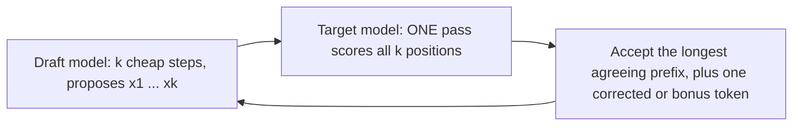

```callout-before
Before you start
Key fact from the memory lesson: a decode step is limited by reading the weights, so checking several tokens in one pass costs hardly more than producing one. This topic turns that fact into speed.
```

A senior editor and a junior writer work together. The junior drafts the next few words quickly. The editor, who is slow but careful, reads the whole draft at once and says "the first four are fine, the fifth is wrong, here is the right one". The editor reviews many words in the time it would take to write one, as long as reading is cheaper than writing.

That is **speculative decoding**. A small, fast **draft model** guesses the next $k$ tokens. The large **target model** then processes all $k$ guesses in a *single forward pass* (like a tiny prefill, since it knows the proposed tokens in advance) and decides which to keep. Verifying $k$ tokens in one pass costs about the same as generating one, because the pass is dominated by reading weights. If most guesses are right, you get several tokens for the price of one target step.



## The acceptance rule keeps the output exact

Speculative decoding does not change what the target would have produced; it only changes how fast. For each proposed token $x$, let $q(x)$ be the draft's probability for it and $p(x)$ the target's probability at that position. Accept $x$ with probability

$$
\min\!\left(1, \frac{p(x)}{q(x)}\right)
$$

If $x$ is rejected, resample a replacement from the **residual distribution** $\propto \max(0, p - q)$ and discard the remaining draft tokens. If all $k$ are accepted, sample one extra "bonus" token from the target's distribution at the last position, which the verification pass has already computed. Leviathan et al. proved that tokens produced this way follow exactly the target's distribution, whatever the draft is.

The chance that a drafted token is accepted, averaged over what the draft proposes, is

$$
\alpha = \sum_{x} \min\big(p(x), q(x)\big) = 1 - \tfrac{1}{2}\sum_x |p(x) - q(x)|
$$

the overlap of the two distributions (one minus the total-variation distance).

```steps
One accept-or-reject, worked
Vocabulary of three tokens A, B, C. Target $p = (0.6, 0.3, 0.1)$, draft $q = (0.5, 0.4, 0.1)$.
---
Acceptance rate: $\alpha = \min(0.6,0.5) + \min(0.3,0.4) + \min(0.1,0.1) = 0.5 + 0.3 + 0.1 = 0.9$. The two models agree 90% of the time.
---
Suppose the draft proposes B. Accept with probability $\min(1, 0.3/0.4) = 0.75$. Suppose it proposes A: accept with probability $\min(1, 0.6/0.5) = 1$ (always).
---
If B is rejected: residual $\max(0, p - q) = (0.1, 0, 0)$, normalised to $(1, 0, 0)$. The replacement is always A.
---
Check exactness for A: $P(\text{output A}) = P(\text{propose A})\cdot 1 + P(\text{propose B})\cdot 0.25 \cdot 1 = 0.5 + 0.4 \times 0.25 = 0.6 = p(A)$. The output distribution equals the target's.
```

## Where the draft comes from

- A **smaller model from the same family** (for example a 1B draft for a 70B target), which must share the tokenizer.
- **Extra heads** on the target model itself (Medusa-style) or a light head reading the target's hidden states (EAGLE-style), which need no separate model.
- **Prompt lookup / n-gram drafting**: copy the continuation of an earlier occurrence in the context. It costs nothing and works well for editing, summarising and code that repeats existing text.

## See it

```sim
speculative-decoding
{"k": 4, "alpha": 0.8, "draftCost": 0.1, "seed": 1}
```

The simulation starts at draft length $k = 4$ and acceptance $\alpha = 0.8$. It reports tokens per target pass and speedup, and also a simulated run you can compare with the formula in the next topic. For now, hold $k$ fixed and move $\alpha$ from 0.5 to 0.95: tokens per pass climb from about 1.9 to over 4. The better the draft matches the target, the more each pass yields.

## In practice

Speculative decoding is a latency tool aimed at the memory-bound regime: low to moderate batch sizes, interactive use, where TPOT is what users feel. It needs extra memory (the draft's weights and KV cache), extra engineering, and a draft matched to the target's domain. A draft trained or tuned on the kinds of text you serve (code, a particular language) typically has a higher $\alpha$ than a generic one.

```quiz
{"q": "Target $p = (0.7, 0.2, 0.1)$ and draft $q = (0.4, 0.4, 0.2)$. What is the acceptance rate $\\alpha = \\sum \\min(p, q)$?", "options": ["0.7", "0.4", "0.9", "0.5"], "answer": 0, "explain": "$\\min(0.7,0.4) + \\min(0.2,0.4) + \\min(0.1,0.2) = 0.4 + 0.2 + 0.1 = 0.7$. The draft is too uncertain about token A, so it is accepted only 70% of the time."}
```

```quiz
{"q": "Does speculative decoding change the text the target model would have sampled?", "options": ["No: with the min(1, p/q) rule and residual resampling the output distribution is exactly the target's", "Yes, quality drops slightly because the draft model is smaller", "Yes, but only at temperature 0", "Only when k is larger than 8"], "answer": 0, "explain": "The acceptance rule and the residual resampling are constructed so that the marginal distribution of each emitted token equals the target's. The draft only influences how many tokens are produced per pass, never which distribution they come from."}
```
