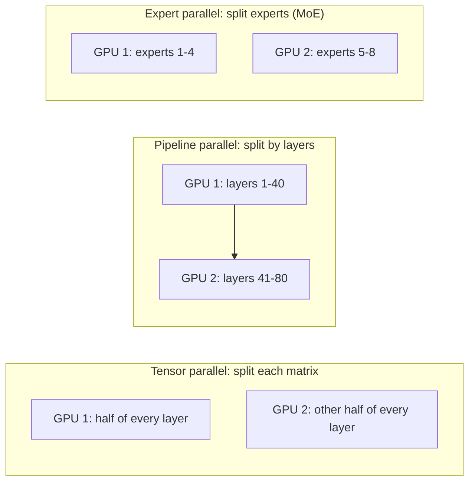

Two separate pressures push a model onto more than one GPU. The first is **capacity**: the weights plus the KV cache simply do not fit. The second is **speed**: more GPUs mean more total memory bandwidth, so a single request's decode steps can be faster. Both have a price, which is moving data between GPUs.

## Capacity: will it fit?

Memory needed on the GPUs combined is

$$
M_{total} \approx \underbrace{N \cdot b}_{\text{weights}} + \underbrace{B\,\bar{n}\,s_{kv}}_{\text{KV cache}} + M_{overhead}
$$

with $N$ parameters, $b$ bytes per weight, batch $B$, average context $\bar{n}$, KV bytes per token $s_{kv}$, and an overhead allowance for activations and the runtime (a few GB per GPU is common).

```steps
How many 80 GB GPUs for Llama 3 70B?
Weights in BF16: $70.6 \times 10^{9} \times 2 = 141$ GB. KV per token (GQA, 80 layers, 8 KV heads, $d_h = 128$): 320 KiB $= 327{,}680$ bytes.
---
Workload: batch 32 with 4,000-token contexts. KV $= 32 \times 4000 \times 327{,}680 = 41.9$ GB.
---
Total with about 5 GB overhead per GPU: on 2 GPUs, $141 + 41.9 + 10 = 193$ GB against 160 GB available. Does not fit.
---
On 4 GPUs: $141 + 41.9 + 20 = 203$ GB against 320 GB. Fits comfortably, with room for a bigger batch.
---
With INT8 weights (70.6 GB) the same workload needs about $70.6 + 41.9 + 10 = 123$ GB, so 2 GPUs suffice. Quantization and parallelism are alternative ways to buy capacity.
```

## Speed: aggregate bandwidth

If the weights are split evenly across $p$ GPUs and each GPU reads only its share, the weight-read time per decode step falls to

$$
t_{weights}(p) \approx \frac{N b}{p\,\beta}
$$

For the 70B model in BF16 on H100s (approximately 3.35 TB/s each): $p = 4$ gives $141/(4 \times 3350) = 10.5$ ms; $p = 8$ gives $5.3$ ms. That is the ideal; communication adds to it (next topics), so real speedups are below linear, and more GPUs also cost more.

| GPUs $p$ | Weights per GPU (70B BF16) | Ideal weight-read time | Ideal batch-1 tokens/s |
|---|---|---|---|
| 2 | 70.5 GB (barely fits, no KV room) | 21 ms | 48 |
| 4 | 35 GB | 10.5 ms | 95 |
| 8 | 17.6 GB | 5.3 ms | 190 |

## Ways to split

A transformer offers three natural cuts:



- **Tensor parallelism (TP)** cuts every weight matrix across GPUs; each layer needs communication, so it wants fast links (topic 5).
- **Pipeline parallelism (PP)** assigns consecutive layers to different GPUs; communication is small and infrequent, but stages must be kept busy (topic 6).
- **Expert parallelism (EP)** is for mixture-of-experts models, placing different experts on different GPUs and routing tokens to them with an all-to-all exchange. A mixture-of-experts model has far more total parameters than it uses per token, so all of them must be held in memory while only a few are read per step.
- **Data parallelism (replicas)** simply runs independent copies; it multiplies throughput, not capacity, and needs no inter-GPU communication at all.

## The interconnect matters

| Link (approximate, per direction) | Bandwidth | Typical use |
|---|---|---|
| NVLink within a node (H100 generation) | about 450 GB/s | Tensor parallelism |
| PCIe Gen5 x16 | about 64 GB/s | Fallback; CPU-GPU transfers |
| InfiniBand between nodes (400 Gb/s NIC) | about 50 GB/s | Pipeline parallelism, inter-node |
| HBM (for comparison) | about 3,350 GB/s | Weight reads |

NVLink is about 7 times faster than PCIe and 9 times faster than a typical inter-node link, and all of them are 7 to 70 times slower than HBM. That ordering tells you what to do: use the fastest links for the chattiest strategy.

## See it

```sim
llm-batching
{"model": "llama3-70b", "gpu": "h100", "batch": 16, "promptTokens": 2000, "outputTokens": 400, "gpuPrice": 2.5}
```

Set the model to Llama-3-70B on an H100 and read the KV-fits indicator and maximum batch: the sim describes one replica, which here would span several GPUs. Compare it with the capacity walkthrough above, and change the GPU to an H200 (141 GB) and see how the batch you can hold changes. More memory per GPU means fewer GPUs per replica, hence less communication.

## In practice

The rule of thumb: use the *smallest* number of GPUs that fits the model with a healthy KV budget, keep them inside one NVLink-connected node, and scale throughput by adding replicas. Go beyond one node only when the model demands it. Splitting a model that would fit on fewer GPUs buys latency at the price of efficiency and of cost per token.

```quiz
{"q": "BF16 weights of a 34B model take 68 GB. On 80 GB GPUs, with the KV cache for your workload needing 25 GB, what is the minimum number of GPUs, ignoring overhead?", "options": ["2", "1", "3", "4"], "answer": 0, "explain": "Total $68 + 25 = 93$ GB exceeds one 80 GB GPU but fits within 160 GB on two. Even though the weights alone fit on one, the KV cache does not, so one GPU is not enough."}
```

```quiz
{"q": "Splitting a model evenly across 4 GPUs, what is the ideal reduction in per-step weight-read time versus one GPU (if it fit)?", "options": ["4 times, before communication costs", "2 times", "Exactly 4 times including communication", "No change; bandwidth is shared"], "answer": 0, "explain": "Each GPU reads a quarter of the weights from its own HBM in parallel, so the ideal is 4×. Communication between GPUs adds time on top, so measured gains fall short of that ideal."}
```
