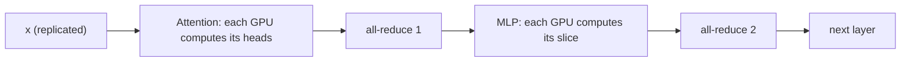

Tensor parallelism cuts each weight matrix into slices, one per GPU. Every GPU does part of every layer, all GPUs work on the same token at the same time, and they exchange partial results a few times per layer. It is the main way to make one request faster across several GPUs, and the communication it needs explains why GPU interconnects matter so much.

## Splitting a matrix multiply

Take $Y = XW$ with $X$ of shape $B \times d$ and $W$ of shape $d \times d_{ff}$. Two ways to split $W$ across $p$ GPUs:

- **Column split**: GPU $i$ holds columns $W_i$ ($d \times d_{ff}/p$) and computes $Y_i = XW_i$. Each GPU needs all of $X$, and produces a slice of $Y$ with *no communication*.
- **Row split**: GPU $i$ holds rows $W^{(i)}$ ($d/p \times d_{ff}$) and the matching slice $X^{(i)}$ of the input, and computes a *partial sum* $Y^{(i)} = X^{(i)} W^{(i)}$. The true output is the sum $Y = \sum_i Y^{(i)}$, which needs an **all-reduce**: every GPU contributes its partial result and every GPU receives the total.

```steps
Row split on a tiny example
$X = [1, 2, 3, 4]$ (one token, $d = 4$), $W$ is $4 \times 1$ with entries $[0.5, -1, 2, 0.25]^\top$, and $p = 2$ GPUs. True output $Y = 0.5 - 2 + 6 + 1 = 5.5$.
---
GPU 1 holds the first two rows: $X^{(1)} = [1, 2]$, $W^{(1)} = [0.5, -1]^\top$. Partial result $= 0.5 - 2 = -1.5$.
---
GPU 2 holds the last two rows: $X^{(2)} = [3, 4]$, $W^{(2)} = [2, 0.25]^\top$. Partial result $= 6 + 1 = 7$.
---
All-reduce (sum): $-1.5 + 7 = 5.5$, and both GPUs now hold it. It equals the single-GPU answer.
```

## The Megatron layout: two all-reduces per layer

A transformer layer has an attention block and an MLP block. The standard arrangement (from the Megatron-LM work) uses the column-then-row pattern in each block:

- **Attention**: split heads across GPUs (a column split of the $Q, K, V$ projections, so each GPU handles $h/p$ heads, with its own slice of the KV cache) and a row split of the output projection $W_O$. One all-reduce after $W_O$.
- **MLP**: column-split the up (and gate) projection, row-split the down projection. One all-reduce after it.

So each layer needs exactly **two all-reduces**, each over an activation of shape $B \times d$. Between them, no communication is needed. A side benefit: the KV cache is split across GPUs too (as long as $p$ divides the number of KV heads).



## How much data moves?

The payload of one all-reduce is the activation tensor: $B \cdot d \cdot b_{act}$ bytes ($B$ tokens in the pass, width $d$, bytes per activation value $b_{act}$, 2 for BF16). A **ring all-reduce** over $p$ GPUs sends, per GPU,

$$
V_{GPU} = 2\,\frac{p-1}{p}\,B\,d\,b_{act} \quad \text{bytes}
$$

Per token step with $L$ layers there are $2L$ all-reduces, so a decode step moves $2L \cdot V_{GPU}$ bytes per GPU, plus a fixed **latency** of some microseconds per all-reduce regardless of size.

```steps
Communication per decode step: 70B model, TP = 8
$L = 80$, $d = 8192$, BF16 activations, batch $B = 32$ sequences (32 tokens per step), $p = 8$.
---
Payload per all-reduce: $32 \times 8192 \times 2 = 524{,}288$ bytes $= 0.5$ MiB.
---
Ring traffic per GPU: $2 \times (7/8) \times 524{,}288 = 917{,}504$ bytes. On NVLink at about 450 GB/s: $917{,}504 / 4.5\times10^{11} = 2.0\ \mu$s.
---
Number of all-reduces per step: $2 \times 80 = 160$. Bandwidth time $160 \times 2\ \mu\text{s} = 0.33$ ms. With about 8 µs of fixed latency each (an illustrative figure), latency adds $160 \times 8 = 1.3$ ms.
---
Compute side: weights per GPU $141/8 = 17.6$ GB, read in $17.6/3350 = 5.3$ ms. Total about $5.3 + 1.3 + 0.3 \approx 6.9$ ms. A single GPU (hypothetical, ignoring that the model would not fit) would need $141/3350 = 42$ ms, so the speedup is $42/6.9 \approx 6.1$, or 76% of the ideal 8. Communication takes about 23% of the step.
```

The takeaway: communication takes a noticeable bite, and for small messages the fixed latency matters more than the bandwidth.

## Over a slow link

Repeat the calculation on PCIe-class links (about 50 GB/s effective): ring traffic of 917,504 bytes takes about 18 µs, plus perhaps 15 to 20 µs fixed latency, roughly 35 µs per all-reduce, times 160 is about 5.6 ms: communication alone is as large as the compute (5.3 ms). This is why tensor parallelism is used within an NVLink-connected node and almost never across nodes.

| Link | Per all-reduce (this example) | 160 per step | Share of a 5.3 ms compute step |
|---|---|---|---|
| NVLink | ~10 µs (2 bandwidth + 8 latency) | ~1.6 ms | ~30% |
| PCIe-class | ~35 µs | ~5.6 ms | ~105% |

## See it

```sim
roofline
{"gpu": "h100", "model": "llama3-70b", "tokens": 32, "precision": "bf16"}
```

The roofline sim describes one GPU running the whole model. Read the ideal pass time for the 70B model at 32 tokens per pass and divide it by 8: that is the ideal TP=8 compute time per step (about 5 ms, scaled by the sim's assumptions). Then add the communication estimates from the tables above and compare the total with the single-GPU figure to see your parallel efficiency.

## In practice

Tensor-parallel degree is a deployment setting: typically 2, 4 or 8, within one node, chosen as the smallest value that fits the model plus KV cache and meets the latency target. It must divide the number of attention (and KV) heads. Because the two all-reduces sit on the critical path of every layer, TP gains diminish quickly beyond 8, and engines overlap communication with computation where they can. Watch for the symptom of a bad interconnect (misconfigured NVLink, GPUs under PCIe switches): TPOT much worse than the compute estimate, with GPU utilisation low.

```quiz
{"q": "With tensor parallelism of degree $p$ using the Megatron layout, how many all-reduces does one transformer layer need?", "options": ["2", "1", "$p$", "4"], "answer": 0, "explain": "One after the attention output projection and one after the MLP down projection, regardless of $p$. The communication volume grows with $(p-1)/p$ and with the activation size, but the count stays two per layer."}
```

```quiz
{"q": "A ring all-reduce over $p = 4$ GPUs of a 1 MiB activation sends how many bytes per GPU?", "options": ["1.5 MiB", "1 MiB", "2 MiB", "0.75 MiB"], "answer": 0, "explain": "$2 \\times (p-1)/p \\times 1\\text{ MiB} = 2 \\times 0.75 = 1.5$ MiB. 0.75 MiB is only half of the ring (reduce-scatter or all-gather alone); 2 MiB is the limit for large $p$."}
```
