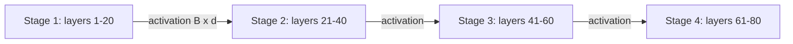

Pipeline parallelism splits the model by depth. With $p$ stages, GPU 1 holds the first $L/p$ layers, GPU 2 the next $L/p$, and so on. A token's activation enters stage 1, flows through each stage in turn, and the last stage produces the logits. Between stages only one activation tensor ($B \times d$) is passed, once, so communication is tiny compared with tensor parallelism. The catch is that stages must wait for each other.

Think of an assembly line with four workstations. A single car still passes through all four in sequence, so one car takes just as long as it would in a one-station factory. The line only helps when many cars are in progress at once, each station always working on a different one.

## Latency is not reduced

For one sequence in decode, the token must traverse all stages sequentially. Each stage reads its own share of the weights, $W/p$ bytes, taking $W/(p\beta)$, and the token needs all $p$ stages, so

$$
t_{token}^{PP} \approx p \cdot \frac{W}{p\,\beta} + (p-1)\,t_{hop} = \frac{W}{\beta} + (p-1)\,t_{hop}
$$

with $t_{hop}$ the time to send the activation to the next stage. That is the *same weight-read time as a single GPU* plus hop overhead. Compare tensor parallelism, where all $p$ GPUs read their slices simultaneously, giving about $W/(p\beta)$ plus all-reduce costs.

```steps
70B in BF16 on 4 H100s: pipeline versus tensor parallel
Weights $W = 141$ GB, $\beta \approx 3.35$ TB/s per GPU. Hops over NVLink about 10 µs each.
---
Pipeline ($p = 4$), one sequence: each stage reads $35.3$ GB in $10.5$ ms. Four stages in sequence: $42.1$ ms, plus $3 \times 0.01 = 0.03$ ms of hops. About 42 ms per token, or 24 tokens/s.
---
Tensor parallel ($p = 4$), one sequence: each GPU reads its $35.3$ GB slice in parallel, 10.5 ms, plus about $160 \times 10\ \mu\text{s} = 1.6$ ms of all-reduces. About 12 ms per token, or 83 tokens/s.
---
Throughput: with 4 micro-batches in flight, every pipeline stage is busy every 10.5 ms, so the pipeline completes one micro-batch of tokens per 10.5 ms. Tensor parallel completes one batch per 12 ms. The two have similar throughput; only tensor parallelism makes each individual token faster.
---
So pipeline parallelism trades per-user latency for lower communication needs and works over slower links.
```

## The bubble

To keep all $p$ stages busy, the batch is divided into $m$ **micro-batches** that follow each other through the pipeline. At the start, stage 2 has nothing to do until stage 1 finishes the first micro-batch, and at the end, stage 1 sits idle. These idle slots are the **pipeline bubble**. With $m$ micro-batches the total time is $m + p - 1$ stage-times, of which $m$ are useful for each stage:

$$
\text{bubble fraction} = \frac{p - 1}{m + p - 1}
$$

| Stages $p$ | Micro-batches $m$ | Bubble fraction | Utilisation |
|---|---|---|---|
| 4 | 1 | 3/4 = 75% | 25% |
| 4 | 4 | 3/7 = 42.9% | 57.1% |
| 4 | 8 | 3/11 = 27.3% | 72.7% |
| 4 | 32 | 3/35 = 8.6% | 91.4% |
| 8 | 8 | 7/15 = 46.7% | 53.3% |
| 8 | 32 | 7/39 = 17.9% | 82.1% |

In serving, continuous batching helps: there is usually a stream of requests, so the pipeline rarely drains. The bubble matters most at low load, where there are too few concurrent sequences to fill $m \ge p$ micro-batches.



## Choosing between them

| | Tensor parallel | Pipeline parallel |
|---|---|---|
| Splits | Each matrix | Consecutive layers |
| Communication | 2 all-reduces per layer, large and frequent | One small activation transfer per stage boundary |
| Needs | Fast links (NVLink) | Works over slower links (inter-node) |
| Per-token latency | Reduced (about $1/p$ of the weight read) | Not reduced |
| Inefficiency | Communication on the critical path | Bubbles at low load |
| Typical use | Within a node, degree 2 to 8 | Across nodes, when the model exceeds one node |

Large deployments combine them: tensor parallelism inside each 8-GPU node, pipeline parallelism across nodes, plus replicas for throughput. A 405B model in BF16 (810 GB) needs more than one 8-GPU 80 GB node (640 GB), so it is often run as TP=8 within a node and PP=2 across two nodes, or quantized to FP8 (405 GB) to fit on one node.

```steps
Two models, two decisions
70B in BF16: needs at least 2 GPUs for weights, 4 for a healthy KV budget. TP=4 inside one node gives about 12 ms per token. Meets any interactive target. Replicas add throughput.
---
405B in BF16: 810 GB of weights does not fit in 8 x 80 GB = 640 GB. Options: FP8 weights (about 405 GB) on one node with TP=8, per-GPU 50.6 GB, step about 15 ms ideal (50.6/3350) plus communication; or BF16 on two nodes with TP=8 and PP=2.
---
The FP8 single-node option avoids slow inter-node links and halves the GPU count. It is usually preferred when quality holds, which echoes the quantization lesson: precision, parallelism and cost are one design problem.
```

## See it

```sim
llm-batching
{"model": "llama3-70b", "gpu": "h100", "batch": 32, "promptTokens": 2000, "outputTokens": 400, "gpuPrice": 2.5}
```

Pretend the replica in the sim is spread over 4 GPUs. Read the per-user speed and replica throughput, and note the cost per million tokens: the sim already charges one GPU price per GPU in the replica, so splitting across more GPUs raises the cost per replica-hour unless throughput rises by at least as much. Try an H200 (more memory, more bandwidth) and see how the same model needs fewer GPUs and gets cheaper per token.

## In practice

Start from capacity: choose the cheapest hardware and precision that fit your model and KV needs on as few GPUs as possible, inside a single NVLink domain. Add tensor-parallel degree only if the latency target demands it and the efficiency is acceptable (measure it: the single-GPU-equivalent time divided by $p$ times the measured time). Reach for pipeline parallelism only when the model will not fit in one node. Disaggregated serving, mentioned earlier, is a different axis: prefill and decode pools each choose their own parallelism.

```quiz
{"q": "With $p = 4$ pipeline stages and $m = 12$ micro-batches, what fraction of stage time is lost to the bubble?", "options": ["3/15 = 20%", "3/12 = 25%", "12/15 = 80%", "1/4 = 25%"], "answer": 0, "explain": "$(p-1)/(m+p-1) = 3/15 = 0.2$. Dividing by $m$ alone (25%) forgets that the total time includes the $p-1$ fill slots; 80% is the utilisation, not the loss."}
```

```quiz
{"q": "You need to cut the per-token latency of a 70B model that already fits on 2 GPUs. Which change is most likely to help?", "options": ["Raise tensor-parallel degree from 2 to 4 within a node", "Add pipeline stages", "Add replicas", "Increase the batch size"], "answer": 0, "explain": "Tensor parallelism divides the weight read across more GPUs in parallel, cutting the per-token step time (with some communication cost). Pipeline stages do not shorten a token's path, replicas add throughput but not speed per request, and bigger batches slow each step."}
```
