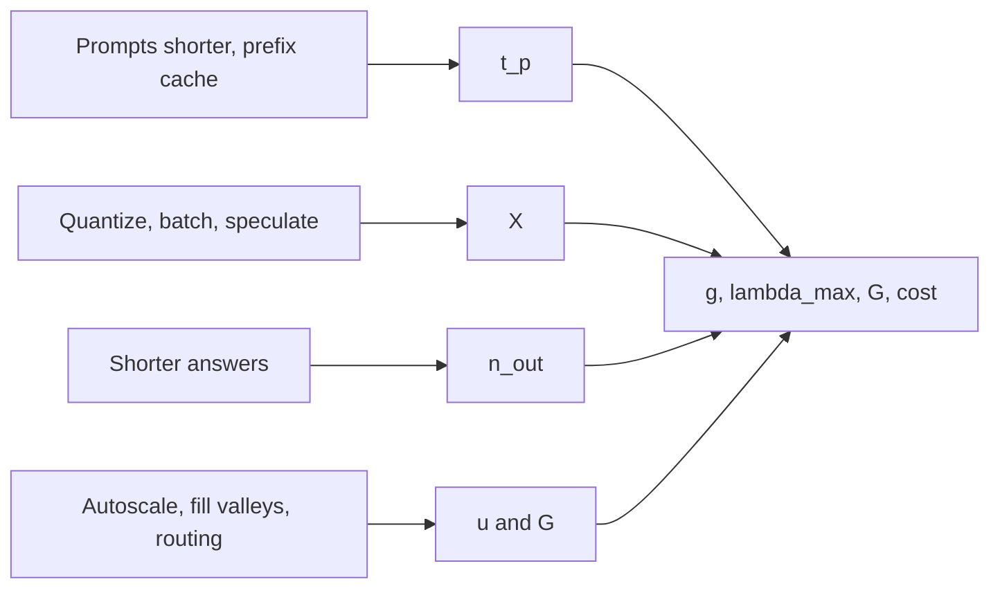

Every topic in this module cuts cost by changing one term in a short chain of formulas. Putting them back together shows which lever matters for which workload, and gives you a repeatable way to write a plan someone else can check.

## The chain

$$
\underbrace{g = t_p + \frac{n_{out}}{X}}_{\text{GPU-seconds per request}} \;\Rightarrow\; \lambda_{max} = \frac{1}{g} \;\Rightarrow\; G = \left\lceil \frac{\lambda_{peak}}{\lambda_{max}\,u} \right\rceil \;\Rightarrow\; \text{monthly cost} = G\,c\cdot730
$$

- **Prefill time $t_p$** falls with prefix caching (skip work), FP8 compute, and fewer input tokens (shorter prompts, better retrieval).
- **Decode throughput $X$** rises with quantization (fewer bytes), larger batches within the SLO, GQA/MQA models and KV quantization (smaller KV reads), and speculative decoding at low batch.
- **Output length $n_{out}$** falls with prompt instructions, structured output and stop conditions.
- **Utilisation $u$ and the number $G$** depend on traffic shape, autoscaling and redundancy choices.
- **Price $c$** depends on hardware choice, commitments and spot capacity.



## Stacking the levers

Start from the chat workload: 100 requests/s peak, 1,000-token prompts, 300-token answers, 8B model on H100s, 70% target utilisation, baseline 11 GPUs and \$20,075 per month.

```steps
Applying the levers one at a time
Baseline: $g = 27 + 45 = 72$ ms, $\lambda_{max} = 13.9$ req/s, $G = \lceil 100/(13.9 \times 0.7) \rceil = 11$ GPUs, \$20,075 per month.
---
Prefix caching, 80% of the prompt cached: $t_p = 27 \times 0.2 = 5.4$ ms, $g = 50.4$ ms, $\lambda_{max} = 19.8$, $G = \lceil 100/13.9 \rceil = \lceil 7.2 \rceil = 8$ GPUs, \$14,600 (27% cheaper).
---
INT8 weights alone (step 6.6 ms, $X = 9{,}700$): $g = 27 + 31 = 58$ ms, $\lambda_{max} = 17.2$, $G = \lceil 100/12.0 \rceil = 9$ GPUs, \$16,425 (18% cheaper).
---
Both: $g = 5.4 + 31 = 36.4$ ms, $\lambda_{max} = 27.5$, $G = \lceil 100/19.3 \rceil = \lceil 5.2 \rceil = 6$ GPUs, \$10,950 (45% cheaper than baseline).
---
Each saving is smaller than its stand-alone figure suggests when stacked, because they attack different shares of the same $g$. Check the quality side too: INT8 needs an evaluation (quantization lesson), and cache hits need the prompt structure from the caching lesson.
```

Compare with levers aimed at the wrong target: speculative decoding barely changes $g$ at batch 64 (the GPU is already using its compute), and a faster-decoding GPU does little if prefill dominates the workload.

## A capacity plan, as a document

A plan someone else can check has these parts, each with its number and its source:

| Section | Content | Example |
|---|---|---|
| Workload | Peak and average req/s, prompt and output length distributions, burst factor | 100 peak, 40 average, 1,000 in / 300 out |
| SLO | TTFT and TPOT percentiles | p95 TTFT < 1 s, p95 TPOT < 50 ms |
| Capacity per GPU | Measured at SLO, with the batch limit used | 13.9 req/s at batch 64, p95 TPOT 40 ms |
| Utilisation target | And why | 70%, queueing and burst headroom |
| Redundancy | N+1 or zone survival | N+1: 12 GPUs |
| Cost | Monthly, per 1k requests, per useful answer | \$21,900; \$0.19 per 1k at average load |
| Levers considered | Expected saving, risk, evidence needed | Prefix cache: -27%, needs prompt restructure |
| Triggers to re-plan | Growth, drift | Traffic +30%, output length +25%, new model |

## See it

```sim
gpu-capacity
{"qps": 100, "promptTokens": 1000, "outputTokens": 300, "model": "llama3-8b", "gpu": "h100", "batch": 64, "targetUtil": 0.7, "gpuPrice": 2.5}
```

Use the sim as a scratchpad for the plan. Reproduce the baseline, then emulate the levers with the controls it has: lower the output tokens (shorter answers), lower prompt tokens (what caching achieves for prefill), switch the GPU, change the batch, and raise the target utilisation, and record the GPU count and monthly cost at each step. The lab uses the same ingredients with a scenario to plan end to end.

```lab
capacity-plan
```

## In practice

Order matters: first measure, then fix the cheapest big thing (usually prompt length, caching and output length: no hardware change, no quality risk), then precision, then batching and scheduling, then fleet shape, and only then hardware. Re-run the plan whenever the workload changes, and keep the load-test script in the repository so the per-GPU capacity number is always reproducible. The simplest operational rule: if you cannot say what $\lambda_{max}$, $u$ and $G$ are for your system today, your costs are a surprise waiting to happen.

```quiz
{"q": "A workload's prefill takes 30 ms per request and decode costs 60 ms of GPU time per request. Prefix caching removes 70% of the prefill. What is the new saturated requests per second per GPU?", "options": ["About 14.5", "About 11.1", "About 33", "About 16.7"], "answer": 0, "explain": "New prefill: $30 \\times 0.3 = 9$ ms, so $g = 9 + 60 = 69$ ms and $\\lambda_{max} = 1/0.069 = 14.5$ req/s. 11.1 is the capacity before caching ($1/0.090$); 16.7 ignores the remaining prefill ($1/0.060$)."}
```

```quiz
{"q": "Which is the best first step to lower the bill of a service whose requests carry 8,000-token prompts that share a 7,000-token prefix?", "options": ["Restructure the prompt so the shared prefix is first and enable prefix caching", "Buy GPUs with more compute", "Apply speculative decoding", "Increase the decode batch size"], "answer": 0, "explain": "Most GPU time goes to prefill of tokens the model has already processed. Caching avoids it with no quality risk. The other options address decode or raw compute."}
```
