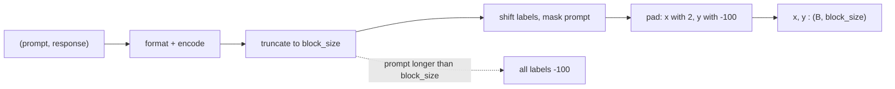

Pretraining batches were easy: cut random windows of exactly `block_size` tokens from one long stream, and every row has the same length. Instruction examples are separate documents of different lengths. "First prime number → 2" is 60 bytes; an Alpaca example with a paragraph of input can be 600. A tensor needs rectangular rows, so something has to turn a list of ragged examples into one `(B, n)` block of inputs and one `(B, n)` block of labels. That something is the **collator**.

A collator makes three decisions. How long is each row (**padding**)? What happens to examples that are too long (**truncation**)? And what goes in the empty slots, both in the input and in the labels? Get the labels wrong and the model trains on padding; get the length wrong and some rows silently lose their answers.

## What the repo's collator does

After building `x` and `y` for each example (topic 2), `SFTCollator.collate` pads every row to the full `block_size`:

```python
def pad_to(ids, val):
    if len(ids) < self.block_size:
        ids = ids + [val] * (self.block_size - len(ids))
    return ids[:self.block_size]

x = torch.tensor([pad_to(s, 2) for s in input_ids], dtype=torch.long)    # (B, block_size)
y = torch.tensor([pad_to(s, -100) for s in labels], dtype=torch.long)    # (B, block_size)
return x, y
```

The full file is `llm_from_scratch/part_6/collator_sft.py`. Inputs are padded with id 2, labels with -100. With the part 4 BPE tokenizer, id 2 is the `<pad>` special token; with bytes it is the control character `\x02`, which never appears in text. Either way its value barely matters, for two reasons:

1. **Right padding plus causal attention.** The pads come after the real tokens. A causal mask lets position $t$ attend only to positions $\le t$, so no real token ever sees a pad. The logits at real positions are exactly what they would be without padding, and no attention mask is needed.
2. **Pad labels are -100.** The pad positions do produce logits (garbage ones), but `cross_entropy` ignores them.

## How much of the batch is real

Padding to a fixed `block_size` is simple but wasteful. With $B$ rows of lengths $T_1, \dots, T_B$ and every row padded to $n$:

$$
\text{useful fraction} = \frac{\sum_{b=1}^{B} T_b}{B \cdot n}
$$

**Worked example.** The three fallback pairs have lengths $60, 78, 86$ bytes. Padded to `block_size = 256` (the repo default): $\frac{224}{3 \times 256} = \frac{224}{768} \approx 29\%$. More than 70% of the forward and backward compute goes to pad tokens. Padding only to the longest row in the batch (**dynamic padding**), $n = 86$: $\frac{224}{258} \approx 87\%$.

And the supervised fraction is far smaller. Those three rows carry $5 + 7 + 11 = 23$ unmasked labels (the repo's collator prints exactly these counts), so $23 / 768 = 3\%$ of the label slots train anything.

| Row | Example | Length $T_b$ | Pads to 256 | Unmasked labels |
|---|---|---|---|---|
| 0 | First prime number → 2 | 60 | 196 | 5 |
| 1 | three primary colors → red | 78 | 178 | 7 |
| 2 | points to direction → compass | 86 | 170 | 11 |

The last column also shows the per-token weighting from topic 2: "compass" supplies $11/23 \approx 48\%$ of the batch loss, "2" only $22\%$.

## Truncation can delete the answer

The collator cuts the formatted text at `block_size` *before* masking: `ids = self.encode(text)[:self.block_size]`. The cut falls on the end of the sequence, which is where the answer is. If the prompt alone is longer than `block_size`, the row keeps only prompt tokens and every label is -100.

This is not hypothetical. Running the collator with `block_size=64` on the fallback data gives rows 1 and 2 (prompt prefixes of 71 and 75 bytes) **zero** supervised tokens. They cost compute and teach nothing. If every row of a batch is in that state, `cross_entropy` divides 0 by 0: the same experiment on a single long row returns a loss of `nan`, and one `nan` loss poisons the weights on the next optimizer step.



```bughunt
{"q": "This collator trains and the loss falls quickly, yet after fine-tuning the model's first answer token is little better than chance, and one-word answers are never learned at all. Which line is the bug?", "code": "def collate(self, batch):\n    input_ids, labels = [], []\n    for prompt, response in batch:\n        prefix = format_prompt_only(prompt).replace('</s>', '')\n        ids = self.encode(format_example(Example(prompt, response)))[:self.block_size]\n        n_prompt = min(len(self.encode(prefix)), len(ids))\n        y = ids[1:] + [-100]\n        for i in range(n_prompt):\n            y[i] = -100\n        input_ids.append(ids)\n        labels.append(y)\n    x = torch.tensor([self.pad(s, 2) for s in input_ids])\n    y = torch.tensor([self.pad(s, -100) for s in labels])\n    return x, y", "bug": 8, "explain": "`range(n_prompt)` also masks position $P - 1$, whose label is the **first answer token**. After the shift, the label at position $t$ is token $t+1$, so the loop must stop at `n_prompt - 1`. With the bug, the model is never trained on the transition from `### Response:\\n` to the answer, only on what follows the first answer token. For one-token answers like '2' the answer itself is never trained, which is why the loss looks so good. The padding lines are fine: right padding with -100 labels is ignored by `cross_entropy`."}
```

## In practice

- **Use dynamic padding.** Padding to the longest row in each batch (and, better, grouping similar lengths, topic 4) is the cheapest speed-up in SFT. The repo pads to `block_size` to keep the code short.
- **Filter or left-truncate long prompts.** Drop examples whose prefix is longer than the context, or cut from the start of the prompt rather than the end of the sequence, so the answer always survives. Count how many rows have zero unmasked labels before training.
- **Guard against empty batches.** If every label in a batch is -100, skip the step instead of calling `backward()` on `nan`.
- **Packing is the other option.** Instead of padding, concatenate several examples into one row with a document-aware mask, as described in [Packing, padding and SFT hyperparameters](/learn/fine-tuning/instruction-tuning/packing-and-hyperparameters).
- **Left padding is for generation, not training.** When you generate for a batch of prompts at once, you pad on the left so every prompt ends at the same position and the new tokens line up. Then the attention mask and the positions must account for the pads.

```quiz
{"q": "A batch has 4 rows of lengths 100, 120, 140 and 160 tokens. How much of the compute is spent on real tokens if rows are padded to `block_size = 512`, and how much with dynamic padding?", "options": ["25% and about 81%", "25% and 100%", "50% and about 81%", "About 81% either way"], "answer": 0, "explain": "Real tokens: $100 + 120 + 140 + 160 = 520$. Fixed padding: $520 / (4 \\times 512) = 520/2048 \\approx 25\\%$. Dynamic padding to the longest row, 160: $520 / 640 \\approx 81\\%$. It never reaches 100% unless all rows happen to have the same length; that would need packing."}
```

```quiz
{"q": "Why can the repo pad inputs with id 2 and use no attention mask at all during training?", "options": ["Because id 2 has a zero embedding", "Because the pads are on the right, causal attention keeps real tokens from seeing them, and their labels are -100", "Because RMSNorm removes the pads", "It cannot; this is a bug that slightly corrupts every row"], "answer": 1, "explain": "Each real position attends only to earlier positions, all of which are real, so its logits are unaffected by whatever follows. The pad positions produce logits too, but their -100 labels drop them from the loss. The embedding of id 2 is an ordinary trained vector, not zero; the argument does not depend on its value."}
```
