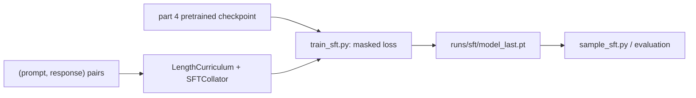

Here is the reassuring part: the SFT loop is the pretraining loop. Same model, same AdamW, same `cross_entropy`, same `zero_grad`, `backward`, `step`. Everything that makes it SFT happened upstream, in the formatted text and the -100 labels. If you have written the loop in [The training loop](/learn/model-foundations/train-a-tiny-gpt/the-training-loop), you could write this one from memory.

What changes is how you read it. A pretraining loss of 0.5 on a byte model would be extraordinary; an SFT loss of 0.5 can mean the model has learned to answer, or that it has memorised 24 answers and learned nothing transferable. The numbers to watch are different, and most of them are not printed by default.

## The loop in the repo

From `llm_from_scratch/part_6/train_sft.py`, with argument parsing and printing trimmed:

```python
col = SFTCollator(block_size=args.block_size, bpe_dir=args.bpe_dir)
model = GPTModern(vocab_size=col.vocab_size, block_size=args.block_size,
                  n_layer=args.n_layer, n_head=args.n_head, n_embd=args.n_embd,
                  use_rmsnorm=True, use_swiglu=True, rope=True).to(device)
if args.ckpt:                                   # start from the part 4 pretrained model
    ckpt = torch.load(args.ckpt, map_location=device)
    model.load_state_dict(ckpt['model'])

opt = torch.optim.AdamW(model.parameters(), lr=args.lr, betas=(0.9, 0.95), weight_decay=0.1)
model.train()
step, i = 0, 0
while step < args.steps:
    batch = cur[i:i + args.batch_size]          # next slice of the sorted curriculum
    if not batch:
        i = 0; continue
    xb, yb = col.collate(batch)                 # (B, block_size), (B, block_size)
    xb, yb = xb.to(device), yb.to(device)
    logits, loss, _ = model(xb, yb)             # loss over unmasked labels only
    opt.zero_grad(set_to_none=True)
    loss.backward()
    opt.step()
    step += 1; i += args.batch_size
```

Then it saves `{'model': state_dict, 'config': cfg}` to `model_last.pt`. Two things to notice when starting from a checkpoint. The model is built from the **command-line flags**, not from the config stored in the checkpoint, so the flags must match the pretrained model exactly (the orchestrator passes `--n_layer 2 --n_head 2 --n_embd 128`, matching the part 4 demo). And the part 4 model was pretrained with `block_size=128` while SFT runs at 256. That loads fine because GPTModern uses RoPE and has no learned position table, but the model now sees positions it never trained on.



## Two numbers that set expectations

**Evidence per step.** The gradient comes only from unmasked labels. Pretraining at $B = 8$, $n = 256$ grades $B \cdot n = 2048$ positions per step. The three fallback examples grade $5 + 7 + 11 = 23$. That is

$$
\frac{2048}{23} \approx 89
$$

times less signal per step. SFT gradients are noisier, which is one reason SFT learning rates are usually lower than pretraining ones.

**Epochs.** With $N$ examples, batch size $B$ and $S$ steps, each example is seen $E = SB/N$ times (topic 4). The fallback data has $N = 3 \le B$, so every step is the whole dataset: 300 steps is 300 epochs.

## A real run, from scratch

Running `train_sft.py` exactly as shipped (fallback data, byte tokenizer, `--n_layer 2 --n_head 2 --n_embd 128 --block_size 256`, $\eta = 3 \times 10^{-4}$, no `--ckpt`) on a laptop CPU took about a minute and printed:

| Step | Loss | Reading |
|---|---|---|
| 0 | about 5.5–6 | random model, close to $\ln 256 = 5.55$ |
| 20 | 2.08 | the fast early drop |
| 60 | 0.198 | answers mostly fitted |
| 100 | 0.042 | |
| 200 | 0.0050 | |
| 300 | 0.0008 | each answer predicted with probability above 0.99 |

A loss of 0.0008 nats means the model gives the right next byte a probability of about $e^{-0.0008} \approx 0.9992$. Then the samples: the three training questions get "2", "red" and "compass". "What does DNA stand for?" gets "compas", and "Name the first prime number" gets "red". The model has memorised a lookup from question bytes to answer bytes. With no pretraining underneath, there is no knowledge for SFT to unlock; with 3 examples and 300 epochs, there is nothing to generalise from. Both problems are deliberate in a demo, and both are what you would diagnose in a real run.

## What to watch

The repo prints the training loss every 20 steps and nothing else. A run you can trust watches more:

- **First loss.** From scratch it should be near $\ln V$. Starting from a pretrained checkpoint it should be far lower (the model already writes English); if it is near $\ln V$, the checkpoint did not load or the tokenizer does not match it.
- **Held-out loss.** Keep 5–10% of examples out of training and compute the same masked loss on them every few dozen steps. Training loss falling while held-out loss rises is overfitting, and it shows up within one or two epochs on small SFT sets.
- **Supervised tokens per batch.** Log `(yb != -100).sum()`. Zero means truncation ate the answers (topic 3); wildly varying counts mean wildly varying gradient quality.
- **Gradient norm.** The repo does not clip. Adding `torch.nn.utils.clip_grad_norm_(model.parameters(), 1.0)` before `opt.step()` costs one line and protects the pretrained weights from a single bad batch.
- **Forgetting.** Generate from a few plain-text prompts (not instructions) before and after SFT. Large drops in quality on the pretraining distribution are **catastrophic forgetting**, the usual price of too many epochs or too high a learning rate.

## In practice

- **Learning rate.** Full fine-tuning of large models typically uses $1 \times 10^{-5}$ to $2 \times 10^{-5}$ with a short warmup and decay, 10 to 30 times lower than pretraining. A tiny model tolerates the repo's $3 \times 10^{-4}$, but adding the warmup and cosine schedule from [Warmup and cosine in code](/learn/model-foundations/scaling-the-training-loop/warmup-and-cosine-in-code) is cheap.
- **Epochs.** 1–3 over the data, stopping on held-out loss. The library version of this loop, with all of these knobs exposed, is in [SFT with LoRA step by step](/learn/fine-tuning/sft-with-lora-step-by-step).
- **Save the tokenizer with the model.** `train_sft.py` saves `"tokenizer_dir": None` in its config. If you fine-tune on BPE, record the directory, or the checkpoint is unusable without guessing.

```quiz
{"q": "You fine-tune the part 4 pretrained model with `--ckpt`, and the first printed loss is 5.4 with a 256-byte vocabulary. What is the most likely explanation?", "options": ["Normal: SFT always starts near $\\ln V$", "The pretrained weights or the matching tokenizer did not actually take effect, because a pretrained model should start well below $\\ln 256 = 5.55$", "The learning rate is too high", "The prompt masking is wrong"], "answer": 1, "explain": "A model that has learned English assigns real probability to the next byte of an answer, so its first SFT loss should be far below the uniform $\\ln 256 \\approx 5.55$. A loss near that value means it is effectively random: wrong checkpoint, failed load, or a tokenizer that does not match the one used in pretraining. A too-high learning rate shows up after the first steps, not at step 0."}
```

```quiz
{"q": "A run has 2,000 examples, batch size 16 and 500 optimizer steps. How many epochs is that, and what should you check first if held-out answers are poor while training loss is near zero?", "options": ["4 epochs; check for overfitting with a held-out loss curve", "0.25 epochs; train longer", "4 epochs; raise the learning rate", "32 epochs; the data is too small"], "answer": 0, "explain": "$E = SB/N = 500 \\times 16 / 2000 = 4$. Near-zero training loss with poor held-out answers is the signature of memorisation, which a held-out loss that bottoms out and climbs would confirm; the fix is fewer epochs or more data, not a higher learning rate."}
```
