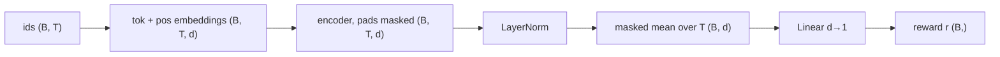

A language model ends in a head that turns each position's hidden state into $V$ logits, one per vocabulary entry. A reward model keeps everything up to that point and swaps the head for a single linear unit: hidden state in, one number out. Same body, different question. The LM head asks "what comes next?"; the reward head asks "how good is all of this?".

The only design decision with real consequences is **which hidden state the head reads**. A transformer produces $T$ hidden states for a $T$-token input, and the reward is one number for the whole thing. Something has to collapse $T$ vectors into one.

## In everyday life

At a singing contest, a judge listens to a whole performance and then shows one number on the scorecard. There is no separate mark for every note. And the silence while the next singer walks on is not part of the performance, so a good judge ignores it.

A **reward model** is that judge for AI answers. It is built from the same kind of parts as a language model, namely a **transformer**, a network that reads all the tokens of a text and builds a summary for each position. A language model ends with a layer that predicts the next piece of text. The reward model swaps that last layer for a tiny one that gives just one number, saying how good the whole answer is. The design question is how to boil many position summaries down to one number. The repo averages them, but only over real tokens. It skips **padding**, the filler added to make rows the same length. If filler leaked in, the score would change just because of how much filler there was.

Unlike a human judge, this one learned its taste only from the picks in the previous lesson. It has no opinions of its own.

**Where you meet it.** A team building a helpful assistant needs to score thousands of candidate replies, far more than people can read. The reward model scores them instead. Without it, a human would have to rate every single reply during training.

```scene
title: A judge with one scorecard
step: 🎤 A singer gives a full performance from start to finish | the whole answer as input
step: 🧠 The judge forms an impression of each moment | hidden state per position
step: 🤫 The silence between singers is left out of the judging | padding mask
step: 🧮 The impressions are blended into one overall feeling | masked mean pooling
step: 🔢 The judge shows a single number on the card | one-number reward head
takeaway: A reward model is a language model body with a one-number head that scores a whole answer, ignoring padding.
```

## Two ways to get one vector

**Last-token scoring.** In a causal (decoder-only) model, the state at the final real token has attended to every earlier token and to nothing after it, so it already summarises the whole sequence. InstructGPT-style reward models take the SFT model, drop its LM head, and read $h$ at the last non-pad position. The catch is finding that position: with right padding it is `lengths - 1`, not `-1`, which would read a pad.

**Masked mean pooling.** The repo uses a bidirectional encoder instead, where every position sees every other one, and averages the hidden states of all non-pad tokens. With a pad mask $M_t = 1$ for real tokens and $0$ for pads:

$$
\bar h = \frac{\sum_{t=1}^{T} M_t\, h_t}{\max\!\left(1, \sum_{t} M_t\right)}, \qquad r = w^\top \bar h + b
$$

where $h_t \in \mathbb{R}^d$ is the final hidden state at position $t$, $w \in \mathbb{R}^d$ and $b$ are the head's weights and bias, and $r$ is the reward. The `max(1, ·)` guards against an all-padding row.

**Worked example.** Take $d = 2$, three positions, the last one a pad: $h_1 = (1, 3)$, $h_2 = (3, -1)$, $h_3 = (9, 9)$, mask $(1, 1, 0)$. Then $\bar h = ((1+3)/2,\ (3-1)/2) = (2, 1)$. With $w = (0.5, -1)$ and $b = 0.1$: $r = 0.5 \cdot 2 - 1 \cdot 1 + 0.1 = 0.1$. If the mask were forgotten, $\bar h = (13/3, 11/3)$ and $r = 2.167 - 3.667 + 0.1 = -1.4$: the pad's state would swing the reward by 1.5, and more padding would swing it further.

## The code

```python
class RewardModel(nn.Module):
    def __init__(self, vocab_size, block_size, n_layer=4, n_head=4, n_embd=256, dropout=0.1):
        super().__init__()
        self.tok_emb = nn.Embedding(vocab_size, n_embd)
        self.pos_emb = nn.Embedding(block_size, n_embd)
        enc_layer = nn.TransformerEncoderLayer(d_model=n_embd, nhead=n_head, dim_feedforward=4*n_embd,
                                               dropout=dropout, activation='gelu', batch_first=True)
        self.encoder = nn.TransformerEncoder(enc_layer, num_layers=n_layer)
        self.ln = nn.LayerNorm(n_embd)
        self.head = nn.Linear(n_embd, 1)                         # d -> 1: the whole "reward head"

    def forward(self, x):                                        # x: (B, T) token ids
        B, T = x.shape
        pos = torch.arange(T, device=x.device).unsqueeze(0)      # (1, T)
        h = self.tok_emb(x) + self.pos_emb(pos)                  # (B, T, d)
        pad_mask = (x == 2)                                      # (B, T) True at pads
        h = self.encoder(h, src_key_padding_mask=pad_mask)       # (B, T, d), pads not attended to
        h = self.ln(h)
        mask = (~pad_mask).float().unsqueeze(-1)                 # (B, T, 1) 1 at real tokens
        pooled = (h * mask).sum(dim=1) / mask.sum(dim=1).clamp_min(1.0)   # (B, d)
        return self.head(pooled).squeeze(-1)                     # (B,)
```

The full file is `llm_from_scratch/part_7/model_reward.py`. The mask is used twice: `src_key_padding_mask` stops real tokens from attending to pads inside the encoder, and the pooling mask keeps pad states out of the average. Both are needed. Running it confirms the result: a 10-token input and the same input with 6 pads appended score $0.20552$ in both cases (eval mode).



## Counting the parameters

For the small config ($L = 2$, $d = 128$, $h = 2$, $V = 256$, $T = 256$): the embeddings are $2 \times 256 \times 128 = 65{,}536$. Each encoder layer has attention in-projection $3d^2 + 3d = 49{,}536$, out-projection $d^2 + d = 16{,}512$, feed-forward $(4d^2 + 4d) + (4d^2 + d) = 131{,}712$ and two LayerNorms $4d = 512$, so $198{,}272$ per layer and $396{,}544$ for two. Add the final LayerNorm ($256$) and the head ($d + 1 = 129$): $462{,}465$ in total, which matches `sum(p.numel() for p in m.parameters())`. The reward head is 129 of them, 0.03%.

```bughunt
{"q": "A colleague rewrote the pooling. Rewards now change when you add padding to an input. Which line is wrong?", "code": "pad_mask = (x == 2)\nh = self.encoder(h, src_key_padding_mask=pad_mask)\nh = self.ln(h)\nmask = pad_mask.float().unsqueeze(-1)\nh_sum = (h * mask).sum(dim=1)\nlen_ = mask.sum(dim=1).clamp_min(1.0)\npooled = h_sum / len_\nr = self.head(pooled).squeeze(-1)", "bug": 4, "explain": "`pad_mask` is True at pads, so `pad_mask.float()` is 1 at pads and 0 at real tokens: the model now averages only the padding states and ignores the answer. It must be `(~pad_mask).float()`. Line 2 is correct: `src_key_padding_mask` expects True at the positions to ignore, which is exactly `pad_mask`. The clamp on line 6 is a guard, not the bug."}
```

## In practice

- **Initialise from the SFT model when you can.** The repo trains a fresh encoder from random weights, which is fine for checking the plumbing but cannot learn much language from a few hundred pairs. Real reward models start from the SFT checkpoint (or a larger model), so they already understand what they are grading, and only the head is new. A common trick is to initialise the head to zero so every reward starts at exactly 0.
- **Encoder or decoder.** A bidirectional encoder is allowed here because the reward model never generates. But reusing the policy's own architecture means the reward model and the policy share a tokenizer and template by construction, which removes a class of bugs when the reward model scores policy samples in [RLHF with PPO](/learn/post-training/rlhf-with-ppo).
- **The pad id is a contract.** The model hard-codes `x == 2`. If your tokenizer puts `<pad>` elsewhere, or a real token has id 2, the mask silently hides real text.

```quiz
{"q": "A decoder-only reward model reads the hidden state at index `-1` of every row. Rows are right-padded to $T = 256$. A row has 40 real tokens. Which state does the head read?", "options": ["The state of the 40th real token, which summarises the whole sequence", "The state of a pad token at position 256, which says nothing about this answer", "The mean of all 256 states", "The state of the first token"], "answer": 1, "explain": "Index `-1` is position 256, a pad. With right padding the last real token is at `lengths - 1` (here index 39), and that index must be gathered per row. The mean of all states is what the repo's encoder computes, and only after masking out pads."}
```
