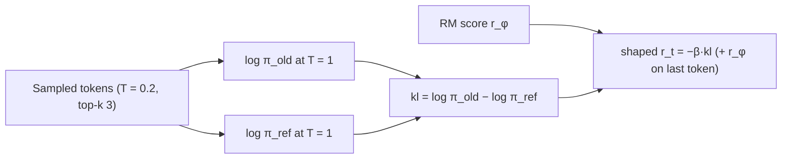

The reward model gives one number per finished answer. If PPO maximised only that number, the policy would soon find answers the reward model loves and people do not: the [reward hacking](/learn/fine-tuning/preference-tuning/reward-hacking-and-overoptimisation) problem. The fix, derived in the [theory lesson](/learn/fine-tuning/preference-tuning/rlhf-ppo), is a **KL penalty** to the SFT reference: a charge for every bit of probability the policy moves away from where it started.

The implementation detail that matters is *where* the charge is paid. The repo, like most PPO-for-LLM code following Ziegler et al. (2019), does not subtract one sequence-level KL at the end. It spreads the penalty over the tokens, so every action pays for its own drift, and adds the reward model's score on top of the last token.

## The shaped reward

For action $a_t$ in state $s_t$, with the reward model's score $r_\phi(x, y)$ and a penalty strength $\beta$:

$$
r_t = -\beta \left[\log \pi_{\theta_{\text{old}}}(a_t \mid s_t) - \log \pi_{\text{ref}}(a_t \mid s_t)\right] + \mathbb{1}[t = T]\; r_\phi(x, y)
$$

$\pi_{\theta_{\text{old}}}$ is the policy that generated the batch, and $\mathbb{1}[t = T]$ is 1 on the last action and 0 elsewhere. Summed over the episode, the per-token terms add up to the sequence-level objective:

$$
\sum_{t=1}^{T} r_t = r_\phi(x, y) - \beta \log \frac{\pi_{\theta_{\text{old}}}(y \mid x)}{\pi_{\text{ref}}(y \mid x)}
$$

The bracket is a one-sample estimate of the KL divergence at that token, often called the $k_1$ estimator. Its expectation over tokens sampled from the policy is the true KL, which is never negative. A single token's value can be negative, though: the policy may have made that particular token *less* likely than the reference did.

**Worked example** (with $\beta = 0.1$ to make the numbers visible; the repo's default `--kl_coef` is $0.01$):

| Token $t$ | $\log \pi_{\text{old}}$ | $\log \pi_{\text{ref}}$ | KL term | RM score | Shaped $r_t$ |
|---|---|---|---|---|---|
| 1 | −0.9 | −1.1 | 0.2 | | $-0.1 \times 0.2 = -0.02$ |
| 2 | −1.2 | −1.0 | −0.2 | | $+0.02$ |
| 3 | −0.4 | −0.9 | 0.5 | | $-0.05$ |
| 4 | −2.0 | −2.3 | 0.3 | 1.5 | $1.5 - 0.03 = 1.47$ |

The KL terms sum to $0.8$ nats, so the total shaped reward is $1.5 - 0.1 \times 0.8 = 1.42$, matching the sum of the last column. Token 2 earns a small *bonus*, because the policy made it less likely than the reference. The same answer, reached by a policy 12 nats away from the reference, would earn $1.5 - 1.2 = 0.3$.

## The code

First the score. From `llm_from_scratch/part_8/train_ppo.py`:

```python
def compute_reward(reward_model, tok, prompt, response, device) -> float:
    text = format_example(Example(prompt, response))        # same template as SFT and RM training
    ids = tok.encode(text)
    x = torch.tensor([ids[:tok.block_size]], device=device)  # (1, T): keep the FIRST block_size tokens
    with torch.no_grad():
        r = reward_model(x)                                  # (1,) scalar score
    return float(r[0].item())
```

The response is decoded to text and re-encoded inside the template, so the reward model sees the answer exactly as it saw the training pairs. Then the shaping, on the flattened action tokens:

```python
pol_lp = model_logprobs(policy, seq)            # (B, T-1)
ref_lp = model_logprobs(ref, seq)               # (B, T-1)
old_logp = pol_lp[act_mask].detach()            # (N,)
ref_logp = ref_lp[act_mask].detach()            # (N,)

kl = (old_logp - ref_logp)                                    # (N,) per-token k1 estimate
shaped_r = rewards[:, 1:][act_mask] - args.kl_coef * kl       # (N,) RM score only on last actions
```

```bughunt
{"q": "A teammate rewrote the reward shaping. After 200 steps the mean reward-model score is flat but `KL_ref` climbs every step. Which line is wrong?", "code": "pol_lp = model_logprobs(policy, seq)\nref_lp = model_logprobs(ref, seq)\nact_mask = mask[:, 1:]\nold_logp = pol_lp[act_mask].detach()\nref_logp = ref_lp[act_mask].detach()\nkl = old_logp - ref_logp\nshaped_r = rewards[:, 1:][act_mask] + kl_coef * kl\nreturns = shaped_r\nadv = returns - old_values", "bug": 7, "explain": "The penalty is added instead of subtracted, so the policy is *paid* for drifting: every token it makes more likely than the reference earns $+\\beta \\cdot$KL. Climbing KL with a flat score is the signature. The KL line itself is correct ($\\log\\pi - \\log\\pi_{\\text{ref}}$); flipping its operands and the sign together would be equivalent, flipping only one is the bug. The shifted mask on line 3 is right too."}
```

## Why the estimate can come out negative

The $k_1$ estimate is unbiased only if the tokens were sampled from the policy itself. The repo samples with `temperature=0.2, top_k=3`, a much sharper distribution than the $T = 1$ softmax its log-probs are computed from. Those samples over-represent the policy's top choices, and the average of $\log \pi - \log \pi_{\text{ref}}$ over them is no longer the KL.

In a 10-step run of the repo's loop with tiny random models, the logged `KL_ref` after the update was $-0.0005$: a "divergence" below zero, which a true KL can never be. The value was small because the policy had barely moved, but the sign shows that the number on the dashboard is an estimate with a bias.



## In practice

- **Typical $\beta$.** Values around 0.01 to 0.05 are common for per-token KL coefficients. Too small and the reward model gets gamed within a few hundred steps; too large and the policy cannot move far enough from SFT to improve. Topic 6 shows how to adapt $\beta$ automatically.
- **Sample and score at the same temperature.** Many implementations divide the logits by the sampling temperature before taking log-probs, so the log-probs describe the distribution the tokens actually came from.
- **Watch for truncation.** `compute_reward` keeps the first `block_size` tokens of prompt plus response. A long prompt can push part of the answer out of the reward model's view, and the policy is then graded on text it cannot see change.

```quiz
{"q": "With $\\beta = 0.02$, an answer has per-token KL terms $0.5, 1.0, -0.5, 1.0$ and reward-model score $2.0$. What is the shaped reward on the last token, and the total over the episode?", "options": ["$1.98$ and $1.96$", "$2.0$ and $2.0$", "$1.98$ and $1.98$", "$1.96$ and $1.96$"], "answer": 0, "explain": "Last token: $2.0 - 0.02 \\times 1.0 = 1.98$. The total is $2.0 - 0.02 \\times (0.5 + 1.0 - 0.5 + 1.0) = 2.0 - 0.04 = 1.96$. Answering $1.98$ for both forgets that the first three tokens pay their own penalties; the negative term earns a small bonus."}
```

```quiz
{"q": "The logged mean of $\\log\\pi - \\log\\pi_{\\text{ref}}$ over sampled tokens is $-0.003$. What is the most likely explanation?", "options": ["It is a sample estimate, and the tokens were not drawn from $\\pi$ at temperature 1, so it is biased and noisy", "The policy is closer to the reference than the reference is to itself", "The KL divergence of two language models can be negative", "The reference model is being trained by mistake"], "answer": 0, "explain": "True KL is never negative, but a per-token average of log-ratios over a finite, low-temperature sample can be. A negative KL is a property of the estimator, not of the models. A trained reference would show up as `KL_ref` staying near zero while the reward changes, not as a negative value."}
```
